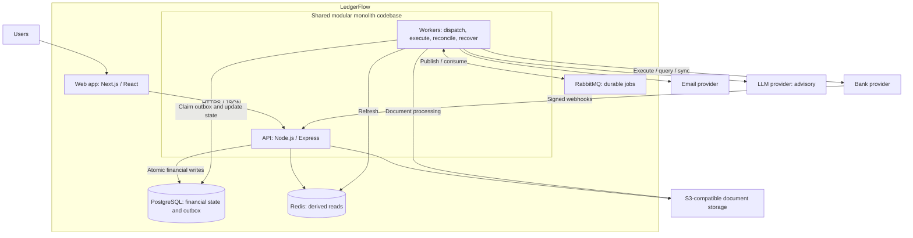
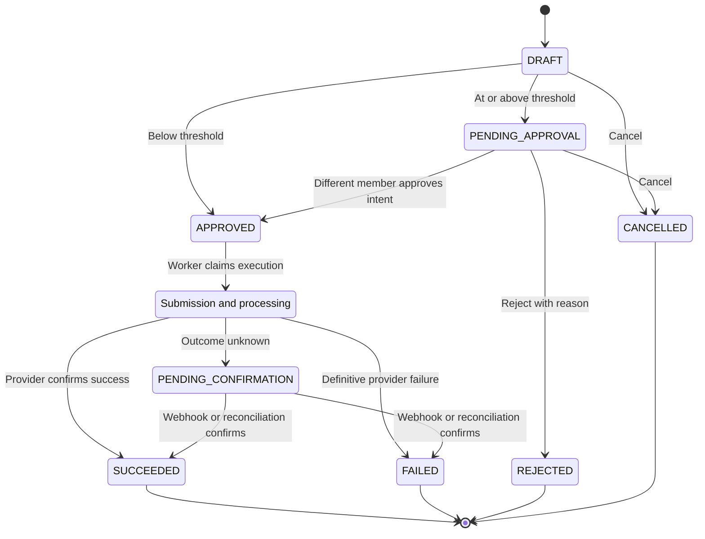

# LedgerFlow

Financial operations for SMBs, with accounting under the hood.

   

> **Design-stage portfolio project.** The repository currently contains product, domain, and architecture documentation. The capabilities and stack below describe the intended system; application code is not implemented yet.

## Overview

Small and medium-sized businesses often spread finance work across spreadsheets, invoice tools, bank portals, and document storage. The result is duplicated work, inconsistent numbers, manual reconciliation, and weak auditability.

LedgerFlow is designed to bring expenses, bills, invoices, payments, transfers, bank activity, documents, and reporting into one multi-tenant platform backed by a shared financial ledger.

**Business users never enter debits or credits.** They record business operations, and the accounting engine translates them into balanced journal entries. For example, recording a paid software expense debits Software Expense and credits the selected Bank or Cash account internally. Reports derive from that ledger; dashboards and AI context remain rebuildable views of it.

The portfolio focus is financial correctness across retries, concurrent requests, external bank failures, and human approvals—not just CRUD screens.

## Key features

All features in this section are **planned v1 scope**.

**Workflows**

- Paid expenses; vendor bills and customer invoices with line items.
- Partial vendor and customer payments, with overpayments blocked.
- Internal account transfers and asynchronous bank-provider execution.
- Gap-free invoice numbering per organization and numbering scope; delivery retries independent of issuance.

**Accounting core**

- Double-entry journal, chart of accounts, and organization-specific ledger mappings.
- Open/closed accounting periods; immutable posted records corrected by explicit reversals.
- Ledger-backed P&L, cash movement, receivables, payables, and expense/revenue breakdowns.

**Banking and reconciliation**

- Signed webhook intake, stale-transfer status checks, and idempotent bank-feed import.
- Deterministic auto-matching; suggested matches require human confirmation.
- Statement reconciliation sessions and audited unmatch/rematch history.

**Controls**

- Organization memberships and capability-based access checks.
- Maker-checker approval for large transfers and large Bank/Cash-impact reversals.
- Append-only audit history and explicit correction dependency ordering.

**Documents**

- Receipts, bill attachments, invoice PDFs, contracts, policies, procedures, and statements.
- Authorized object-storage access, immutable metadata, and malware scanning before serving content.

**AI assistant**

- Financial explanations, summaries, category suggestions, and draft assistance.
- Deterministic tools for financial numbers; permission-filtered document retrieval for context.
- Advisory outputs only, subject to normal authorization, validation, and approval rules.

## Engineering highlights

These are documented design mechanisms, not claims of completed implementation.

| Problem                 | Planned approach                                                                                                                                                                                               |
| ----------------------- | -------------------------------------------------------------------------------------------------------------------------------------------------------------------------------------------------------------- |
| Double-entry ledger     | Use exact decimal money, enforce balanced journals, and commit business state, journal lines, audit, and outbox records atomically. Unique source/posting identities prevent duplicate postings.               |
| Immutable history       | Freeze material fields after posting. Corrections create linked offsetting entries in the current open period; active dependent payments must be reversed explicitly first.                                    |
| Multi-tenancy           | Scope repositories by organization, authorize active memberships and capabilities, and use tenant-aware foreign keys, including actor references. PostgreSQL RLS is optional defense in depth.                 |
| Idempotency             | Persist command identity and response snapshots; reject key reuse with a different request. Stable provider keys and unique event/posting constraints protect separate retry boundaries.                       |
| Transactional outbox    | Commit durable work alongside local state. Workers claim short-lived leases, process at least once with idempotent consumers, and dead-letter exhausted retries for review.                                    |
| Webhook security        | Verify raw-body HMAC signatures with constant-time comparison, check timestamps, and deduplicate provider event IDs before side effects. Normalize outcomes through the same transition guard used by polling. |
| Reconciliation          | Keep imported bank observations separate from accounting recognition. Strong provider identities permit auto-matching; other suggestions need confirmation, with one active match per transaction and target.  |
| Maker-checker approvals | Bind approval to a specific intent hash/version and require a different approving member. Material changes invalidate approval; execution checks the approved version.                                         |
| Concurrency control     | Lock bill/invoice parents before final payments, serialize invoice-number allocation, coordinate posting with period closure, and use partial unique constraints for active matches and pending approvals.     |
| Uncertain bank outcomes | A timeout becomes `PENDING_CONFIRMATION`, not failure. Reconciliation resolves execution; confirmed bank success can recover local posting without initiating another transfer.                                |
| Advisory AI             | Build tenant-scoped, permission-filtered context from deterministic tools. Validate structured outputs; document retrieval supplies context, never authoritative balances or direct ledger writes.             |

## Architecture

The planned backend is a **modular monolith with asynchronous workers**. API and worker processes share a codebase with separate entrypoints. Local ACID transactions preserve financial consistency; slow or failure-prone external work runs outside those transactions.



- **Presentation:** transport, request validation, authentication context, and error mapping.
- **Application:** use cases, authorization, transaction boundaries, and durable outbox writes.
- **Domain:** financial invariants, accounting mappings, lifecycles, and approval/reversal policies.
- **Infrastructure:** repositories, queues, provider adapters, storage, and observability; implements inward-facing contracts.

Feature modules own their persistence and collaborate through application interfaces. Accounting owns journal creation; reconciliation invokes supported workflows rather than rewriting financial records. PostgreSQL is the internal source of truth; the bank owns external execution outcomes. Read models may lag and are rebuildable. This is not event sourcing or a microservice system.

## Domain at a glance

`Dr` means debit; `Cr` means credit. These mappings are internal to the accounting engine.

| Workflow                      | Recognition point                                               | Journal entry                                |
| ----------------------------- | --------------------------------------------------------------- | -------------------------------------------- |
| Paid expense                  | Post expense                                                    | Dr Expense / Cr Bank or Cash                 |
| Vendor bill                   | Post bill                                                       | Dr Expense per line / Cr Accounts Payable    |
| Vendor payment                | Record payment                                                  | Dr Accounts Payable / Cr Bank or Cash        |
| Customer invoice              | Issue invoice                                                   | Dr Accounts Receivable / Cr Revenue per line |
| Customer payment              | Record payment                                                  | Dr Bank or Cash / Cr Accounts Receivable     |
| Internal account transfer     | Confirmed outcome; provider success required when bank-executed | Dr Destination Account / Cr Source Account   |
| External-beneficiary transfer | Provider-confirmed success required before posting              | Accounting treatment deferred                |
| Reversal                      | Explicit correction in current open period                      | Offsetting entry linked to original          |
| Bank reconciliation           | Import and match                                                | No journal entry from matching alone         |

Payments settle receivables/payables without recognizing revenue/expense again. Drafts have no ledger impact. Each organization uses one base currency in v1.

### Transfer lifecycle

Simplified execution lifecycle; intermediate submission/processing states are grouped. Cancellation is available from draft or pending approval.



Accounting has a separate lifecycle: `NOT_POSTED → POSTED → REVERSED`. **`SUCCEEDED` does not mean `POSTED`:** idempotent accounting recovery handles success followed by a local posting failure. A successful bank transfer cannot be unsent; correcting money movement requires a new compensating transfer, separate from any accounting reversal.

## Tech stack

Planned technologies from the architecture document; versions are not pinned yet.

| Area          | Technology                   | Purpose                                                                      |
| ------------- | ---------------------------- | ---------------------------------------------------------------------------- |
| Web           | Next.js, React, TypeScript   | Business-facing interface and API interaction                                |
| API / workers | Node.js, Express, TypeScript | Use cases, domain policies, integrations, and background processing          |
| Database      | PostgreSQL                   | ACID financial state, decimal amounts, constraints, locks, audit, and outbox |
| Messaging     | RabbitMQ                     | Durable at-least-once job/event transport                                    |
| Cache         | Redis                        | Derived, non-authoritative reads                                             |
| Documents     | S3-compatible storage        | Binary content with metadata in PostgreSQL                                   |

RabbitMQ and Redis are documented implementation choices; domain behavior depends on durable delivery and non-authoritative caching, not those specific products. Bank, email, and LLM providers remain behind adapters.

## Project structure

**Planned `src/` layout from the architecture document. This tree does not exist yet.**

```text
src/
├── modules/
│   ├── organizations/        # organizations, memberships, financial settings
│   ├── accounting/           # ledger accounts, ledger mapping, periods, journal, posting
│   ├── expenses/
│   ├── vendor-bills/         # vendors, bills, bill lines, vendor payments
│   ├── invoicing/            # customers, invoices, invoice lines, numbering, delivery, customer payments
│   ├── transfers/            # financial accounts, transfers, approvals, bank execution
│   ├── bank-reconciliation/  # bank transactions, sync, sessions, matches, suggestions
│   ├── reporting/
│   ├── audit/
│   ├── documents/
│   └── ai/
├── infrastructure/
└── shared/                   # Money, idempotency, outbox, approval and reversal policies
```

## Getting started

**The application cannot be run yet.** There is no `package.json`, lockfile, environment template, migration tooling, runtime entrypoint, or test suite in this checkout. The steps below are setup TODOs, not executable instructions.

### Prerequisites (planned)

- Node.js and a package manager — **TODO:** select and pin supported versions and package manager.
- PostgreSQL, RabbitMQ, Redis, and S3-compatible storage — **TODO:** define supported versions and local provisioning.
- Sandbox bank access and email/LLM integration configuration — **TODO:** choose providers and document local substitutes and required credentials.

### Setup and execution

| Step                    | Current instruction                                                                                                                                                          |
| ----------------------- | ---------------------------------------------------------------------------------------------------------------------------------------------------------------------------- |
| Install dependencies    | **TODO:** add package manifests and lockfile, then document the actual install command.                                                                                      |
| Environment setup       | **TODO:** add an environment template and startup validation; document exact variable names for database, queue, cache, storage, authentication, and provider configuration. |
| Local services          | **TODO:** add provisioning instructions and actual startup commands for required infrastructure.                                                                             |
| Migrations              | **TODO:** select migration tooling, create the schema/migrations, and document the actual migration command.                                                                 |
| Run API                 | **TODO:** add the API entrypoint and document its actual run command.                                                                                                        |
| Run worker              | **TODO:** add the worker entrypoint and document its actual run command.                                                                                                     |
| Run web                 | **TODO:** add the web application and document its actual run command.                                                                                                       |
| Run tests               | **TODO:** add test tooling and suites, then document the actual test commands.                                                                                               |
| Lint, type-check, build | **TODO:** add quality-gate scripts and document their actual commands.                                                                                                       |

The planned verification strategy covers domain unit tests, real-database integration tests for constraints and concurrency, provider contract tests, and end-to-end financial workflows. Retry duplication, overpayment races, tenant leakage, self-approval, and posting recovery are explicit test targets.

## Documentation

- [Product overview and scope](docs/01-product-overview-and-scope.md) — problem, users, product principles, workflows, v1 boundaries, and external dependencies.
- [Domain model](docs/02-domain-model.md) — bounded contexts, entities, accounting mappings, invariants, lifecycles, and proposed constraint enforcement.
- [High-level architecture](docs/03-high-level-architecture.md) — modular boundaries, containers, consistency, security, workers, recovery, and testing strategy.

## Scope and roadmap

### Designed v1 scope

The intended implementation covers organization membership and access control, counterparties and financial accounts, expenses, bills, invoices, partial payments, transfers, ledger posting, reversals, accounting periods, approvals, banking/reconciliation, audit, reporting, documents, and advisory AI.

V1 uses one base currency per organization, blocks overpayments and credit balances, corrects invoices by full reversal and replacement, and never reopens closed periods. Reconciliation is one-to-one at the active-match level; non-deterministic matches need human confirmation.

### Explicitly out of scope

- Payroll, tax filing/full tax engine, full ERP, or bank-core functionality.
- Multi-currency accounting and FX, vendor/customer credits, credit notes, partial invoice corrections, and specialized partial reversals.
- Split/aggregate reconciliation and fuzzy automatic matching without human confirmation.
- Complex international payment rails, card issuing/management, and direct debit infrastructure.
- Autonomous AI financial actions, event sourcing, microservices, and a dedicated search engine.

### Deferred decisions

- Financial-account lifecycle and opening-balance UX/accounting treatment.
- Minimum default chart of accounts, customization, hierarchy, and archival rules.
- Complete role-to-capability permission matrix.
- Accounting treatment of transfers to external beneficiaries.

Implementation remains ahead; no delivery dates or completed feature milestones are claimed. Advanced corrections, multi-currency, and broader reconciliation are deferred extensions rather than v1 commitments.

## Status

**Current state: documented design, no application implementation.**

Present in the repository: the three design documents, engineering instructions, ignore configuration, and an MIT license. No frontend, API, workers, database schema/migrations, infrastructure configuration, automated tests, or runnable package scripts are present.

The engineering mechanisms described here still require implementation and verification. There is no running demo or measured performance/coverage claim in this README.

## License and author

- License: [MIT](LICENSE).
- Author: Yousef Haggag (https://github.com/yousefhaggag)
