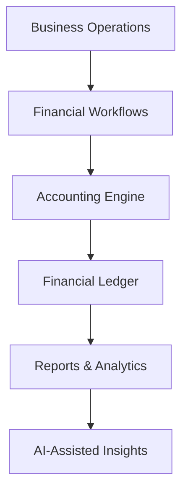

# Product Overview & System Scope

**Related documents:** [02 – Domain Model](02-domain-model.md) · 03 – High-Level Architecture

---

## 1. Product Summary

### Vision & Purpose

Small and medium-sized businesses (SMBs) commonly run their finances across disconnected tools: spreadsheets for expenses, separate systems for invoices, bank portals for transfers, cloud storage for documents, manual reconciliation, and accounting reports maintained elsewhere. This fragmentation produces duplicated work, inconsistent financial data, weak auditability, and poor visibility into the real financial state of the business.

LedgerFlow is a multi-tenant financial operations platform that unifies these workflows — expenses, vendor bills, customer invoices, payments, internal and bank transfers, bank activity, reconciliation, reporting, and financial insights — into a single system with one authoritative financial model.

Target organizations include SaaS/software companies, marketing and design agencies, consulting firms, professional-services companies, and similar SMBs.

The long-term goal is not to expose accounting complexity to every user. Teams operate in business language (vendors, customers, bills, invoices, expenses, bank accounts, payments, transfers) while the system translates each operation into a consistent double-entry model internally.

### Core Value Proposition

Keep accounting invisible for normal business users while maintaining accounting-grade financial integrity underneath.

| Benefit | Description |
|---|---|
| Simple operational UX | Users never create debits or credits manually. Recording *AWS – 10,000 EGP – paid from CIB* internally yields `Debit Software Expense 10,000 / Credit CIB Bank 10,000`. |
| Single source of financial truth | Every financial operation converges on one ledger; reports, dashboards, analytics, and AI context derive from it. |
| Traceable, safe history | Posted records are immutable; mistakes are corrected via explicit, audited reversals. |
| Reliable bank integration | Bank interactions are treated as unreliable distributed boundaries: asynchronous, idempotent, webhook-secured, and reconciled. |
| Controlled high-risk operations | Approval (maker-checker) applies based on financial impact (large transfers, large cash-impact reversals). |
| Trustworthy AI assistance | AI observes, analyzes, explains, and recommends; it never becomes financial truth. |

### Product Principles

These principles are normative for all feature specifications.

| # | Principle | Summary |
|---|---|---|
| PP1 | Business UX, accounting under the hood | Accounting is an internal integrity mechanism, not the primary interface. |
| PP2 | One authoritative financial model | Workflows converge on a shared ledger instead of independently updating unrelated totals. Flow: Financial Operation → Ledger → Reports → Dashboard → Analytics → AI Context. |
| PP3 | Prefer derived financial state | Values computable from authoritative records are derived, not stored as mutable counters (e.g. `paidAmount = SUM(active payments)`, `remainingAmount = total − paidAmount`, overdue from due date and remaining balance). Caches/projections are allowed for performance but must never become competing sources of truth. |
| PP4 | History is corrected, not erased | Posted records are immutable. Corrections follow Original Record → Explicit Reversal → Corrected Record. Reversals link to the original, require a reason, are audited, and post into the current open accounting period. Closed periods remain immutable. |
| PP5 | Explicit dependency ordering | No implicit cascading reversals. A record with active dependents (e.g. a bill with an active payment; an issued invoice with active customer payments) cannot be reversed until dependents are explicitly reversed first. |
| PP6 | Financial controls follow risk | Controls depend on financial impact, not entity type. Reversals touching Bank/Cash above a threshold require approval; large bank transfers require approval before any request reaches a provider. Maker-checker: the requester cannot approve their own operation. |
| PP7 | External systems do not control internal integrity | Invoice Issued ≠ Invoice Email Delivered. A failed email never rolls back an issued invoice. Bank execution is asynchronous and reconciled rather than a single synchronous DB operation. |
| PP8 | AI assists; it is not financial truth | Authoritative answers come from deterministic financial tools and ledger data. RAG serves document context (policies, procedures, contracts), never authoritative balances derived from embeddings. |

### Product Boundary

LedgerFlow does not replace the bank. The bank is authoritative for bank-side execution and available bank balance.

LedgerFlow is responsible for orchestrating supported financial operations, maintaining its internal accounting representation, reconciling that representation against external activity, enforcing organization financial controls, producing reliable reports, and providing contextual financial assistance.

The AI assistant is not the accounting system; the ledger is the deterministic source for authoritative reporting and calculations.

### Portfolio Scope

LedgerFlow is an engineering portfolio project rather than a time-constrained commercial launch. A minimal commercial MVP would contain a smaller subset of the capabilities below. The scope is intentionally broader in selected areas to demonstrate production-oriented engineering: financial domain modeling, double-entry accounting, transactional integrity, multi-tenancy, authorization, asynchronous workflows, external API integration, idempotency, webhook security, reconciliation, distributed-system failure handling, auditability, AI integration, and operational observability.

**Rule of thumb:** features are introduced through explicit domain requirements, never complexity for its own sake.

### Success Criteria

LedgerFlow succeeds when a business user can perform normal financial operations without understanding double-entry accounting, while the system still provides consistent financial records, traceable history, safe corrections, reliable bank integration, controlled high-risk operations, reconcilable external activity, accurate reporting inputs, and trustworthy context for analytics and AI assistance.

---

## 2. System Scope

### In-Scope (Included Capabilities)

**Platform & tenancy**
- Organizations (tenant boundary) and team membership
- Role-based access control (Owner, Admin, Accountant, Finance Member, Viewer) enforced through capability checks
- Organization-level financial controls (`largeTransferThreshold`, `largeReversalThreshold`)
- Organization-level mapping of system accounting roles (Accounts Payable, Accounts Receivable, default Revenue, Bank Fees, Opening Balance Equity) to chart-of-accounts entries

**Counterparties & accounts**
- Customers and Vendors, including contact details (email, phone, address)
- Financial accounts (`BANK`, `CASH`), each mapped to an asset account in the chart of accounts

**Operational financial workflows**
- Expenses (paid immediately)
- Vendor bills with line items, and vendor payments (partial payments supported)
- Customer invoices with line items and gap-free per-organization invoice numbering, and customer payments (partial payments supported)
- Internal / account-to-account transfers
- Bank-provider integrations: transfer initiation, approval controls, status synchronization

**Banking & reconciliation**
- Secure bank webhook processing (signature verification, replay protection, deduplication)
- Transfer-level reconciliation (stale transfer status checks)
- Bank transaction import (idempotent), with per-account sync state
- Bank reconciliation: deterministic auto-match, suggested matches with human confirmation, unmatch/rematch with retained history, and reconciliation sessions against a statement period and ending balance

**Accounting core**
- Double-entry accounting engine (internal), journal entries and lines, chart of accounts
- Accounting periods (`OPEN → CLOSED`)
- Reversal handling via a shared financial reversal policy

**Governance & insight**
- Audit trail (part of the financial model, not a UI feature)
- Financial reports (P&L, cash movement, receivables, payables, expense/revenue breakdown) and dashboards
- Documents (receipts, bill attachments, invoice PDFs, contracts, policies)
- AI-assisted financial insights and document context (advisory only)

### Core Workflows and Accounting Impact

| Workflow | Trigger | Accounting recognition | Key rules |
|---|---|---|---|
| Expense | Post expense | `Dr Expense / Cr Bank or Cash` | Immediate recognition; immutable once posted; corrected by reversal. |
| Vendor Bill | Post bill | `Dr Expense / Cr Accounts Payable` (one expense debit per line) | Expense recognized at bill posting (accrual). Bill total equals the sum of its lines. Overdue is derived. |
| Vendor Payment | Record payment | `Dr Accounts Payable / Cr Bank or Cash` | Does not re-expense; only against a posted bill; overpayment blocked in v1. |
| Customer Invoice | Issue invoice | `Dr Accounts Receivable / Cr Revenue` (one revenue credit per line) | Draft has no ledger impact. Issuing assigns the final gap-free number and freezes material fields. Invoice total equals the sum of its lines. Independent of email delivery. |
| Customer Payment | Record payment | `Dr Bank or Cash / Cr Accounts Receivable` | Revenue is not recognized again; only against an issued invoice; overpayment blocked in v1. |
| Internal Transfer | Confirmed outcome | `Dr Destination Account / Cr Source Account` | No revenue or expense. Posting only after confirmed external success for bank-executed transfers. |
| Bank Transfer | Submit → approve (if required) → async execute | Posted only after provider-confirmed success | Provider is authoritative for execution; `SUCCEEDED ≠ POSTED`. |
| Reversal | Explicit command with reason | Offsetting entry in current open period | Strict dependency ordering; approval when Bank/Cash impact ≥ threshold. |
| Bank Reconciliation | Import → match → confirm | None by itself | Bank observation ≠ accounting recognition. |

### v1 Cross-Cutting Constraints

- Single base currency per organization. Every financial record carries its currency (the schema is currency-aware); in v1 that currency must equal the organization's base currency.
- Overpayments and vendor/customer credits are blocked.
- Financial corrections use reversal + corrected record (invoices: reverse the entire invoice, then create a corrected invoice).
- Reversals post to the current open period; closed periods are not reopened.
- Non-deterministic reconciliation matches require human confirmation.
- A bank transaction has at most one active match, and a financial record is matched to at most one bank transaction at a time.
- No organization can post financial records until its required system accounting roles are mapped.
- LedgerFlow does not block a bank transfer solely because its locally recorded balance appears insufficient; the bank makes the final execution decision.

### Out-of-Scope (Explicit Exclusions)

| Excluded / deferred capability | Rationale |
|---|---|
| Payroll | Separate domain; not required to prove the financial operations core. |
| Tax filing and full tax engine | Regulatory complexity outside v1 focus. |
| Multi-currency accounting and FX (exchange-rate sources, realized/unrealized gains) | v1 is single-currency; the model stays currency-aware for later extension. |
| Vendor credits | Overpayments are blocked in v1. |
| Customer overpayments / customer credit balances | Same as above. |
| Credit notes and partial invoice corrections | v1 corrects via full reversal + replacement invoice. |
| Specialized partial reversals | Deferred with advanced corrections. |
| Advanced fuzzy auto-reconciliation without human confirmation | v1 requires human confirmation for non-deterministic matches. |
| Split/aggregate reconciliation (1→N, N→1) | Deferred until a real workflow requires it. |
| Complex international payment rails (e.g. SWIFT) | Outside v1 bank-integration depth. |
| Advanced card issuing / card management | Not part of the domain focus. |
| Direct debit infrastructure | Not part of v1 payment rails. |
| Fully autonomous AI financial actions | AI is advisory; sensitive actions require human confirmation and approval. |
| Reopening closed accounting periods | v1 corrects via reversals in the current open period. |
| Full ERP scope, bank core, global multi-currency suite | Explicit v1 non-goals. |
| Event-sourced / microservice architecture | Explicit non-goals; see 03 – High-Level Architecture. |
| Dedicated search engine | Indexed PostgreSQL queries suffice until a real need is demonstrated. |

**Deferred domain decisions still to design:** account lifecycle and opening balances (including their accounting treatment), the minimum default chart of accounts, the complete RBAC permission matrix, and the accounting treatment of transfers to external beneficiaries.

---

## 3. Users & External Systems

### User Roles & Actors

Roles are permission groupings. Application code authorizes capabilities (e.g. `expense:reverse`) rather than comparing role names.

| Role | Primary needs | Typical access |
|---|---|---|
| Owner | Visibility into cash, revenue, expenses, receivables, payables, performance. | Full organization access, financial controls, approvals. |
| Admin | Manage organization configuration, team access, financial controls, operational settings. | Administrative capabilities; may manage `financial_controls`. |
| Accountant | Review records, perform accounting-sensitive operations and corrections, maintain integrity. | Reversals, period close, reconciliation, review. |
| Finance Member | Day-to-day finance tasks: expenses, bills, payments, invoices, transfers. | Operational create/pay/record capabilities per permissions. |
| Viewer | Consume dashboards and financial information. | Read-only; cannot modify financial state. |

Example capabilities: `expense:create`, `expense:reverse`, `vendor_bill:create`, `vendor_bill:pay`, `invoice:create`, `invoice:issue`, `invoice:record_payment`, `transfer:create`, `transfer:approve`, `financial_controls:manage`, `accounting_period:close`, `bank_reconciliation:complete`.

The detailed RBAC permission matrix is defined separately and evolves with workflow requirements (e.g. whether `invoice:issue` differs from draft creation).

### Non-human Actors

| Actor | Role in the system |
|---|---|
| Background workers | System actors performing outbox dispatch, transfer execution/reconciliation, accounting recovery, invoice delivery, bank sync, projections. Require deliberate tenant policies. |
| Bank provider | External sender of signed webhooks; authority for external execution outcomes. Webhooks are untrusted input until verified. |
| AI assistant | Advisory actor operating on permission-filtered, tenant-scoped context; cannot bypass authorization, validation, or approval. |

**Approval invariant:** the requester of an approval-required operation can never be its approver, even if they hold both capabilities.

### External Dependencies

| System | Purpose | Authority / contract | Failure impact |
|---|---|---|---|
| Bank provider(s) | Transfer execution, transfer status, account balance, transaction feed, webhooks. | Authoritative for external cash movement, bank-side available balance, and transaction feed. Accessed via a `BankProvider` adapter; a sandbox provider supports development. | Transfers stay in recoverable non-final states (`PENDING_CONFIRMATION`); reconciliation resolves them. |
| Email provider | Invoice delivery and notifications. | Communication concern only. | Never rolls back financial state; delivery retried independently. |
| Object storage | Documents (receipts, attachments, PDFs, statements). | Stores binary content; metadata lives in PostgreSQL. A storage URL is never authorization. | Document access degraded; financial core unaffected. |
| LLM / AI provider | Summaries, categorization suggestions, reconciliation suggestions, natural-language questions. | Advisory only; outputs validated against structured schemas. | AI features degrade; financial API remains available. |
| Secrets management | Bank credentials, webhook secrets, LLM keys, storage credentials. | Server-side only, per environment (dev/staging/prod). | Affects integrations, not stored financial truth. |

Internal infrastructure (PostgreSQL, queue, cache) is described in 03 – High-Level Architecture.
