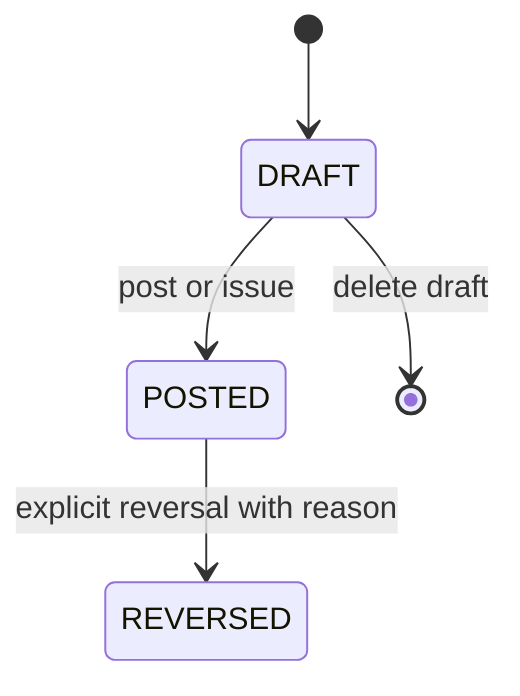
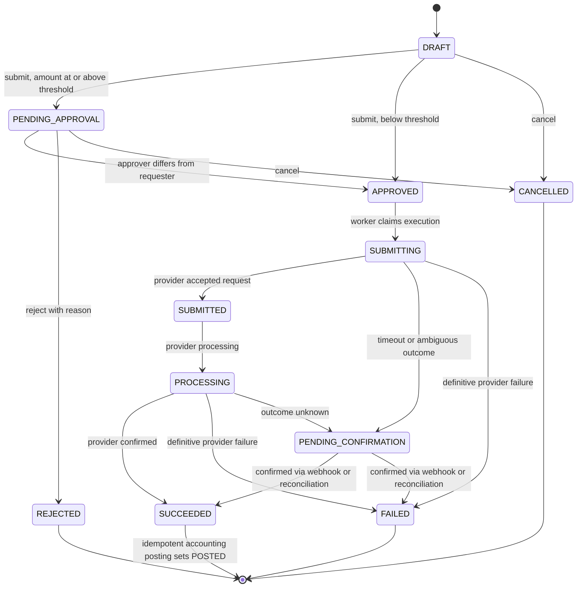
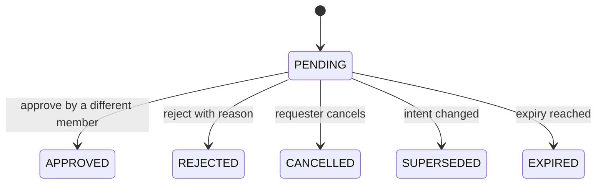
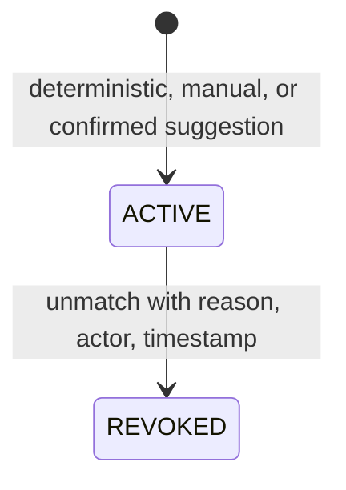
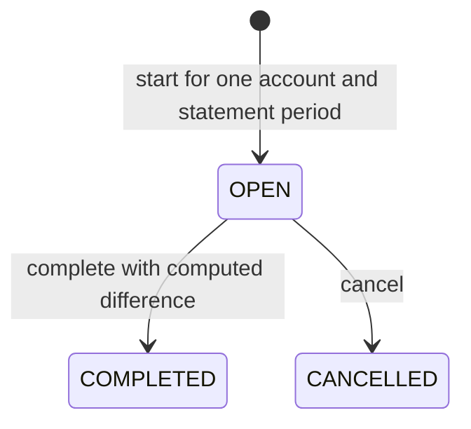

# Domain Model

**Standard:** Domain-Driven Design (DDD) · UML class/ER guidelines
**Scope:** Conceptual model only. SQL tables, column types, indexes, foreign-key syntax, ORM mappings, and partitioning belong in `docs/architecture/database.md`.
**Related documents:** [01 – Product Overview & Scope](01-product-overview-and-scope.md) · 03 – High-Level Architecture

---

## 1. Executive Summary & Bounded Contexts

LedgerFlow is a multi-tenant financial operations platform. The domain model ensures that persistence, APIs, UI, asynchronous workers, bank integrations, reporting, and AI all operate on the same business semantics.

Most operational workflows eventually produce journal entries:

```
Business Operation → Domain Rules → Accounting Mapping → Journal Entry → Ledger
```

The ledger is the authoritative accounting representation. Operational entities preserve business meaning that generic journal entries cannot express.

### Core Domain Principles

| # | Principle | Meaning |
|---|---|---|
| DP1 | Organization is the tenant boundary | Every organization-owned resource belongs to exactly one organization; cross-organization references are invalid. Access requires authenticated user + active membership + required permission + resource in the same organization. This is a backend/domain invariant, not a frontend convention. |
| DP2 | Business entities ≠ accounting entities | A VendorBill answers what happened operationally (vendor, due date, payment lifecycle); the ledger answers what the accounting impact was. |
| DP3 | Posted financial history is immutable | Drafts are editable. Once posted, financially material fields are immutable. Path: Posted → Reversal → optional corrected record. |
| DP4 | Prefer derived financial state | `paidAmount = SUM(active payments)`, `remainingAmount = totalAmount − paidAmount`, `overdue = dueDate < today AND remainingAmount > 0`. Projections may cache but never compete as sources of truth. |
| DP5 | Reconciliation ≠ accounting recognition | `ExternalBankTransaction ≠ JournalEntry`. Matching an observation and creating a new financial record are separate actions. |
| DP6 | Approval ≠ execution | Approval authorizes one specific immutable intent. Transfer `APPROVED ≠` bank transfer `SUCCEEDED`. |

### Bounded Contexts

These are logical boundaries, not separate services.

| Context | Owns | Key concepts |
|---|---|---|
| Identity & Organization | Tenancy, membership, authorization model | Organization, User, Membership, Role, Permission, FinancialSettings |
| Financial Operations | Business workflows and lifecycles | Vendor, Customer, FinancialAccount, Expense, VendorBill (+ lines), VendorPayment, CustomerInvoice (+ lines), InvoiceNumberSequence, CustomerPayment, Transfer |
| Accounting | Ledger integrity and period control | LedgerAccount, LedgerMapping, JournalEntry, JournalLine, AccountingPeriod |
| Banking & Reconciliation | External bank boundary | BankConnection, BankSyncState, BankProvider (boundary), TransferOutcome, ProcessedProviderEvent, ExternalBankTransaction, ReconciliationSession, ReconciliationMatch, ReconciliationSuggestion |
| Financial Controls | Risk-based governance | ApprovalRequest, FinancialReversalPolicy, thresholds |
| Documents | Files and knowledge artifacts | Document, DocumentAttachment |
| Reporting & Analytics | Derived, eventually consistent read models | P&L, Receivables, Payables, Dashboard metrics |
| Audit | Who did what, when, why | AuditEvent |
| AI Assistance | Advisory layer (non-authoritative) | AI Financial Context, deterministic tools |

Reliability infrastructure (`OutboxEvent`, `IdempotencyRecord`) supports all contexts and is modeled in §2.7.

### State Classification

Every piece of state is classified before implementation. New mutable state must declare its class.

| Class | Examples |
|---|---|
| Authoritative internal financial state | Journal entries/lines, posted expenses/bills, payments, issued invoices, approved domain transitions, accounting periods, reconciliation matches |
| Derived internal state | `paidAmount`, `remainingAmount`, `overdue`, dashboard totals, analytics projections |
| External authoritative state | Bank execution result, provider available balance, provider transaction feed |
| Operational state | `requiresReview`, `retryCount`, `lastReconciliationAttempt`, `nextReconciliationAt`, sync status, delivery status |

Operational health must not overwrite uncertain financial truth. Execution state `PENDING_CONFIRMATION` together with `requiresReview = true` is valid.

---

## 2. Domain Entities & Value Objects

Attribute lists are conceptual (essential fields and keys), not physical schema. Every tenant-owned entity carries `organizationId`. The column-level model is in `diagrams/domain-erd.md`.

### 2.1 Identity & Organization

**Organization** — primary tenant and ownership boundary
- Attributes: `id`, `name`, `baseCurrency` (v1: one base currency, e.g. `EGP`), `status`, `accountingTimezone`, `financialSettings`
- Responsibilities: defines the tenant boundary; anchors currency semantics and the timezone used to derive accounting dates; owns financial-control settings and system ledger mapping.

**OrganizationFinancialSettings** (value object)
- Attributes: `largeTransferThreshold`, `largeReversalThreshold`
- Responsibilities: parameterize risk controls. Separate because initiating money movement and reversing existing financial impact are different controls. Changes are audited.

**User / OrganizationMembership**
- Attributes: `User.id`; `Membership { userId, organizationId, role, status }`
- Responsibilities: a user participates in an organization only through membership. Roles: Owner, Admin, Accountant, Finance Member, Viewer. Every actor reference in the domain (creator, approver, requester, reverser) is a *membership*, so an actor is always a member of the same organization as the record they touch.

**Permission** (capability)
- Examples: `expense:create`, `expense:reverse`, `vendor_bill:create`, `vendor_bill:pay`, `invoice:create`, `invoice:issue`, `transfer:create`, `transfer:approve`, `financial_controls:manage`, `accounting_period:close`
- Responsibilities: authorization is expressed as capabilities, not scattered role-name comparisons. The full matrix is workflow-driven and defined separately.

### 2.2 Counterparties & Financial Accounts

**Vendor** — party from whom the business purchases goods or services
- Attributes: `id`, `organizationId`, `name`, contact details (`email`, `phone`, `address`), `status`
- Responsibilities: links to Expenses and Vendor Bills. No accounting impact by existing.

**Customer** — party to whom the business sells goods or services
- Attributes: `id`, `organizationId`, `name`, contact details (`email`, `phone`, `address`), `status`
- Responsibilities: links to Customer Invoices. Its email is the default recipient for invoice delivery. No accounting impact by existing.

**FinancialAccount** — business-facing location through which money is held or moved (e.g. CIB Bank, QNB Bank, Office Cash)
- Attributes: `id`, `organizationId`, `type` (`BANK` | `CASH`), `name`, `currency`, `status`, `ledgerAccountId`, optional bank-connection mapping (`bankConnectionId` + `providerAccountId`, both or neither)
- Responsibilities: must belong to the same organization, be active for the operation, and use the organization's base currency (v1). Every financial account maps to exactly one asset-type ledger account, which is where its postings land. Only `BANK` accounts can be linked to a bank connection; `CASH` accounts never are.
- **Recorded vs provider balance:** LedgerFlow Recorded Balance ≠ Provider Available Balance. The ledger derives an internal balance; the bank is authoritative for available balance and whether an external transfer can proceed.

### 2.3 Accounting

**LedgerAccount** (Chart of Accounts)
- Attributes: `id`, `organizationId`, `code`, `name`, `classification` (Assets, Liabilities, Equity, Revenue, Expenses), `status`
- Examples: Bank/Cash, Accounts Payable, Accounts Receivable, Service Revenue, Software Expense, Bank Fees, Opening Balance Equity
- Responsibilities: internal classification. Business users never choose debit/credit lines for ordinary workflows; business operations map to accounting rules internally. Only active ledger accounts can receive postings.

**LedgerMapping** (system accounting roles)
- Attributes: `organizationId`, `systemRole` (`ACCOUNTS_PAYABLE`, `ACCOUNTS_RECEIVABLE`, `DEFAULT_REVENUE`, `BANK_FEES`, `OPENING_BALANCE_EQUITY`), `ledgerAccountId`
- Responsibilities: tells the posting engine which ledger account plays each system role for an organization. One mapping per role per organization. An organization cannot post until all required roles are mapped. Expense categories, bill-line expense accounts, and invoice-line revenue accounts are chosen by the user per record; only the roles above are system-defined.

**JournalEntry** — authoritative representation of an accounting event
- Attributes: `id`, `organizationId`, `accountingPeriodId`, `postingDate`, `currency`, `entryType`, source identity (`sourceType`, source record, `postingKind`), `reversalOf?`, `reversalReason?`, `lines[]`
- Responsibilities: preserves the business reason it exists (Expense, VendorBill, VendorPayment, Invoice, CustomerPayment, Transfer, or Reversal). Enforces Σ Debit = Σ Credit; an unbalanced entry can never become posted state. Entry and all lines persist atomically. Immutable after posting. Each entry has exactly one source record.

**JournalLine** — one side of a journal entry
- Attributes: `ledgerAccountId`, `debit`, `credit`
- Responsibilities: a line never holds both a positive debit and a positive credit; immutable after posting; amounts are positive decimals. Lines inherit the entry's posting date and period, so balances by account and date can be computed from lines alone.

**AccountingPeriod**
- Attributes: `id`, `organizationId`, date range, status (`OPEN → CLOSED`)
- Responsibilities: controls the time boundary for posting. Normal posting requires an open period. Periods of one organization never overlap. v1 does not reopen closed periods. All reversals post into the current open period, never backdated. Closing a period and posting into it are mutually exclusive operations.

### 2.4 Financial Operations

**Expense** — a cost that has already been paid
- Attributes: `id`, `organizationId`, `vendorId?`, `financialAccountId` (paid from), category ledger account (must be an expense account), `amount`, `currency`, date, `status`
- Lifecycle: `DRAFT → POSTED → REVERSED`. Only drafts can be deleted.
- Accounting: `Dr Expense / Cr Bank or Cash` at posting; draft has no accounting impact.
- Responsibilities: material fields immutable after posting. Reversal (`Dr Bank / Cr Expense`) requires a reason, references the original, is audited, posts in the current open period, and may require approval under the Financial Reversal Policy.

**VendorBill** — an expense incurred before necessarily being paid
- Attributes: `id`, `organizationId`, `vendorId`, bill date, `dueDate`, `totalAmount`, `currency`, document reference, `postingStatus`, `lines[]`
- Lifecycle: posting `DRAFT → POSTED → REVERSED`; payment state is separate and derived (`UNPAID`, `PARTIALLY_PAID`, `PAID`, `OVERDUE`). Only drafts can be deleted.
- Accounting: `Dr Expense (per line) / Cr Accounts Payable` at posting (expense recognized here, not at payment).
- Responsibilities: derives `paidAmount` and `remainingAmount` from payments; `totalAmount` must equal the sum of line amounts when the bill is posted; lines are editable only while the bill is a draft; cannot be reversed while active payments exist; no automatic cascading. A bill with the same vendor and document reference as an existing bill triggers a duplicate warning, not a hard block.

**VendorBillLine**
- Attributes: line number, description, quantity, unit price, `amount`, expense ledger account
- Responsibilities: carries the expense classification of one part of the bill. Immutable once the bill is posted.

**VendorPayment** — settles some or all of a vendor bill
- Attributes: `id`, `organizationId`, `vendorBillId`, `financialAccountId`, `amount`, `currency`, payment date, `status` (active/reversed)
- Accounting: `Dr Accounts Payable / Cr Bank or Cash`; creates no additional expense.
- Responsibilities: only against a posted bill; multiple active payments may settle one bill; `newPaymentAmount <= remainingAmount` (overpayment blocked; vendor credits deferred); currency equals the bill's and the paying account's; immutable once posted; reversal touches Bank/Cash so the reversal policy may apply.

**CustomerInvoice** — an amount owed by a customer
- Attributes: `id`, `organizationId`, `customerId`, `invoiceNumber` (final number assigned at issue), issue date, `dueDate`, `totalAmount`, `currency`, `postingStatus`, `lines[]`, delivery state (operational)
- Lifecycle: posting `DRAFT → ISSUED → REVERSED`; payment state separate and derived. Only drafts can be deleted.
- Accounting: `Dr Accounts Receivable / Cr Revenue (per line)` at issue.
- Responsibilities: drafts are editable and have no ledger impact; issuing assigns the final number and freezes material fields; `totalAmount` must equal the sum of line amounts at issue; **Invoice Issue ≠ Email Delivery** (delivery failure never rolls back issuance and is retried independently). v1 correction: reverse original → create corrected draft → issue corrected invoice, after reversing any active customer payments.

**InvoiceLine**
- Attributes: line number, description, quantity, unit price, `amount`, revenue ledger account
- Responsibilities: carries the revenue classification of one part of the invoice. Immutable once the invoice is issued.

**InvoiceNumberSequence**
- Attributes: `organizationId`, scope (e.g. prefix or fiscal year), `nextValue`
- Responsibilities: generates invoice numbers. The number is taken inside the same transaction that issues the invoice, so a failed issue never consumes a number and issued numbers are gap-free within a scope. Concurrent issues serialize on the sequence.

**InvoiceDelivery** (operational state)
- Attributes: `id`, `organizationId`, `customerInvoiceId`, `channel`, `recipient` (snapshot at send time), `deliveryStatus`, `attempts`, `lastAttemptAt?`, `lastError?`, `deliveredAt?`
- Responsibilities: tracks email delivery separately from financial issuance. Failure or retry never changes the invoice's posting state. Changing the customer's email later does not rewrite past deliveries.

**CustomerPayment** — money received against an invoice
- Attributes: `id`, `organizationId`, `customerInvoiceId`, `financialAccountId`, `amount`, `currency`, payment date, `status`
- Accounting: `Dr Bank or Cash / Cr Accounts Receivable`; revenue is not recognized again.
- Responsibilities: only against an issued invoice; multiple partial payments supported; overpayment blocked in v1; correction via reversal (approval may apply on Bank/Cash impact).

**Transfer** — intent to move money and, for connected accounts, the lifecycle of external bank execution
- Attributes: `id`, `organizationId`, source `financialAccountId`, destination `financialAccountId?` (internal) or `beneficiaryRef?` (external), `amount`, `currency`, `executionStatus`, `accountingStatus`, intent identity (`intentHash`, `intentVersion`), `providerTransferId?`, `providerIdempotencyKey` (`transfer:{transferId}`), `requesterMembershipId`, operational fields (`requiresReview`, `reviewReason?`, `retryCount`, `lastReconciliationAttempt?`, `nextReconciliationAt?`, `providerUpdatedAt?`), reversal metadata
- Distinguishes: internal business intent · external bank execution · internal accounting posting.
- Execution states: `DRAFT`, `PENDING_APPROVAL`, `APPROVED`, `REJECTED`, `SUBMITTING`, `SUBMITTED`, `PROCESSING`, `PENDING_CONFIRMATION`, `SUCCEEDED`, `FAILED`, `CANCELLED`. Accounting states: `NOT_POSTED`, `POSTED`, `REVERSED`.
- Accounting: internal account-to-account: `Dr Destination / Cr Source`; no revenue or expense. Posting occurs only after confirmed external success. The accounting treatment of transfers to external beneficiaries is a deferred decision (§2.11).
- Responsibilities:
  - Approval before any provider request when `amount ≥ largeTransferThreshold`.
  - The intent (accounts, amount, currency, beneficiary) is hashed and versioned. Material fields are immutable after submission; any change creates a new intent version and requires a new approval.
  - Retries reuse the same stable provider idempotency identity.
  - `FAILED` = definitive provider failure. `PENDING_CONFIRMATION` = outcome unknown (a timeout is not a failure). `SUCCEEDED` = provider confirmed movement. `POSTED` = accounting recorded. `SUCCEEDED ≠ POSTED`.
  - `requiresReview` is an operational flag layered on top of any execution state; it never replaces one.
  - A bank-executed transfer is never "un-sent". Correcting one that already succeeded means a new compensating transfer; the accounting reversal and the bank movement are separate facts.

### 2.5 Financial Controls

**ApprovalRequest** — authorization required before a controlled action can continue
- Attributes: `id`, `organizationId`, `action` (`TRANSFER_APPROVAL` | `REVERSAL_APPROVAL`), target (exactly one of: transfer, expense, vendor payment, customer payment), intent snapshot / hash / version, `requesterMembershipId`, `approverMembershipId?`, `status`, timestamps, rejection reason, `expiresAt?`
- Lifecycle: `PENDING → APPROVED | REJECTED | CANCELLED | SUPERSEDED | EXPIRED`
- Uses: large transfer (before execution); large cash-impact reversal (before posting)
- Responsibilities: binds to the exact immutable action; must not survive material mutation of that intent (the approval becomes `SUPERSEDED`); at most one pending approval per target; maker-checker is a backend invariant (requester ≠ approver); an approved or rejected request always records who decided and when, and a rejection records a reason; a rejection creates no bank request or journal entry.

**FinancialReversalPolicy** (domain policy; not necessarily persisted)
- Rule: evaluate the reversal's actual accounting impact. If it does not touch Bank/Cash → no cash-impact threshold approval. If it does and `amount ≥ largeReversalThreshold` → approval required; otherwise normal reversal authorization.
- Examples: unpaid vendor-bill reversal (`Dr AP / Cr Expense`) → no approval; vendor-payment reversal (`Dr Bank / Cr AP`) → threshold applies.
- Responsibilities: the policy follows financial impact rather than entity type.

**Reversal** (domain concept)
- A reversal is an explicit command that sets the original record to `REVERSED` and posts an offsetting JournalEntry (`reversalOf` → original) into the current open period. It requires a reason, retains links to original records for reporting/audit, and respects strict dependency ordering.

### 2.6 Banking & Reconciliation

**BankConnection** — an organization's authorized relationship with a bank/provider
- Attributes: provider identity, `organizationId`, connection status, provider configuration metadata
- Responsibilities: credentials/tokens are never ordinary domain data; secret storage belongs to security/integration architecture.

**BankSyncState** (operational state)
- Attributes: `id`, `organizationId`, `bankConnectionId`, `financialAccountId`, `lastSyncedAt?`, `syncCursor?`, `syncStatus`, `lastError?`
- Responsibilities: one sync position per bank-linked financial account, so a connection with several provider accounts never loses data when one account's feed advances faster than another's. Supports the "bank sync stalled" alert. Idempotent import is still guaranteed by the unique identity on ExternalBankTransaction.

**BankProvider** (external boundary, not an entity)
- Capabilities: `createTransfer`, `getTransferStatus`, `getAccountBalance`, `getTransactions` (plus webhook verification/normalization in the adapter).
- Responsibilities: provider-specific statuses are normalized (Provider Status → Adapter → Normalized Outcome → Domain State Transition). The bank is authoritative for bank-side execution and available balance; LedgerFlow for accounting representation and controls.

**TransferOutcome** (value object)
- Attributes: `transfer`, `normalizedStatus`, `providerTransferId`, `occurredAt`, `source` (`WEBHOOK` | `RECONCILIATION`)
- Responsibilities: `source` is for audit/observability only and must never change business rules. Provider events request a valid transition; they do not assign state directly. Invalid regressions include `SUCCEEDED → PROCESSING`, `FAILED → PROCESSING`, `POSTED → FAILED`, `POSTED → PROCESSING`.

**ProcessedProviderEvent**
- Attributes: `provider`, `providerEventId`, `organizationId?` (empty until the tenant is resolved), `receivedAt`, `processingStatus`; unique on `(provider, providerEventId)`
- Responsibilities: durable deduplication for at-least-once delivery, recorded before any side effect; a duplicate valid webhook is acknowledged without repeating business processing. It is an internal inbox, not tenant-facing data, and its payload has a retention period.

**ExternalBankTransaction** — immutable observation imported from a provider
- Attributes: `organizationId`, `financialAccountId`, `provider`, `providerAccountId`, `providerTransactionId`, `amount`, `direction`, `currency`, `transactionDate`, `valueDate?`, `description`, `reference`, `providerMetadata`
- Responsibilities: repeated sync must not create duplicates (identity = provider + provider account + providerTransactionId); the provider and provider account must agree with the financial account's bank mapping; users cannot rewrite provider-observed facts; importing never creates accounting automatically (e.g. −1,500 EGP `MONTHLY SERVICE CHARGE` becomes an expense only via deterministic match or explicit business action).

**ReconciliationMatch** — links an external transaction to an internal financial record
- Attributes: `financialAccountId`, `externalBankTransactionId`, target (exactly one of: transfer, expense, vendor payment, customer payment), `suggestionId?`, `reconciliationSessionId?`, `matchType` (`DETERMINISTIC` | `MANUAL` | `SUGGESTED_CONFIRMED`), `status` (`ACTIVE → REVOKED`), revocation reason/actor/timestamp
- Responsibilities:
  - Deterministic match = strong shared provider identity (e.g. `providerTransferId`), may auto-reconcile.
  - The bank transaction, the target record, and the match all belong to the same financial account; the amount, currency, and direction must be compatible.
  - v1 is one-to-one: at most one active match per bank transaction **and** at most one active match per target record.
  - A `SUGGESTED_CONFIRMED` match always references the suggestion that produced it.
  - Revoked matches are retained, not deleted; unmatching does not reverse the underlying record (reconciliation correction ≠ accounting correction).

**ReconciliationSession**
- Attributes: `id`, `organizationId`, `financialAccountId`, `status` (`OPEN` | `COMPLETED` | `CANCELLED`), statement period (`statementStartDate`, `statementEndDate`), `statementEndingBalance`, `difference`, `startedBy`, `startedAt`, `completedBy?`, `completedAt?`
- Responsibilities: a working session that reconciles one financial account against a bank statement. At most one session is open per account. On completion the system computes the difference between the statement ending balance and the matched/recorded position; completion with a non-zero difference is an explicit, audited decision. Matches optionally reference the session they were made in.

**ReconciliationSuggestion** (non-authoritative)
- Attributes: `financialAccountId`, `externalBankTransactionId`, candidate record, `evidence`, `confidence?`, `status` (`PENDING → CONFIRMED | REJECTED | EXPIRED`)
- Responsibilities: produced by rules/heuristics or future AI. Non-deterministic confidence ≠ financial authority: Suggestion → Human confirmation → ReconciliationMatch. Candidates obey the same account-consistency rules as matches.

### 2.7 Reliability, Documents & Audit

**OutboxEvent** — durable work required after a successful business transaction
- Attributes: `id`, `organizationId`, `aggregateType`, `aggregateId`, `aggregateVersion`, `eventType`, versioned payload, `occurredAt`, `availableAt`, lease (`lockedAt`, `lockedBy`), `attempts`, `processedAt?`, failure metadata, `deadLetteredAt?`
- Examples: `EXPENSE_RECORDED`, `INVOICE_ISSUED`, `INVOICE_DELIVERY_REQUESTED`, `TRANSFER_APPROVED`, `BANK_TRANSFER_SUCCEEDED`
- Responsibilities: committed atomically with domain state; a reliability mechanism, not financial truth. Delivery is at-least-once, so consumers are idempotent. A worker claims an event with a time-limited lease; an expired lease makes the event claimable again after a crash. `aggregateVersion` lets consumers detect and handle out-of-order events for the same aggregate. Events that exhaust retries are dead-lettered for operator review rather than retried forever.

**IdempotencyRecord**
- Attributes: `organizationId`, idempotency key, command identity (`commandType`, request hash), result reference, `responseSnapshot`, `status`, `lockedUntil?`, `expiresAt`
- Responsibilities: gives a financial command a stable logical identity so retries return the same committed result (the stored response is replayed). The same key with a different request is rejected. A record stuck `IN_PROGRESS` past its lock time can be recovered. Works together with unique business constraints; records expire after a retention window.

**Document**
- Attributes: `id`, `organizationId`, `kind` (`RECEIPT`, `BILL`, `INVOICE_PDF`, `CONTRACT`, `POLICY`, `PROCEDURE`, `STATEMENT`), `storageKey`, `contentType`, `size`, `checksum`, `scanStatus`, `createdBy`
- Examples: expense receipt, bill attachment, contract, financial policy, procedure
- Responsibilities: metadata is immutable; a replacement is a new document. Access follows tenant and permission boundaries; possession of a storage URL is not authorization. Organization-level documents (policies, contracts, procedures) exist without being attached to a financial record. Content is scanned before it can be served. Retrieved content used for RAG is untrusted input and cannot override authorization or financial rules.

**DocumentAttachment** — links a document to one expense, vendor bill, or customer invoice
- Responsibilities: exactly one target per attachment; a document may be attached to several records. Detaching removes the link, not the document, is audited, and is not allowed once the target is posted or issued.

**AuditEvent**
- Attributes: `organizationId`, actor (membership and user, or `SYSTEM`), `action`, target (type from a controlled vocabulary, id), `occurredAt`, `reason?`, `previousState?`, `newState?`, `relatedRecord?`, `correlationId`, `requestId?`, `ipAddress?`
- Examples: `EXPENSE_POSTED`, `REVERSAL_APPROVED`, `INVOICE_ISSUED`, `TRANSFER_APPROVED`, `TRANSFER_EXECUTION_STARTED`, `RECONCILIATION_MATCH_REVOKED`, `FINANCIAL_CONTROL_CHANGED`, `ACCOUNTING_PERIOD_CLOSED`
- Responsibilities: append-only; answers who, when, why, while the journal answers what financial effect. Neither substitutes for the other. Audit targets are referenced by type and id without enforced links so history survives deletion of drafts.

### 2.8 Derived Read Models & AI Context

Reporting read models (Profit & Loss, Receivables, Payables, Expense/Revenue Breakdown, Cash Movement, Dashboard Metrics) derive from ledger and financial records and may be eventually consistent. If a projection disagrees with authoritative state, it is rebuilt.

AI Financial Context consumes deterministic tools (`getCurrentBalance()`, `getInvoiceStatus()`, `getPayment()`, `compareMonthlyExpenses()`, `getSpendingTrends()`, `getRevenueBreakdown()`); RAG serves unstructured context only. Document chunks and embeddings are derived state owned by the AI system (see `ai-system.md`), rebuilt from Documents. AI cannot bypass tenant isolation, authorization, validation, approvals, or accounting invariants.

### 2.9 Value Objects

| Value object | Definition |
|---|---|
| Money | `{ amount: Decimal, currency: CurrencyCode }`. Binary floating point is never financial truth. Every financial record and journal entry carries its currency. |
| OrganizationFinancialSettings | `{ largeTransferThreshold, largeReversalThreshold }` |
| TransferOutcome | `{ transfer, normalizedStatus, providerTransferId, occurredAt, source }` |
| TransferIntent | `{ sourceAccount, destination, amount, currency, version, hash }` — the immutable snapshot an approval binds to. |
| Business dates | `invoiceIssueDate`, `billDate`, `dueDate`, `accountingPostingDate` are explicit dates; timestamps (`createdAt`, `approvedAt`, `providerUpdatedAt`) are instants. The accounting period is derived from the organization's accounting timezone, never from server-local time. |

### 2.10 State Transitions & Invariants

**Transition rules** (state is never an arbitrary string; transitions are explicit and concurrency-safe)

| Entity | Valid | Invalid |
|---|---|---|
| Expense | `DRAFT → POSTED`, `POSTED → REVERSED` | `REVERSED → POSTED` |
| Vendor Bill | `DRAFT → POSTED`, `POSTED → REVERSED` | `POSTED → DRAFT` |
| Invoice | `DRAFT → ISSUED`, `ISSUED → REVERSED` | `ISSUED → DRAFT` |
| Approval | `PENDING → APPROVED \| REJECTED \| CANCELLED \| SUPERSEDED \| EXPIRED` | any transition out of a decided state |
| Transfer | see lifecycle diagram (§4.2) | Stale/backward provider transitions cannot overwrite stronger terminal knowledge |

**Core domain invariants**

| Area | Invariant |
|---|---|
| Tenant | All related organization-owned resources, including the acting memberships, belong to the same Organization. |
| Accounting | For every posted JournalEntry: Σ Debit = Σ Credit. |
| Posting roles | Posting requires the organization's system ledger roles to be mapped; financial accounts map to asset ledger accounts; expense categories are expense accounts; invoice lines credit revenue accounts. |
| Period | Normal posting → open period only. Reversal → current open period. Closed period → no historical mutation. |
| Currency | A record, its payments, its paying account, and its journal entry share one currency; in v1 it equals the organization base currency. |
| Totals | A posted bill's or issued invoice's total equals the sum of its lines. |
| Immutability | Posted financial records cannot be destructively edited; only drafts can be deleted. |
| Payment | Active payments cannot exceed the remaining payable/receivable amount (v1); payments require a posted bill / issued invoice. |
| Dependency | A parent financial record cannot be reversed while active dependent records exist. |
| Approval | The requester cannot approve their own approval-required operation; one pending approval per target; an approval is valid only for the intent version it was granted for. |
| Transfer | Accounting posting occurs only after confirmed external success for bank-executed transfers. |
| Numbering | Issued invoice numbers are unique and gap-free per organization and numbering scope. |
| Idempotency | Retrying the same logical command must not duplicate financial effect. |
| Reconciliation | One active match per bank transaction and per target; transaction, target, and match share a financial account; non-deterministic suggestions require human confirmation; unmatching revokes without erasing history. |

**Consistency boundaries** (atomic units)

| Command | Committed together |
|---|---|
| Expense posting | Expense state + JournalEntry + JournalLines + Outbox event |
| Bill posting | Bill state (total validated against lines) + JournalEntry + JournalLines + Outbox event |
| Vendor / Customer payment | Payment + JournalEntry + JournalLines + Outbox event, while validating authoritative payment state against overpayment |
| Invoice issue | Issue state + final invoice number (from the sequence) + JournalEntry + JournalLines + Outbox event (email delivery is outside) |
| Transfer approval | Approval state + approver metadata + Outbox `TRANSFER_APPROVED` (no bank call inside the transaction) |
| Confirmed bank success | One valid transfer transition + durable downstream work; accounting posting stays recoverable and idempotent |

**Idempotency boundaries** (four distinct failure modes; never collapse into one in-memory check)

| Boundary | Scenario | Guarantee |
|---|---|---|
| Command | User double-clicks Pay | One logical payment |
| Provider execution | Bank succeeds, response times out, worker retries | Same provider identity → one external money movement |
| Event processing | Same provider event delivered twice | One effective domain transition |
| Accounting | `BANK_TRANSFER_SUCCEEDED` retried | One journal posting |

### 2.11 Deferred Domain Decisions

- **Accounts & opening balances:** user-facing account lifecycle, opening-balance UX and accounting treatment (the `OPENING_BALANCE_EQUITY` role exists for it).
- **Chart of accounts:** minimum default chart content, customization level, hierarchy, archival/deactivation rules.
- **RBAC matrix:** roles are known; the full matrix remains workflow-driven.
- **External transfers:** accounting treatment of transfers to beneficiaries outside the organization's own accounts.
- **Reconciliation beyond v1:** one-to-many and many-to-one matching (would introduce an allocation record: match, target, allocated amount), implemented only when a real workflow requires it.
- **Advanced corrections:** credit notes, vendor/customer credits, partial invoice corrections, specialized partial reversals.
- **Multi-currency:** conversion, exchange-rate sources, realized FX gains/losses, unrealized revaluation.

### 2.12 Model Evolution Rules

1. New state must have a clear owner — classify as Authoritative, Derived, External, or Operational.
2. New financial workflows must answer: when does recognition occur, which accounts are affected, when does the record become immutable, how is it corrected, what dependencies block correction, what is the idempotency boundary?
3. External integrations must define authority — what LedgerFlow owns, what the provider owns, how disagreements reconcile.
4. Async workflows must define recovery — worker crash, request timeout, duplicate event, out-of-order events, uncertain state reconciliation.
5. AI must not redefine domain truth.

---

## 3. Relationships & Multiplicity

### 3.1 Relationship Catalogue

| From | To | Cardinality | Notes |
|---|---|---|---|
| Organization | Membership | 1 : N | User ↔ Organization is N : M through Membership. |
| User | Membership | 1 : N | A user may belong to several organizations. |
| Organization | OrganizationFinancialSettings | 1 : 1 | Thresholds for transfers and reversals. |
| Organization | LedgerMapping | 1 : N | One mapping per system role. |
| LedgerAccount | LedgerMapping | 1 : N | An account may serve more than one system role only if the roles allow it. |
| Organization | InvoiceNumberSequence | 1 : N | One per numbering scope. |
| Organization | Vendor, Customer, FinancialAccount, LedgerAccount, AccountingPeriod, Transfer, ExternalBankTransaction, ApprovalRequest, BankConnection, Document, AuditEvent, OutboxEvent, IdempotencyRecord | 1 : N | Every tenant-owned entity has exactly one organization. |
| Vendor | Expense | 1 : N (optional on Expense) | An expense may exist without a vendor. |
| Vendor | VendorBill | 1 : N | |
| VendorBill | VendorBillLine | 1 : 1..N | A bill has at least one line to be posted. |
| VendorBill | VendorPayment | 1 : N | Multiple active partial payments; sum ≤ total. |
| Customer | CustomerInvoice | 1 : N | |
| CustomerInvoice | InvoiceLine | 1 : 1..N | An invoice has at least one line to be issued. |
| CustomerInvoice | CustomerPayment | 1 : N | Multiple active partial payments; sum ≤ total. |
| CustomerInvoice | InvoiceDelivery | 1 : N | Delivery attempts, independent of issuance. |
| LedgerAccount | VendorBillLine / InvoiceLine / Expense | 1 : N | Expense or revenue classification chosen per record. |
| FinancialAccount | Expense / VendorPayment / CustomerPayment | 1 : N | Paid from / received into. |
| FinancialAccount | Transfer | 1 : N (source) and 0..1 : N (destination) | Source is mandatory; destination is empty for external beneficiaries. |
| FinancialAccount | ExternalBankTransaction | 1 : N | Observed on this account. |
| FinancialAccount | LedgerAccount | N : 1 | Every financial account maps to one asset ledger account. |
| BankConnection | FinancialAccount | 1 : N (optional) | Provider account mapping; bank accounts only. |
| BankConnection | BankSyncState | 1 : N | One per linked financial account. |
| FinancialAccount | BankSyncState | 1 : 0..1 | Sync cursor and status per account. |
| FinancialAccount | ReconciliationSession | 1 : N | A session reconciles one account; one open at a time. |
| ReconciliationSession | ReconciliationMatch | 0..1 : N | Optional grouping of matches made in a session. |
| AccountingPeriod | JournalEntry | 1 : N | A posting belongs to exactly one period. |
| JournalEntry | JournalLine | 1 : 2..N | At least two lines; balanced. |
| LedgerAccount | JournalLine | 1 : N | |
| JournalEntry | JournalEntry (reversal) | 0..1 : 0..1 | `reversalOf` links a reversal to the original. |
| Expense, VendorBill, VendorPayment, CustomerInvoice, CustomerPayment, Transfer | JournalEntry | 1 : 0..N | Each source produces primary posting(s) and possibly a reversal entry; each entry has exactly one source. |
| Transfer / reversal target (Expense, VendorPayment, CustomerPayment) | ApprovalRequest | 1 : 0..N | Approval binds to one immutable intent snapshot; one pending at a time. |
| Membership | ApprovalRequest | 1 : N (requester), 0..1 : N (approver) | requester ≠ approver. |
| ExternalBankTransaction | ReconciliationMatch | 1 : 0..N | At most one active match in v1; revoked matches retained. |
| ExternalBankTransaction | ReconciliationSuggestion | 1 : 0..N | |
| ReconciliationSuggestion | ReconciliationMatch | 1 : 0..1 | Confirming a suggestion yields exactly one match. |
| ReconciliationMatch | Transfer / Expense / VendorPayment / CustomerPayment | N : 1 (polymorphic) | v1 is one-to-one at the active level, from both sides. |
| Document | DocumentAttachment | 1 : N | A document may be attached to several records. |
| DocumentAttachment | Expense / VendorBill / CustomerInvoice | N : 1 | Exactly one target per attachment. |
| Organization | AuditEvent | 1 : N | Append-only. |
| Provider | ProcessedProviderEvent | 1 : N | Unique on `(provider, providerEventId)`. |

### 3.2 Financial Dependency Graph

Corrections follow reverse dependency order. LedgerFlow never cascades silently.

```
VendorBill      └── VendorPayment(s)
CustomerInvoice └── CustomerPayment(s)
Transfer        └── External Execution └── Accounting Posting
```

| Correction of | Required explicit order |
|---|---|
| Vendor bill with payments | 1. Reverse each active vendor payment → 2. Verify none remain → 3. Reverse the bill |
| Invoice with payments | 1. Reverse each active customer payment → 2. Verify none remain → 3. Reverse the invoice → 4. Create and issue corrected invoice |

### 3.3 Ownership & Reference Rules

- Cross-tenant references are invalid even if the IDs exist; repositories load tenant-owned resources by `(organizationId, id)`. This includes actor references: the creating, approving, or reversing membership must belong to the same organization.
- Journal entries reference exactly one business source and a `postingKind`; uniqueness over `(organization, source, postingKind)` prevents duplicate primary postings.
- Feature modules never mutate each other's persistence directly; cross-module effects go through supported workflows (for example, reconciliation invokes payment/expense workflows rather than editing them).
- Draft records may be deleted; posted or issued records never are. Deleting a draft is audited.

---

## 4. Diagrams

### 4.1 Entity-Relationship Diagram (conceptual)

Relationships only; attributes are listed in §2 and column-level detail is in `diagrams/domain-erd.md`. Every tenant-owned entity also references `ORGANIZATION` (omitted for readability except for principal aggregates).

```mermaid
erDiagram
    ORGANIZATION ||--o{ MEMBERSHIP : has
    USER ||--o{ MEMBERSHIP : holds
    ORGANIZATION ||--|| ORG_FINANCIAL_SETTINGS : configures
    ORGANIZATION ||--o{ LEDGER_MAPPING : maps
    ORGANIZATION ||--o{ INVOICE_NUMBER_SEQUENCE : numbers
    ORGANIZATION ||--o{ VENDOR : owns
    ORGANIZATION ||--o{ CUSTOMER : owns
    ORGANIZATION ||--o{ FINANCIAL_ACCOUNT : owns
    ORGANIZATION ||--o{ LEDGER_ACCOUNT : owns
    ORGANIZATION ||--o{ ACCOUNTING_PERIOD : owns
    ORGANIZATION ||--o{ TRANSFER : owns
    ORGANIZATION ||--o{ BANK_CONNECTION : owns
    ORGANIZATION ||--o{ DOCUMENT : owns
    ORGANIZATION ||--o{ AUDIT_EVENT : owns
    ORGANIZATION ||--o{ OUTBOX_EVENT : owns
    ORGANIZATION ||--o{ IDEMPOTENCY_RECORD : owns

    LEDGER_ACCOUNT ||--o{ LEDGER_MAPPING : "mapped as"
    LEDGER_ACCOUNT ||--o{ FINANCIAL_ACCOUNT : "posting account"
    LEDGER_ACCOUNT ||--o{ EXPENSE : categorizes
    LEDGER_ACCOUNT ||--o{ VENDOR_BILL_LINE : "expense account"
    LEDGER_ACCOUNT ||--o{ INVOICE_LINE : "revenue account"
    LEDGER_ACCOUNT ||--o{ JOURNAL_LINE : "posted to"

    VENDOR |o--o{ EXPENSE : supplies
    VENDOR ||--o{ VENDOR_BILL : bills
    VENDOR_BILL ||--|{ VENDOR_BILL_LINE : has
    VENDOR_BILL ||--o{ VENDOR_PAYMENT : "settled by"
    CUSTOMER ||--o{ CUSTOMER_INVOICE : "billed via"
    CUSTOMER_INVOICE ||--|{ INVOICE_LINE : has
    CUSTOMER_INVOICE ||--o{ CUSTOMER_PAYMENT : "collected by"
    CUSTOMER_INVOICE ||--o{ INVOICE_DELIVERY : "delivered via"

    FINANCIAL_ACCOUNT ||--o{ EXPENSE : "paid from"
    FINANCIAL_ACCOUNT ||--o{ VENDOR_PAYMENT : "paid from"
    FINANCIAL_ACCOUNT ||--o{ CUSTOMER_PAYMENT : "received into"
    FINANCIAL_ACCOUNT ||--o{ TRANSFER : "source of"
    FINANCIAL_ACCOUNT |o--o{ TRANSFER : "destination of"
    FINANCIAL_ACCOUNT ||--o{ EXTERNAL_BANK_TRANSACTION : "observed on"
    FINANCIAL_ACCOUNT ||--o{ RECONCILIATION_SESSION : "reconciled in"
    FINANCIAL_ACCOUNT |o--o| BANK_SYNC_STATE : "synced via"
    BANK_CONNECTION |o--o{ FINANCIAL_ACCOUNT : "maps provider account"
    BANK_CONNECTION ||--o{ BANK_SYNC_STATE : tracks

    ACCOUNTING_PERIOD ||--o{ JOURNAL_ENTRY : contains
    JOURNAL_ENTRY ||--|{ JOURNAL_LINE : has
    JOURNAL_ENTRY |o--o| JOURNAL_ENTRY : reverses
    EXPENSE |o--o{ JOURNAL_ENTRY : source
    VENDOR_BILL |o--o{ JOURNAL_ENTRY : source
    VENDOR_PAYMENT |o--o{ JOURNAL_ENTRY : source
    CUSTOMER_INVOICE |o--o{ JOURNAL_ENTRY : source
    CUSTOMER_PAYMENT |o--o{ JOURNAL_ENTRY : source
    TRANSFER |o--o{ JOURNAL_ENTRY : source

    TRANSFER |o--o{ APPROVAL_REQUEST : "approval for"
    EXPENSE |o--o{ APPROVAL_REQUEST : "reversal approval for"
    VENDOR_PAYMENT |o--o{ APPROVAL_REQUEST : "reversal approval for"
    CUSTOMER_PAYMENT |o--o{ APPROVAL_REQUEST : "reversal approval for"
    MEMBERSHIP ||--o{ APPROVAL_REQUEST : requests
    MEMBERSHIP |o--o{ APPROVAL_REQUEST : decides
    MEMBERSHIP ||--o{ AUDIT_EVENT : "acts in"

    EXTERNAL_BANK_TRANSACTION ||--o{ RECONCILIATION_MATCH : "matched by"
    EXTERNAL_BANK_TRANSACTION ||--o{ RECONCILIATION_SUGGESTION : "candidate for"
    RECONCILIATION_SUGGESTION |o--o| RECONCILIATION_MATCH : "confirmed into"
    RECONCILIATION_SESSION |o--o{ RECONCILIATION_MATCH : groups
    TRANSFER |o--o{ RECONCILIATION_MATCH : target
    EXPENSE |o--o{ RECONCILIATION_MATCH : target
    VENDOR_PAYMENT |o--o{ RECONCILIATION_MATCH : target
    CUSTOMER_PAYMENT |o--o{ RECONCILIATION_MATCH : target
    TRANSFER |o--o{ RECONCILIATION_SUGGESTION : "suggested target"
    EXPENSE |o--o{ RECONCILIATION_SUGGESTION : "suggested target"
    VENDOR_PAYMENT |o--o{ RECONCILIATION_SUGGESTION : "suggested target"
    CUSTOMER_PAYMENT |o--o{ RECONCILIATION_SUGGESTION : "suggested target"

    DOCUMENT ||--o{ DOCUMENT_ATTACHMENT : "attached through"
    EXPENSE |o--o{ DOCUMENT_ATTACHMENT : "document target"
    VENDOR_BILL |o--o{ DOCUMENT_ATTACHMENT : "document target"
    CUSTOMER_INVOICE |o--o{ DOCUMENT_ATTACHMENT : "document target"

    ORGANIZATION |o--o{ PROCESSED_PROVIDER_EVENT : "resolved to"
```



### 4.2 Lifecycle Diagrams

**Posting lifecycle** — Expense, Vendor Bill, Customer Invoice (invoice uses `ISSUED` as its posted state). Payment state (`UNPAID`, `PARTIALLY_PAID`, `PAID`, `OVERDUE`) is derived and not part of this state machine.



**Transfer lifecycle** — execution state. `accountingStatus` (`NOT_POSTED → POSTED → REVERSED`) advances independently: it moves to `POSTED` only after `SUCCEEDED`. `requiresReview` is an operational flag layered on top of any state, not a state of its own.



**Approval lifecycle**



**Reconciliation match lifecycle** — revoked matches are retained; the bank transaction becomes eligible for a new match.



**Reconciliation session lifecycle**



### 4.3 Key Business Scenarios (Reference)

| Scenario | Flow |
|---|---|
| Paid expense | Record AWS expense → `POSTED` → `Dr Software Expense / Cr CIB Bank` → audit + reporting. |
| Bill + partial payment | Post bill 30,000 with lines (`Dr Expense / Cr AP`) → pay 10,000 (`Dr AP / Cr Bank`) → remaining 20,000. Profit changes at bill posting, not settlement. |
| Invoice + collection | Issue 50,000, number taken from the sequence (`Dr AR / Cr Revenue`) → receive 20,000 (`Dr Bank / Cr AR`). Revenue changes at issue, not collection. |
| Large bank transfer | Create → submit → `PENDING_APPROVAL` → different member approves the exact intent version → Outbox `TRANSFER_APPROVED` → async execution → confirmed success → idempotent posting → `POSTED`. |
| Edited transfer after approval | Material change → new intent version → pending approval `SUPERSEDED` → new approval required before execution. |
| Large payment reversal | Reverse a 200,000 vendor payment → touches Bank → at or above `largeReversalThreshold` → `REVERSAL_APPROVAL` request on that payment → different member approves → reversal posts in the current open period. |
| Bank timeout | HTTP timeout → not `FAILED` → `PENDING_CONFIRMATION` (optionally `requiresReview`) → webhook/reconciliation → confirmed outcome. |
| Unmatched bank fee | Import −1,500 `SERVICE CHARGE` → no deterministic match → unmatched → user creates expense (`Dr Bank Fees / Cr Bank`) → match created. |
| Wrong manual match | `BTX-100 ↔ EXP-55` → revoke with reason (history retained) → `BTX-100` unmatched → `BTX-100 ↔ EXP-61`. No accounting reversal unless the record itself was wrong. |
| Statement reconciliation | Open session for CIB account, March statement, ending balance 480,000 → match transactions → complete → difference computed and recorded. |

### 4.4 Invariant-to-Constraint Map

The ERD cannot express these rules. Implement them in `database.md` as constraints, partial unique indexes, locks, or deferred triggers, and back them with application checks.

| Invariant | Suggested enforcement |
|---|---|
| Σ Debit = Σ Credit per journal entry | Deferred constraint trigger checked at commit |
| Amounts are positive | `CHECK (amount > 0)` on payments, expenses, transfers, lines |
| A line never has both debit and credit positive | `CHECK (debit = 0 OR credit = 0)` |
| Journal entry has exactly one source | `CHECK` that exactly one source reference is non-null |
| No duplicate primary posting per source | Partial unique `(organizationId, sourceRef, postingKind)` per source reference |
| Posting date inside an open period | Trigger plus a lock on the period row (shared for posting, exclusive for close) |
| Only active ledger accounts receive postings | Trigger on journal lines |
| Bill/invoice total equals sum of lines | Trigger at post/issue; lines immutable afterwards |
| Payment only on posted bill / issued invoice | Trigger or service check under the parent row lock |
| Parent not reversible with active children | Service check under the parent row lock, backed by trigger |
| Unique invoice numbers, gap-free | Unique `(organizationId, invoiceNumber)`; number drawn from the sequence row locked `FOR UPDATE` inside the issue transaction |
| Currency consistency | Triggers comparing record, payment, account, and organization currency |
| Financial account ↔ bank mapping | `CHECK` both-or-neither on connection and provider account; `CASH` has none |
| Provider identifiers need a connection | `CHECK (providerTransferId IS NULL OR bankConnectionId IS NOT NULL)` and equivalents; partial uniques per connection |
| Unique provider events | Unique `(provider, providerEventId)` |
| Unique bank transaction identity | Unique `(organizationId, provider, providerAccountId, providerTransactionId)` |
| One active match per bank transaction and per target (v1) | Partial unique on the transaction and on each target where `status = 'ACTIVE'` |
| Match, transaction, and target share an account | Composite reference including `financialAccountId` plus compatibility trigger |
| Suggested match references its suggestion | `CHECK` tying `matchType` to `suggestionId`; unique `suggestionId` |
| One open reconciliation session per account | Partial unique on `(organizationId, financialAccountId)` where `status = 'OPEN'` |
| Requester cannot approve own request | `CHECK (approver <> requester)` plus application check |
| Decided approval has actor and time; rejection has reason | `CHECK` constraints on approval |
| One pending approval per target | Partial unique per target where `status = 'PENDING'` |
| Approval matches current intent | Execution verifies approval's intent version/hash equals the transfer's |
| Approval has exactly one target | `CHECK` that exactly one target reference is non-null |
| No overpayment | Row lock on the parent bill/invoice, then check `newAmount <= remainingAmount` inside the posting transaction |
| Tenant consistency of references | Composite foreign keys including `organizationId` (also for actor memberships), plus optional RLS |
| Immutability of posted records | Application state machine plus triggers rejecting updates to material columns after posting |
| Reversal requires a reason | `CHECK (status <> 'REVERSED' OR reversalReason IS NOT NULL)` |
| Drafts only are deletable | `CHECK` on soft-delete marker; `ON DELETE RESTRICT` on all financial references |
| Outbox ordering and recovery | Unique `(aggregate, aggregateVersion)`; lease expiry; workers claim with `FOR UPDATE SKIP LOCKED` |
