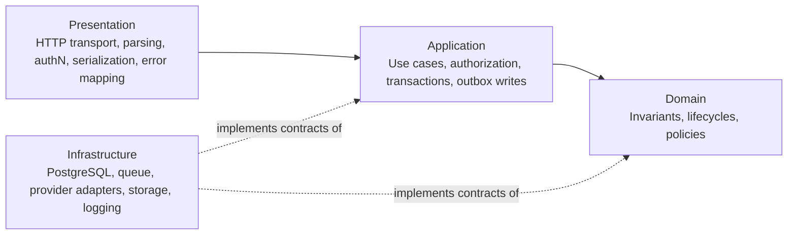
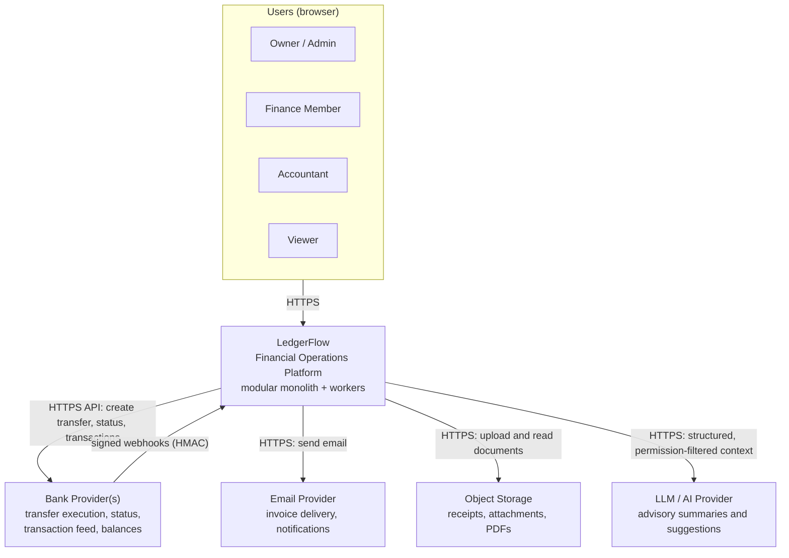
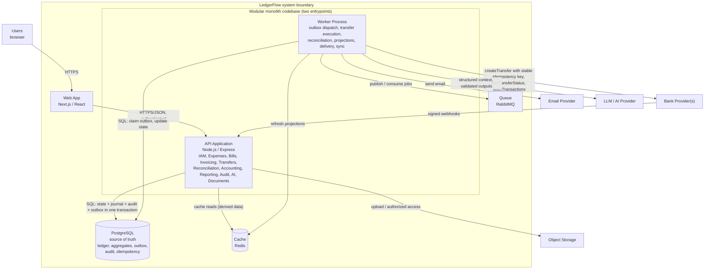
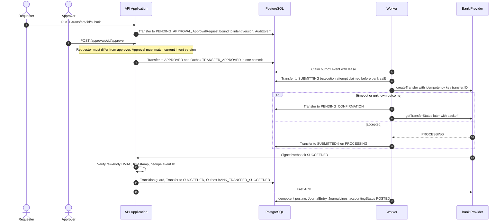

# High-Level Architecture

> **Standard:** C4 Model (Context & Container levels) · arc42 Sections 4 & 5 (Solution Strategy, Building Block View)
> **Related documents:** [01 – Product Overview & Scope](./01-product-overview-and-scope.md) · [02 – Domain Model](./02-domain-model.md)
> Feature-level behavior lives in feature specs (`expenses.md`, `vendor-bills.md`, `invoicing.md`, `transfers.md`, `bank-reconciliation.md`). This document defines the mechanisms that let those behaviors remain correct as one system.

---

## 1. Architectural Strategy & Patterns

### 1.1 Architectural Goals

1. Preserve financial correctness.
2. Keep accounting hidden from normal business users.
3. Maintain explicit domain boundaries.
4. Prevent cross-tenant access.
5. Keep critical writes strongly consistent; allow dashboards, analytics, and AI to be eventually consistent.
6. Integrate safely with external banks.
7. Make retries and failures recoverable.
8. Preserve immutable financial history.
9. Remain understandable and maintainable by a single developer.

```text
Simple Business UX → Domain Workflows → Accounting Engine → Immutable Ledger → Reliable Financial Read Models
```

### 1.2 Architecture Style

**Modular monolith with asynchronous workers** — not independent microservices.

- Modules are separated logically through application/domain boundaries and deployed together.
- Local ACID transactions span financial modules (e.g. *VendorBill → POSTED + JournalEntry + JournalLines + AuditEvent + OutboxEvent* in one commit).
- Fewer distributed-system failure modes and simpler solo development, while still demonstrating production patterns.
- Modules can be extracted later if evidence appears (independent scaling, deployment lifecycle, availability or security isolation, high-volume async workload). Candidates: AI processing, document processing, notification delivery, bank connectivity, analytics. The Accounting Core should be extracted only with strong justification.

### 1.3 Patterns Summary

Architectural decisions are recorded in this document rather than in separate decision records.

| Pattern | Where it applies |
|---|---|
| Modular monolith | Deployment and code organization |
| PostgreSQL as authoritative store | All financial state |
| Transactional Outbox | Bridge local commits to async work |
| Derived state over mutable counters | `paidAmount`, `remainingAmount`, overdue |
| Strict reversal ordering | Corrections |
| Current-open-period reversal posting | Accounting periods |
| Bank as execution authority | Transfers |
| CP core / AP read models (CQRS-lite) | Consistency strategy |
| Single currency, multi-currency-ready schema | Money |
| AI as advisory layer | AI |
| Layered tenant isolation + optional RLS | Multi-tenancy |
| Domain decoupling | Domain design |
| Unified transfer outcome pipeline | Webhooks + reconciliation |
| At-least-once delivery + idempotent consumers | Async processing |
| Impact-based reversal policy + maker-checker | Financial controls |

### 1.4 Layers



| Layer | Responsibilities | Must not |
|---|---|---|
| **Presentation** | HTTP/API transport, request parsing, session extraction, input schema validation, response serialization, HTTP error mapping | Contain financial rules (e.g. approval thresholds) |
| **Application** | Coordinate use cases (`PostExpense`, `PostVendorBill`, `RecordVendorPayment`, `IssueInvoice`, `RecordCustomerPayment`, `SubmitTransfer`, `ApproveFinancialAction`, `ReverseFinancialRecord`, `StartBankReconciliation`, `ConfirmReconciliationSuggestion`, `CompleteBankReconciliation`); load aggregates, authorize, invoke domain behavior, set transaction boundaries, write outbox events | Host arbitrary accounting formulas |
| **Domain** | Business invariants and policies: entity lifecycles, transfer state machine, `FinancialReversalPolicy`, approval policy and intent binding, accounting period rules, ledger-role mapping rules, currency consistency, bill/invoice line totals, invoice numbering, overpayment invariants, reconciliation match rules | Depend on Express/Next, the PostgreSQL driver, bank SDKs, Redis, HTTP, or LLM SDKs |
| **Infrastructure** | PostgreSQL repositories, outbox dispatcher, queue, `BankProvider` adapters, email, object storage, malware scanning, LLM provider, logging/tracing, secrets | Be depended on by domain/application (dependency direction is inward) |

### 1.5 Module Structure and Dependency Rules

Modules: Organization & IAM · Accounting · Expenses · Vendors & Vendor Bills · Customers & Invoicing · Payments · Transfers · Bank Reconciliation · Reporting · Audit · Documents · AI.

```text
src/
├── modules/
│   ├── organizations/        # organizations, memberships, financial settings
│   ├── accounting/           # ledger accounts, ledger mapping, periods, journal, posting
│   ├── expenses/
│   ├── vendor-bills/         # vendors, bills, bill lines, vendor payments
│   ├── invoicing/            # customers, invoices, invoice lines, numbering, delivery, customer payments
│   ├── transfers/            # financial accounts, transfers, approvals, bank execution
│   ├── bank-reconciliation/  # bank transactions, sync, sessions, matches, suggestions
│   ├── reporting/
│   ├── audit/
│   ├── documents/
│   └── ai/
├── infrastructure/
└── shared/                   # Money, idempotency, outbox, approval and reversal policies
```

Rules:
- Feature modules never mutate each other's persistence directly. A transfer use case calls the Accounting application interface; the Accounting module owns journal creation and resolves system ledger roles.
- Bank Reconciliation must not modify `CustomerPayment`, `VendorPayment`, `Expense`, or `Transfer` to force a match; it invokes their supported workflows or creates explicit reconciliation adjustments.
- Shared mechanisms live as policies/services (`Accounting Posting`, `FinancialReversalPolicy`, `Approval Policy`, `Accounting Period Policy`, `Money`, `Idempotency`); workflows remain independent.
- Prefer feature/domain-oriented layout over `controllers/ services/ models/` folders.

### 1.6 Source-of-Truth Hierarchy

| Category | Examples | Rule |
|---|---|---|
| **Authoritative internal** (PostgreSQL, transactional) | Expenses, bills and bill lines, invoices and invoice lines, payments, transfers, journal entries/lines, accounting periods, ledger mapping, approvals, reversals, reconciliation matches | Strong consistency |
| **External authority** | Bank provider, statement, feed — external cash movement | Reconciled, never overwritten |
| **Derived** | `paidAmount`, `remainingAmount`, overdue, dashboard metrics, analytics, AI context and document embeddings, materialized projections | Rebuildable; must not become independent financial truth |
| **Operational** | `requiresReview`, retry counters, sync state, delivery state, outbox leases | Describes workflow health; never overwrites uncertain financial truth |

### 1.7 Consistency Strategy (CP core, AP read models)

| Boundary | Examples | Behavior under failure |
|---|---|---|
| **Consistency-first financial core (CP)** | Journal posting, payments, approvals, invoice numbering, transfer state transitions, reversals, reconciliation match allocation, accounting period changes | Reject, retry, or delay rather than accept contradictory truth |
| **Availability-oriented derived systems (AP)** | Dashboard, analytics, AI context, notifications, search/read projections | Serve slightly stale data; expose "last updated" if lag matters |

CAP is applied to specific consistency boundaries, not as a label for the whole application. The design is **CQRS-lite** (authoritative write model separated from derived read models), **not** event sourcing: outbox events propagate change reliably but PostgreSQL records and journal entries remain the primary persisted state (`Events ≠ sole source of truth`).

### 1.8 Financial Integrity Mechanisms

- **Journal invariants:** `SUM(Debits) = SUM(Credits)`, `amount > 0`, valid organization, active ledger accounts, accounting period, a single currency, and exactly one source record. Uniqueness over `(organization, source record, postingKind)` prevents duplicate primary postings.
- **Posting prerequisites:** the organization's system ledger roles (Accounts Payable, Accounts Receivable, default Revenue, Bank Fees, Opening Balance Equity) must be mapped before any posting; each financial account maps to an asset ledger account. A posting attempt with a missing mapping is rejected as a configuration error, never guessed.
- **Document totals:** a bill or invoice posts only when its total equals the sum of its lines, and its lines are immutable afterwards.
- **Immutable history:** posted records are corrected via reversal, adjustment, or corrected replacement; never silently mutated. Only drafts can be deleted.
- **Reversal policy:** shared `FinancialReversalPolicy` evaluates Bank/Cash impact against `largeReversalThreshold`; strict reversal ordering with no automatic cascade.
- **Accounting periods:** `OPEN → CLOSED`; corrections post into the current open period, referencing the original context. Posting and period close are serialized so a posting can never land in a period that closes concurrently.
- **Currency:** every financial record, payment, account, and journal entry carries its currency; in v1 all must equal the organization's base currency.
- **Database constraints as last line of defense:** positive amounts, unique invoice numbers, unique provider event IDs, unique posting source, unique provider transaction IDs, tenant-aware foreign keys, one active reconciliation match per bank transaction and per target, one pending approval per target.
- **Transaction boundaries:** all local effects commit together; **no external network call inside a DB transaction** unless unavoidable and justified.
- **Money:** decimal/fixed-precision semantics only; never binary floating point.

### 1.9 Architecture Rules (System-Wide Invariants)

1. Never trust the frontend as financial authority.
2. Never mutate posted financial history silently.
3. Every financial effect must be traceable to a business source.
4. Every journal entry must balance.
5. External network calls do not participate in local ACID transactions.
6. Durable outbox events bridge local commits and async work.
7. Async consumers must be idempotent.
8. Retrying a financial command must not duplicate its effect.
9. Derived values must not become independent mutable financial truth.
10. Tenant ownership is validated on every relevant reference, including acting memberships.
11. Large sensitive actions use maker-checker where policy requires, bound to an exact intent version.
12. Closed accounting periods are not rewritten by normal correction flows.
13. Bank-provider success is not equivalent to local accounting completion.
14. Webhook and reconciliation paths converge on the same transition logic.
15. Bank reconciliation discovers differences; it does not hide them.
16. Dashboard/analytics/AI may lag; the financial core may not contradict itself.
17. AI can recommend and explain but cannot bypass deterministic financial rules.
18. Infrastructure complexity must justify itself through an actual requirement.

### 1.10 Failure Philosophy

LedgerFlow favors **recoverable intermediate states over false certainty**; it distinguishes *unknown* from *failed*.

- Bank confirmed success but local accounting failed → state is `SUCCEEDED` with accounting posting pending, **not** `FAILED`.
- Bank request timed out → `PENDING_CONFIRMATION` (outcome unknown, reconciliation required), **not** automatically `FAILED`.
- Operational alerts and the `requiresReview` flag never change financial state automatically; a transfer can be `PENDING_CONFIRMATION` and flagged for review at the same time.
- A worker that crashes mid-task leaves a recoverable record: the execution attempt is claimed durably before the bank call, and an expired lease makes the work claimable again.

---

## 2. Level 1: System Context Diagram

### Explanation

The **system boundary** is LedgerFlow: the web application, backend modules, workers, and their owned data stores. Outside the boundary are human actors and external systems that LedgerFlow depends on but does not control.

- **Users** interact over HTTPS through the web UI (Owner, Admin, Accountant, Finance Member, Viewer).
- **Bank providers** are authoritative for external execution and available balances. LedgerFlow calls them asynchronously and receives signed webhooks.
- **Email provider** delivers invoices and notifications; failures never affect financial state.
- **Object storage** holds document binaries; access is always authorized through LedgerFlow.
- **LLM/AI provider** receives permission-filtered, structured context and returns advisory output.



**Authority boundaries**

| Concern | Authoritative system |
|---|---|
| Bank-side execution outcome, available balance, transaction feed | Bank provider |
| Accounting representation, controls, reporting inputs | LedgerFlow (PostgreSQL) |
| Invoice email delivery status | Email provider (operational state in LedgerFlow) |
| Financial numbers used by AI | LedgerFlow deterministic tools, never the LLM |

---

## 3. Level 2: Container Diagram

### Decomposition

| Container | Description |
|---|---|
| **Web App** | Next.js/React UI. Frontend route protection is UX only; the frontend is untrusted input. |
| **API Application** | Exposes business use cases (not CRUD): `POST /expenses/:id/post`, `POST /invoices/:id/issue`, `POST /transfers/:id/submit`, `POST /approvals/:id/approve`, `POST /reconciliations/:id/complete`. Hosts all domain modules and the webhook endpoint. |
| **Worker Process** | Same codebase as the API, different entrypoint. Runs outbox dispatch, transfer execution, transfer reconciliation, accounting recovery, invoice delivery, per-account bank-feed sync, bank matching, projection updates, notifications, document scanning, AI context refresh. |
| **PostgreSQL** | Primary transactional store and source of truth: organizations, memberships, ledger mapping, aggregates and their lines, journal entries/lines, approvals, accounting periods, invoice number sequences, audit, outbox, idempotency records, provider-event inbox, bank transactions, reconciliation state. Optional RLS. |
| **Queue / Job Infrastructure** | Durable transport for asynchronous work; at-least-once delivery. |
| **Cache** | Non-authoritative reads only (dashboard summaries, reference data, AI context fragments). |
| **Object Storage** | Binary documents; PostgreSQL stores metadata (organization ownership, kind, storage key, content type, size, checksum, scan status, `createdBy`). |

### Technology Stack

| Container | Technology | Responsibilities | Communication Protocol |
|---|---|---|---|
| Web App | Next.js, React, TypeScript | UI, input convenience calculations, session handling | HTTPS/JSON to API |
| API Application | Node.js, Express, TypeScript | Authentication, capability authorization, use-case orchestration, domain policies, webhook intake, transactional writes with outbox | HTTPS (in); SQL over TCP to PostgreSQL; queue client; HTTPS (out) to providers |
| Worker Process | Node.js, TypeScript (same codebase) | Outbox dispatch, bank execution and reconciliation, accounting recovery, delivery, projections, scheduled jobs (claim/lease safe) | Queue consumer; SQL over TCP; HTTPS (out) to bank, email, LLM, storage |
| PostgreSQL | PostgreSQL | ACID source of truth; constraints; row locking; decimal types; optional RLS; outbox and idempotency tables | SQL over TCP (pooled connections) |
| Queue / Jobs | RabbitMQ | Reliable at-least-once event/job transport | AMQP |
| Cache | Redis | Derived/non-authoritative caching only | Redis protocol (RESP) |
| Object Storage | S3-compatible storage | Document binaries | HTTPS (signed access mediated by LedgerFlow) |
| Bank Provider Adapter(s) | `BankProvider` interface implementations | `createTransfer`, `getTransferStatus`, `getAccountBalance`, `fetchTransactions`, `verifyWebhook`, `normalize` | HTTPS REST; inbound signed webhooks |
| Email / LLM providers | Provider SDK/HTTP behind adapters | Delivery; advisory generation with validated structured outputs | HTTPS |

> Queue and cache products are implementation choices; the architecture only requires a durable at-least-once queue and a non-authoritative cache. Replacing either does not change domain behavior.

### Container Diagram



### Key Interaction: Large Bank Transfer



Below-threshold transfers skip the approval steps: submission moves the transfer directly to `APPROVED` and writes `TRANSFER_APPROVED`.

Reconciliation polling and webhooks feed the **same** normalized outcome pipeline (Normalized Outcome → Transition Guard → State Update → Outbox) so business rules are identical regardless of discovery source.

### Deployment Topology (v1)

Web Frontend, API Application, Worker Process, PostgreSQL, Queue/Job infrastructure, Object Storage. API and Worker share a codebase with different entrypoints.

- **Scaling:** API scales horizontally (state lives in shared persistence, not process memory). Workers scale by queue partitioning/claiming with idempotency preserved. The database scales first through indexes, query optimization, connection pooling, and bounded transactions; read replicas or isolated projections come later if needed.
- **No in-memory financial state:** a restart must not lose pending transfer execution, approvals, bank outcomes, posting requirements, or reconciliation state.
- **Scheduled jobs** (transfer reconciliation, bank-feed sync, stuck-workflow detection, projection recovery, cleanup) must be safe if two scheduler instances overlap: use claiming, locks, leases, and idempotency; cron alone is not concurrency control.
- **Search:** indexed PostgreSQL queries; no dedicated search engine unless a real need is demonstrated.

---

## 4. Cross-Cutting Concerns

### 4.1 Authentication & Authorization

- **Authentication** answers *who*; **authorization** answers *can this user do this in this organization*.
- Capability-based checks (`expense:create`, `expense:reverse`, `invoice:issue`, `transfer:approve`, `bank_reconciliation:complete`) rather than role-name comparisons in business logic.
- Requirements: secure authentication, server-side authorization, secure cookie/token handling, no unnecessary secrets in browser storage, CSRF protection for cookie-based mutations, session expiry/invalidation, audit correlation to the authenticated actor.
- Frontend route protection is UX only; **backend authorization is authoritative**. The frontend is never trusted for `organizationId`, role, approval status, `paidAmount`, `journalEntryId`, reconciled flags, or transfer status.
- **Actors are memberships:** every actor reference (creator, requester, approver, reverser) is an organization membership, so an actor always belongs to the organization of the record they touch.
- **Maker-checker:** the requesting membership must differ from the approving membership. Approval is a domain record capturing action (transfer approval or reversal approval), exactly one target, intent snapshot/hash/version, requester, approver, timestamps, and status (`PENDING`, `APPROVED`, `REJECTED`, `CANCELLED`, `SUPERSEDED`, `EXPIRED`). At most one approval is pending per target. Materially changing the intent supersedes the prior approval, and execution verifies the approval's intent version against the current one.

### 4.2 Multi-Tenancy & Tenant Isolation

Layered enforcement; no single layer is sufficient:

```text
Authentication → Organization Membership → Application Authorization
→ Organization-scoped Repository Queries → Database Constraints / RLS where appropriate
```

- Repository APIs use `findById({ organizationId, id })`, never `findById(id)`, for tenant-owned resources.
- Cross-tenant references are invalid even if IDs exist. Foreign keys are tenant-aware (they include `organizationId`), including references to the acting membership.
- PostgreSQL RLS is optional defense-in-depth: it does not replace application authorization. The transaction context must safely establish the active organization before queries; background jobs require deliberate policies rather than blanket RLS bypass.
- The provider-event inbox is internal infrastructure, not tenant-facing: it is excluded from tenant RLS policies, and its tenant is resolved only after the event is verified. Details belong in `security.md` / `database.md`.

### 4.3 Idempotency, Retries & Concurrency

- **Idempotency:** financial commands (post payment, issue invoice, submit transfer, reverse payment) have stable logical identities; idempotency records plus unique business constraints ensure a retried command yields the same committed result. The record stores a response snapshot so a retry replays the original answer; the same key with a different request is rejected; a record stuck `IN_PROGRESS` past its lock time is recoverable; records expire after a retention window.
- **Delivery semantics:** at-least-once + idempotent consumers + database constraints; desired outcome is *potentially repeated delivery → exactly one financial effect*.
- **Retry classification:**

| Class | Examples | Handling |
|---|---|---|
| Retryable | Provider 5xx, connection reset, rate limit, queue interruption, temporary DB connectivity | Retry with backoff |
| Non-retryable domain rejection | Permission denied, invalid amount, closed period, self-approval, overpayment, missing ledger mapping, currency mismatch | Reject; no retry |
| Ambiguous external outcome | Bank request timed out | Neither success nor failure: same provider idempotency key, status query, reconciliation |

- **Concurrency:** invariants are protected by row-level locking, transaction isolation, optimistic versioning, unique constraints, or conditional updates, chosen per aggregate:

| Invariant | Mechanism |
|---|---|
| Two concurrent final payments must not overpay | Lock the parent bill/invoice row, then check remaining amount inside the posting transaction |
| Posting must not land in a period that closes concurrently | Posting takes a shared lock on the period row; closing takes an exclusive lock |
| Concurrent invoice issues must produce unique, gap-free numbers | Number drawn from the sequence row locked inside the issue transaction; a rolled-back issue consumes no number |
| A bank transaction or record matched twice | Partial unique constraints on active matches |
| Two pending approvals for one target | Partial unique constraint on pending approvals |
| Two workers claiming one outbox event | Short claim transaction (`FOR UPDATE SKIP LOCKED`) that sets a lease; locks are never held during external calls |

### 4.4 Transactional Outbox & Workers

- State change and `OutboxEvent` commit atomically, avoiding the dual-write problem.
- Outbox event shape: `id`, `organizationId`, `aggregateType`, `aggregateId`, `aggregateVersion`, `eventType`, versioned payload, `occurredAt`, `availableAt`, lease (`lockedAt`, `lockedBy`), `attempts`, `processedAt?`, failure metadata, `deadLetteredAt?`. Payloads carry stable identifiers and no secrets.
- **Claiming and leases:** a worker claims an event in a short transaction and holds it through a time-limited lease, not an open database lock. An expired lease makes the event claimable again after a crash.
- **Ordering:** `aggregateVersion` lets consumers detect out-of-order events for the same aggregate; consumers ignore stale events idempotently.
- **Dead letters:** events that exhaust retries are dead-lettered, raise an alert, and wait for operator review rather than retrying forever. Processed events are retained for a bounded period.
- Workers must assume crash after side effect, duplicate delivery, restart, network timeout, and partial external failure.
- **Foundational rule:** external calls never define local transaction atomicity. Use *local transaction + durable intent/event + idempotent external operation + retry + reconciliation*.

### 4.5 External Integration Security (Bank, Webhooks, Providers)

- **Provider adapter isolation:** provider statuses and signature logic stay inside adapters; no giant abstraction for hypothetical banks before a real second provider exists.
- **Webhook pipeline:** raw-body signature verification (HMAC) → timestamp/replay check → provider event deduplication (`(provider, providerEventId)` unique, recorded before any side effect) → resolve tenant → normalize outcome → canonical transition guard → DB transaction + outbox → fast ACK. Slow downstream work never runs inside the webhook request. Constant-time signature comparison; ignored stale/duplicate events are logged for audit and observability. Stored event payloads are encrypted or redacted as required and purged after a retention period.
- **Bank-feed sync:** one sync position (cursor and status) per bank-linked financial account, so accounts on the same connection progress independently. Import is idempotent through the provider transaction identity.
- Every external response is validated against the provider contract and normalized before entering domain logic.

### 4.6 Validation & Error Architecture

- **Layered validation:** transport schema → application authorization → domain invariants → database constraints.
- **Error taxonomy:** Validation Error, Authorization Error, Domain Conflict (including incomplete organization configuration such as an unmapped ledger role), Not Found, Concurrency Conflict, External Provider Error, Ambiguous External Outcome, Infrastructure Failure. Clients must be able to tell whether retry is safe (`PROVIDER_OUTCOME_UNKNOWN` ≠ `PROVIDER_INSUFFICIENT_FUNDS`).

### 4.7 Audit & Accounting History

- Ledger answers *what financial effect occurred*; audit trail answers *who, when, why, what state changed, who approved*. Neither substitutes for the other.
- Audit records are append-only, not editable or deletable by normal users, minimize sensitive fields, and may include `organizationId`, actor (membership and user, or system), `action`, target type (from a controlled vocabulary) and id, `reason`, correlation ID, request ID, client IP, timestamp, selected before/after metadata. No secrets or full request payloads.
- Audit targets are referenced by type and id without enforced links, so history survives deletion of drafts. Deleting a draft is itself audited.
- Audit volume grows fastest of all tables: it is time-partitioned and indexed by organization and time, and by correlation ID.

### 4.8 Logging, Metrics, Tracing & Alerting

- **Correlation:** every significant operation carries request/correlation ID, organization ID, actor ID, aggregate ID, outbox event ID, and provider reference, enabling tracing *HTTP → DB transaction → Outbox → Worker → Bank → Webhook → Accounting posting*.
- **Structured logs** with context (`correlationId`, `organizationId`, `transferId`, `provider`, `providerTransferId`, `operation`). Never log passwords, tokens, webhook secrets, bank credentials, or unnecessary document contents.
- **Metrics:** HTTP error rate, DB transaction failures, concurrency conflicts, outbox backlog, retries, expired leases and dead letters, worker failures, queue age, provider latency, webhook verification failures, stuck transfers, `SUCCEEDED`-but-not-`POSTED` transfers, transfers flagged `requiresReview`, idempotency records stuck `IN_PROGRESS`, bank import failures, unreconciled bank transactions, open reconciliation sessions with non-zero difference, document scan failures, AI provider failures, projection lag.
- **Alerts:** outbox backlog or dead-letter growth, repeated posting-recovery failure, transfer stuck beyond SLA, provider terminal-state conflict, webhook signature failure spike, stalled bank sync (per account), reconciliation import failures, invariant/constraint failure spikes.
- **Health checks:** liveness, readiness, and dependency health are separate. An AI-provider outage must not take the financial API down; a primary DB outage makes financial writes unavailable.

### 4.9 Secrets Management

Secrets (bank API credentials, webhook secrets, LLM keys, storage credentials) are never hardcoded, committed, returned to the frontend, logged, or placed in outbox payloads. Credentials are separate per environment (development, staging, production); real bank production credentials must never be reachable from local development.

### 4.10 Caching

Allowed for derived/non-authoritative reads (dashboard summaries, reference data, static configuration, AI context fragments). The cache must never be the sole authority for payment existence, approval, accounting period state, ledger mapping, journal posting, or reconciliation matches; cache loss must not corrupt financial truth.

### 4.11 Reporting, Dashboards & Read Models

- Reports derive from journal entries/lines through reporting queries or projections (P&L, cash flow, receivables, payables); operational tables enrich (customer, vendor, invoice, bill, category) but totals reconcile to the ledger. Journal lines carry their posting date and period, so balances by account and date are computed without joining back to entries.
- Dashboards are materialized asynchronously via *Financial Commit → Outbox → Projection Worker → Dashboard Projection*. They are never the authority for payment existence, transfer success, or period state; expose "last updated" where useful.

### 4.12 Documents & Uploads

Binary content lives in object storage; PostgreSQL holds metadata, including document kind (receipt, bill, invoice PDF, contract, policy, procedure, statement) and scan status. Flow: authenticated request → authorization and metadata validation → upload → persist metadata → malware scan → attach to a domain entity (expense, vendor bill, or invoice) or keep as an organization-level document (policies, contracts, procedures). Content is served only after a clean scan. Document metadata is immutable; replacement creates a new document. Detaching is audited and not allowed once the target is posted or issued. Filenames and content are untrusted; raw storage URLs are not authorization.

### 4.13 AI Architecture Boundary

- AI is advisory: financial summaries, cash-flow observations, suggested categories, reconciliation suggestions, draft assistance, natural-language questions.
- Flow: *Authoritative data → AI Context Builder → permission-filtered structured context → LLM → suggestion/explanation*. Never *LLM output → ledger*.
- Tool calling maps to explicit application capabilities (e.g. `createExpenseDraft`), never arbitrary SQL; sensitive actions still require authorization, validation, approval, and human confirmation.
- Outputs use validated structured schemas; free-form text never drives state transitions.
- RAG serves unstructured context (policies, documents, help); numeric truth comes from SQL/structured tools. Document chunks and embeddings are derived state, tenant-scoped, rebuildable from documents, and retrieved only for documents the user is permitted to read.
- AI needs its own evaluation (classification accuracy, evidence correctness, hallucination rate, tool selection, tenant leakage, financial-number fidelity).

### 4.14 Data Lifecycle, Time & Schema Evolution

- **Time:** timestamps stored as absolute instants; accounting dates (`invoiceIssueDate`, `billDate`, `dueDate`, `accountingPostingDate`) are explicit business dates derived with the organization's accounting timezone; the period is never derived from server-local time.
- **Retention:** only drafts are deletable; posted records, journals, and audit are retained per policy; destructive deletion of posted accounting history is not promised without defining regulatory consequences. Operational tables have bounded retention: processed outbox events, expired idempotency records, and provider-event payloads.
- **Schema evolution:** forward-compatible rollouts, no destructive rewrites without a migration plan, safe backfills of derived fields, no changing the meaning of historical money; versioned events; contract tests for provider adapter changes.

### 4.15 Backup, Recovery & Disaster Recovery

- Automated backups, point-in-time recovery where available, restore testing, and a documented recovery procedure. An untested backup is incomplete.
- After restoring to an earlier point, external systems may contain later actions (e.g. a bank transfer succeeded after the snapshot). Recovery relies on provider reconciliation, webhook/event replay where available, bank reconciliation, and idempotent accounting recovery. **Never blindly re-execute external financial actions after restore.**

### 4.16 Testing Strategy

| Level | Focus |
|---|---|
| Unit | Domain policies and state machines: `FinancialReversalPolicy`, approval policy and intent binding, transfer transition guard, overpayment rules, accounting mappings, line-total rules, currency consistency, reconciliation match rules |
| Integration (real DB) | Transactions, constraints, locking, RLS/tenant boundaries, outbox atomicity and leases, journal posting, invoice numbering, period lock |
| Contract | Bank adapters, webhook signatures, bank-feed normalization, email provider, AI structured outputs |
| End-to-end | Critical business workflows |

High-value architecture tests:
- Payment retry → one payment and one journal.
- Two concurrent final payments → no overpayment.
- Two concurrent invoice issues → distinct, gap-free numbers; a failed issue consumes none.
- Posting concurrent with period close → never lands in a closed period.
- Posting with an unmapped ledger role → rejected with a configuration error.
- Bill or invoice whose total differs from its lines → cannot be posted.
- Approval commits while worker is down → outbox preserves work.
- Transfer edited after approval → approval superseded, execution blocked until re-approved.
- Requester approving own request → rejected.
- Worker crashes holding an outbox lease → event reclaimed and processed once.
- Bank success then accounting worker failure → no second transfer and local posting recovers.
- Duplicate webhook → one financial effect.
- Duplicate reconciliation import → no duplicate bank transactions.
- Second match for an already-matched transaction or record → rejected; match across different financial accounts → rejected.
- Cross-tenant ID supplied (including as acting membership) → no data leakage.

### 4.17 Non-Goals (v1)

Not a full ERP, tax filing engine, payroll platform, global multi-currency accounting suite, bank core, event-sourced distributed microservice system, or autonomous AI accountant. Complexity is included only where it teaches or protects something real: transactions, concurrency, idempotency, bank APIs, webhooks, reconciliation, RBAC, accounting, eventual consistency, AI boundaries, and observability.

### 4.18 Architecture Summary

> **Keep financial truth small, strongly consistent, explicit, and durable; move slow or failure-prone work outside that transaction boundary and connect it through idempotent, observable asynchronous workflows.**

```text
Business UX → Domain Workflows → Financial Policies (RBAC, Approval, Periods, Reversal, Idempotency)
→ Accounting Engine (Immutable Journal) → PostgreSQL (source of truth) → Transactional Outbox
→ Async Workers → Bank APIs / Read Models / AI and Delivery → Webhooks + Reconciliation → observable recovery
```
