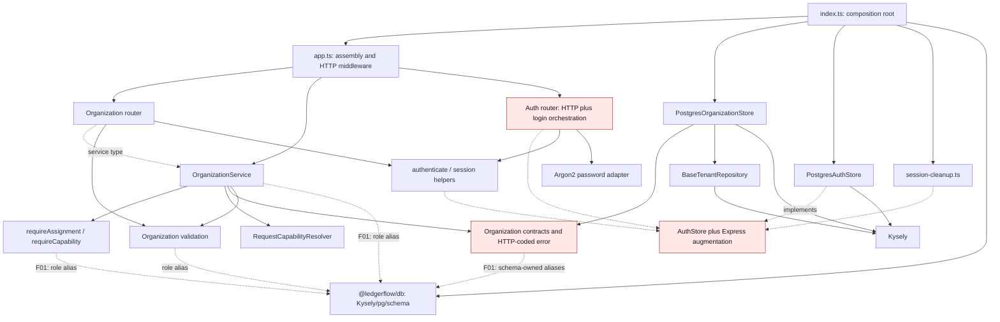
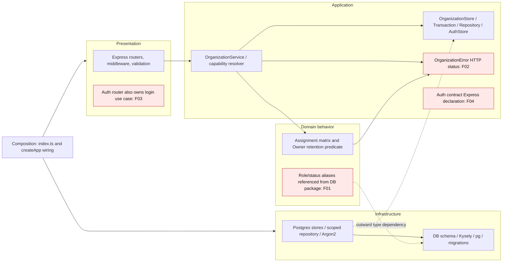
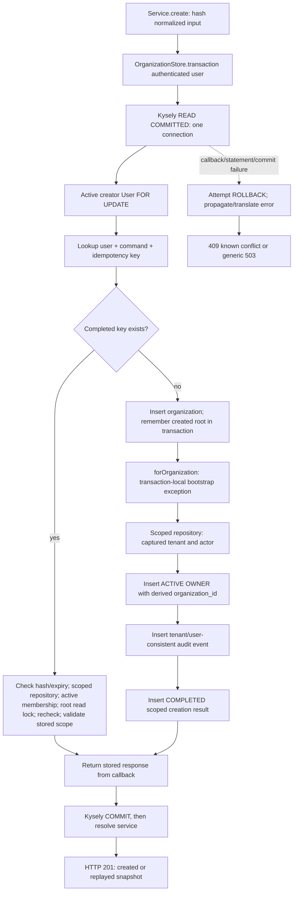
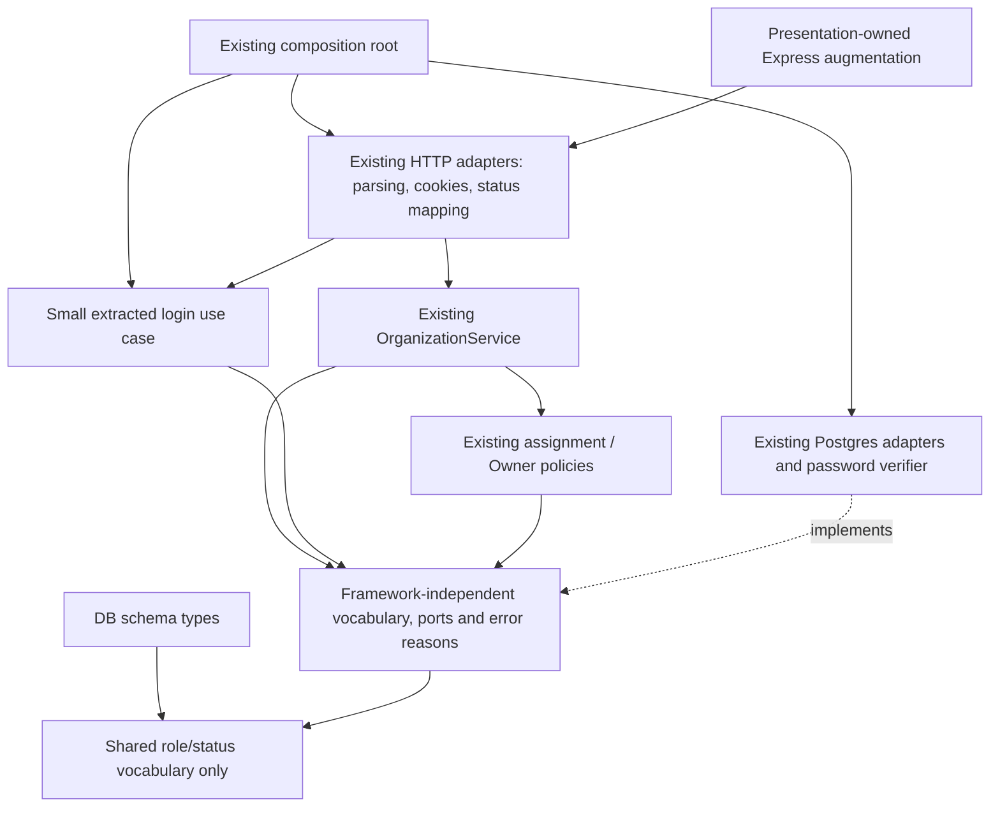

# LedgerFlow Architecture Compliance Review

Review date: **2026-10-21 (Africa/Cairo)**. Source baseline: `7e8e16023cefd6b46f960d1131ed8122418b328f`.

Scope: implemented backend, its persistence schema/adapters, relevant web consumers, tests, and architecture documents. This is an audit: no production source, contracts, migrations, dependencies, or data were changed. The existing untracked `docs/reviews/s1-technical-walkthrough.md` was preserved.

Evidence labels used throughout:

- **Source:** an observed implementation or test definition, with repository-relative path and actual line numbers.
- **Executed:** a check run during this review, with results in section 9.
- **Unverified:** runtime, PostgreSQL, deployment, or operational behavior not exercised here. An existing test is evidence of intended coverage, not a passing result from this audit.

## 1. Executive Summary

**Verdict: PARTIAL Clean Architecture compliance.** The organization feature has a credible ports-and-adapters design: HTTP adapters call an application service; the service owns transaction boundaries through interfaces; PostgreSQL adapters implement those interfaces; and startup owns the database pool and concrete stores. It is more than a folder convention. It is not yet a fully independent domain/application core.

The main confirmed deviations are database-package ownership of organization/domain vocabulary, HTTP status codes embedded in business errors, authentication use-case orchestration inside an Express router, and an Express-specific declaration mixed into an inward-facing auth contract. Unexpected request failures also lose the correlation information needed to diagnose them. These are focused, incremental improvements; none justifies replacing the modular monolith.

**No Critical or High exploitable defect was confirmed in the implemented HTTP paths.** Source review found consistent organization predicates, active-membership checks, capability enforcement, assignment restrictions, atomic audit writes, and a sensible owner-demotion locking protocol. This is not a blanket security certification: PostgreSQL integration tests were not executed because no disposable test database URL was configured.

Ownership retention is **safe by the current service protocol, not enforced against arbitrary database/repository writers**. Competing role changes take the same organization lock and re-read authority. The raw role-update method, however, can be called without the last-owner check or audit. There is no second production HTTP writer today. Preserve this boundary and test/enforce it before adding member removal, status changes, workers, or administrative writers.

Executed results: **25 API tests and 8 web tests passed**, with no failed or skipped tests. Fresh uncached workspace build, lint, and type-check all passed. The available toolchain was Node **22.22.0** / npm **10.9.4**, outside the declared Node 24 / npm 11 ranges; supported-toolchain verification remains required.

Accounting, money primitives, journal posting, workers, outbox execution, bank integrations, and financial controls are placeholders or design documents. Their correctness is **NOT VERIFIED**, rather than inferred from organization-management code or diagrams.

## 2. Architecture Inventory

### Implemented components and actual layer assignments

| Component | Responsibility and actual layer | Source evidence |
| --- | --- | --- |
| `apps/api/src/index.ts` | Outer composition root and process lifecycle: validates host/port, creates one pool, instantiates concrete stores, starts cleanup/server, handles signals. | Lines 9–29, 35–56 |
| `apps/api/src/app.ts` | Application assembly plus presentation middleware: CORS, security headers, CSRF checks, JSON/cookie parsing, correlation, routers, error mapping. Constructing `OrganizationService` here is composition, not a domain dependency violation. | Lines 15–23, 26–68, 69–85 |
| Organization router | Presentation: session authentication, identifier/body/query parsing, actor extraction, HTTP serialization. No SQL or assignment policy in handlers. | `apps/api/src/modules/organizations/routes.ts:9–39` |
| Organization validators | Presentation input parsing plus a reusable stored-response guard. Pure functions, but they import persistence-owned role vocabulary. | `apps/api/src/modules/organizations/validation.ts:1–92` |
| `OrganizationService` | Application orchestration: authorization, transaction boundaries, creation identity, paging, audit intent. Also contains the small last-owner rule. No concrete store construction or SQL. | `apps/api/src/modules/organizations/service.ts:12–133` |
| `RequestCapabilityResolver`, `requireCapability` | Application authorization: transaction-local immutable snapshots, scope checks, explicit invalidation, fail-closed capability checks. | `apps/api/src/modules/organizations/capabilities.ts:9–43` |
| `requireAssignment` | Domain policy: strict Owner/Admin assignment authority, independent of dynamic capability grants. It is behaviorally a domain rule even though the folder is not named `domain`. | `apps/api/src/modules/organizations/policy.ts:4–16` |
| Organization interfaces and errors | Application ports, DTOs, and domain vocabulary in one file. Transaction callback exposes application operations, not Kysely. HTTP-coded errors and DB-owned aliases weaken the boundary. | `apps/api/src/modules/organizations/types.ts:1–84` |
| `PostgresOrganizationStore` / transaction adapter | Infrastructure: READ COMMITTED transaction execution, user-bound transaction context, repository factory, bootstrap/idempotency persistence, SQL error translation. Implements the inward-facing interfaces. | `apps/api/src/infrastructure/organization-store.ts:67–178` |
| `ScopedOrganizationRepository` | Infrastructure: scoped membership access, organization row locks, mutations, owner existence query, audit insert. Extends shared tenant infrastructure. | `apps/api/src/infrastructure/organization-store.ts:11–65` |
| `BaseTenantRepository`, `tenantScope` | Infrastructure query-building helpers: captured tenant/user, bound SQL values, scoped selects/updates/deletes, server-derived insert ownership, returned-resource checks. Kysely belongs here. | `apps/api/src/infrastructure/tenant-repository.ts:1–50` |
| Auth router | Mixed presentation and application: parses credentials, verifies login eligibility, creates/rotates sessions, sets cookies, revokes logout credentials. | `apps/api/src/modules/auth/routes.ts:14–69` |
| Auth session helpers | Presentation authentication adapter plus crypto helpers: parse/hash bearer secret, set cookie options, attach authenticated request context. Express imports are legitimate for this adapter. | `apps/api/src/modules/auth/session.ts:1–36` |
| Password verifier | Infrastructure crypto adapter, despite residing in the auth module: concrete Argon2id, module-initialized dummy hash, sanitized error event. | `apps/api/src/modules/auth/password.ts:1–18` |
| `AuthStore` | Application persistence port with safe identity/session value types; Express request augmentation is co-located unnecessarily. | `apps/api/src/modules/auth/types.ts:1–40` |
| `PostgresAuthStore` | Infrastructure: global identity/session queries, atomic rotation, expiry enforcement, bounded cleanup. Global identities are an intentional non-tenant boundary. | `apps/api/src/infrastructure/auth-store.ts:7–53` |
| Session cleanup / health adapter | Infrastructure lifecycle maintenance and dependency-health mapping. Cleanup is local per process; database row locking supports multiple cleaners. | `apps/api/src/infrastructure/session-cleanup.ts:4–15`; `health.ts:3–10` |
| `packages/db` | Infrastructure package: Kysely/pg pool, physical schema, migrations, development seed. It currently also owns role/status aliases used by the inner layers. | `packages/db/src/index.ts:1–53`; `schema.ts:1–101`; `migrator.ts:1–20` |
| `packages/shared` | Framework-independent health contract and runtime guard. No implemented Money/domain engine. | `packages/shared/src/index.ts:1–10` |
| Web identity/API consumers | Presentation: credentialed API requests, response guards, session/selected organization held in React memory. Capability hints govern UX; server authorization remains authoritative. | `apps/web/src/lib/api.ts:11–23`; `components/identity/identity-provider.tsx:17–38`; `lib/identity.ts:1–38` |

The `accounting`, `expenses`, `vendor-bills`, `invoicing`, `transfers`, `bank-reconciliation`, `reporting`, `audit`, `documents`, and `ai` backend module directories contain placeholders, not implemented application/domain layers. There is no implemented worker entrypoint in the reviewed source tree. An `audit` placeholder does not mean audit persistence is absent: organization auditing is implemented in its store and migration 003.

### Documentation and blast radius

Reviewed `README.md`, `docs/01-product-overview-and-scope.md`, `02-domain-model.md`, `03-high-level-architecture.md`, `04-local-development.md`, `database.md`, `authentication.md`, and `features/organization-management.md`, alongside workspace manifests/configuration and the applicable agent instructions. No separate ADR file was found by filename search. Feature-specific confirmed decisions are more precise than the broad planned architecture.

Respect these existing decisions:

- Strict Option A assignment authority; dynamic access grants do not override it (`docs/features/organization-management.md:95–108, 244–258`).
- Authenticated active-user bootstrap is independent of role grants; `org:create` is catalogued but is not a tenant-role gate (same document, lines 244–258). This is intentional, not an authorization bypass.
- Global role/permission catalog, global identities, transaction-local capability caching, and no required RLS.
- Retained expired creation keys reject reuse; no automatic deletion/reuse (`service.ts:42–45`; feature spec lines 119–130).
- Migration 005 has an explicitly documented availability exception: a PostgreSQL 16 table rewrite and maintenance window (`docs/database.md:317–332`). Do not relabel this acknowledged trade-off as an undiscovered zero-downtime defect.

Potential remediation touches organization contracts/policies/service/validation, the DB schema's type imports, PostgreSQL adapter error translation, auth routing/contracts, and HTTP error mapping. Runtime HTTP shapes, membership enums, audit/idempotency tables, migration history, web response guards, and existing tests are consumers to preserve. This audit makes no DB change, so migration/index/transaction change checklists are not implementation actions here.

## 3. Clean Architecture Compliance

| Rule | Assessment | Evidence and interpretation |
| --- | --- | --- |
| Domain has no outward dependencies | **PARTIAL** | Assignment logic has no SQL/Express calls, but imports `MembershipRole` from `@ledgerflow/db`; its errors carry HTTP 403 (`policy.ts:1–15`). See F01/F02. |
| Application depends on abstractions, not concrete stores | **PARTIAL** | `OrganizationService` receives `OrganizationStore` (`service.ts:26–32`) and never imports a concrete adapter. It still depends on DB-owned role vocabulary (`service.ts:2`). |
| Application ports do not expose ORM/driver/transport types | **PARTIAL** | No `Kysely`, `Transaction<Database>`, `pg`, Express Request, or Response in organization port signatures (`types.ts:43–73`). Their role/status aliases originate in infrastructure; errors use HTTP semantics. Auth's contract file contains an Express namespace declaration. |
| Infrastructure implements inner contracts | **PASS** | `ScopedOrganizationRepository implements OrganizationRepository`, transaction adapter implements `OrganizationTransaction`, and stores implement their ports (`organization-store.ts:11,67,155`; `auth-store.ts:7`). |
| Concrete resource wiring stays at the edge | **PASS for stores/pool; PARTIAL for auth behavior** | Pool/stores are created in `index.ts:22–27`; service/router assembly occurs in `app.ts:65–67`. The auth router directly binds password/session helpers and contains the login workflow (F03). |
| Business behavior independent of HTTP/database concerns | **PARTIAL** | Organization orchestration and owner checking use ports; status-coded exceptions leak HTTP into policy/application. Auth login workflow is embedded in HTTP code. |
| No hidden mutable global tenant/authorization context | **PASS in reviewed organization path** | User ID captured before yielding (`organization-store.ts:159–165`); tenant/actor captured in private fields (`tenant-repository.ts:10–20`); resolver is instantiated inside `tenantAccess`, not shared across requests (`service.ts:14`). |

Confirmed outward compile-time dependency edges are exactly: `organizations/types.ts:1`, `service.ts:2`, `policy.ts:1`, and `validation.ts:1` importing aliases from `@ledgerflow/db`. The validation adapter is allowed to depend outward, but contributes to infrastructure owning the shared vocabulary. These imports are **type-only and erased at runtime**; do not claim that calling the policy opens a DB connection or that Kysely objects escape the ports. `packages/db/src/schema.ts:1–6` establishes the physical-schema origin of those aliases.

Other confirmed boundary coupling consists of HTTP status semantics flowing from inner errors/policies (F02), auth application orchestration in the HTTP adapter (F03), and Express-specific augmentation in the shared auth contract file (F04). There is no observed organization service import of a concrete store, infrastructure query builder, or Express router. `node:crypto` hashing and `Buffer` cursor encoding in the service are platform coupling, not PostgreSQL/HTTP dependencies; a hash/cursor abstraction is not presently justified. Importing a pure response guard from `validation.ts` is not by itself a framework dependency violation.

Folder separation alone is not the issue: small policies and application functions can share a feature folder. Moving files without changing dependency ownership would not resolve F01/F02.

## 4. SOLID Scorecard

| Principle | Status | Supporting evidence, actual limitation, and minimal improvement |
| --- | --- | --- |
| **SRP** | **PARTIAL** | Organization router is transport-only (`routes.ts:20–39`), service coordinates organization use cases (`service.ts:35–125`), SQL remains in adapters. No God Service is demonstrated by the 134-line service. Auth router combines credential validation, login eligibility, session issuance, metadata collection, cookie transport, logout, and throttling (`auth/routes.ts:14–69`): F03. Extract login orchestration while keeping HTTP concerns in the router. F04 separates framework declarations from contracts. |
| **OCP** | **PASS within implemented scope** | Access grants change in `role_permissions` without editing business code (`organization-store.ts:90–102`; existing integration tests at `organizations-postgres.test.mjs:283–353`). Store replacement uses the existing port. Adding a sixth role requires changing the enum/assignment matrix/validation, but the approved model deliberately has five structural roles; that is not a speculative OCP failure. Do not introduce a policy plugin system. |
| **LSP** | **PARTIAL** | Concrete adapters satisfy typed signatures and observed return behavior: absent membership returns undefined, absent role-update target throws 404 (`organization-store.ts:19–22,43–47`), transaction exceptions propagate (`159–175`). Installed Kysely source confirms commit-after-callback/rollback-on-throw. Existing real-DB tests specify rotation rollback and mutation rollback, but were not run here. Ports do not document all lock/atomicity/error guarantees and there is no shared store-contract suite. **No confirmed substitutability defect** in production adapters; document/test behavior before adding alternatives. |
| **ISP** | **PASS for present consumers** | `CapabilitySource` is a single lookup (`capabilities.ts:9–11`); `OrganizationStore` is one transaction boundary (`types.ts:71–73`); repositories are feature-specific. `OrganizationTransaction` combines bootstrap, discovery, and tenant operations for this one cohesive feature. No unrelated production consumer or forced unsupported method is demonstrated. Consider narrower use-case views only if new consumers need them. |
| **DIP** | **PARTIAL** | Organization service receives the store port; infrastructure implements inward contracts; clock is injected (`service.ts:26–32`, `organization-store.ts:155–165`). F01 reverses vocabulary ownership, F02 embeds transport policy, F04 mixes framework declarations into the contract. Fix those small boundaries; do not wrap every standard-library call. |

These statuses evaluate independent principles, not an arbitrary numerical architecture score. Behavioral replacement guarantees under real PostgreSQL remain unverified in this run.

## 5. Findings

Sorted by severity; findings with the same severity are ordered by architectural impact. No Critical or High finding is substantiated by the available evidence. Conditional integrity/deployment risks are listed separately in section 6.

### F01 — Medium — Inner organization vocabulary is owned by infrastructure

**Evidence:** `apps/api/src/modules/organizations/types.ts:1`, `service.ts:2`, `policy.ts:1`, `validation.ts:1`; `packages/db/src/schema.ts:1–6`; `packages/db/src/index.ts:4–8`.

```ts
// organizations/types.ts:1
import type { MembershipRole, MembershipStatus, OrganizationStatus } from "@ledgerflow/db";
// organizations/policy.ts:1
import type { MembershipRole } from "@ledgerflow/db";
```

**Principle:** Clean Architecture Dependency Rule / DIP. Domain/application types should own role/status semantics, with persistence adapting inward.

**Why it matters:** Policy and service compilation require the infrastructure schema package and its declarations. Physical persistence becomes the authority for business vocabulary; replacing or independently testing the inner feature still requires that dependency. This is compile-time coupling, not a runtime SQL dependency or tenant exploit.

**Minimal fix:** Move the existing unchanged unions to a framework-independent contract file/package, and have DB schema/adapters import them. Preserve `@ledgerflow/db` re-exports if callers need compatibility. Avoid parallel copies and avoid importing the entire API feature into the lower-level DB workspace. Add a narrow import-boundary check. Relevant consumers include the four organization files, DB schema/index, and organization adapter.

### F02 — Medium — Domain/application failures encode HTTP policy

**Evidence:** `apps/api/src/modules/organizations/types.ts:75–80`; `policy.ts:11–15`; `capabilities.ts:40–42`; `service.ts:41–54,100–131`; `apps/api/src/app.ts:71–73`; `infrastructure/organization-store.ts:166–173`.

```ts
// organizations/types.ts:75–79
export class OrganizationError extends Error {
  readonly status: number;
  constructor(status: number, message: string) {
    super(message);
    this.status = status;
// organizations/policy.ts:15
throw new OrganizationError(403, "Permission denied.");
```

**Principle:** Separation of domain/application behavior from presentation; HTTP error mapping belongs at the HTTP adapter.

**Why it matters:** Assignment denial, last-owner conflict, missing resources, and infrastructure conflict translation all share HTTP status knowledge. Another transport or worker must inherit HTTP conventions. Generic `status: number` also provides no explicit closed taxonomy of business failures. Existing status/message responses are consistent, so this is an architecture defect, not evidence that current authorization returns the wrong HTTP code.

**Minimal fix:** Use a small typed error code/reason set in the inner contract (for example permission denial, resource absence, last-owner conflict, concurrent conflict). Translate it to the **same existing** HTTP status and message in `app.ts`. Map PostgreSQL failures to those reasons in the adapter. Preserve non-disclosing 404 behavior, current JSON envelope, and tests; do not add a framework-wide exception hierarchy.

### F03 — Medium — Authentication use-case orchestration lives in the Express router

**Evidence:** `apps/api/src/modules/auth/routes.ts:34–58,61–66`; `password.ts:1–5`; `session.ts:8–20`.

```ts
// auth/routes.ts:40–43
const user = await store.findUserByEmail(input.email);
const passwordMatches = await verifyPassword(user?.passwordHash, input.password);
if (!user || !passwordMatches || user.status !== "ACTIVE") {
  response.status(401).json({ error: "Invalid email or password" });
```

The same handler generates session credentials, derives lifetime, and calls transactional session persistence (lines 46–56), then sets the HTTP cookie (57–58).

**Principle:** SRP and application/presentation boundaries. The store port is sound, but the login application workflow has no transport-independent entrypoint.

**Why it matters:** Eligibility/session workflow changes require edits to Express code; testing the workflow currently requires HTTP fixtures and real Argon2 work. The database lookup, password function, and cookie code are individually small, yet their orchestration couples use-case policy to transport. No insecure login result was demonstrated; 11 auth API tests passed.

**Minimal fix:** Extract a small login application function/service taking the existing store, clock, and password-verification function. Return safe identity and issued session result to the router. Keep body validation, IP/user-agent extraction, cookies, throttling, and HTTP status mapping in the adapter. Wire dependencies in `createApp`/startup. Preserve dummy-password verification, rotation semantics, cookie policy, and generic credential failures. No DI container or crypto framework is needed.

### F05 — Medium — Unexpected request failures are logged without request correlation

**Evidence:** `apps/api/src/app.ts:26–29,69–82`; organization audit correlation at `modules/organizations/routes.ts:9–13` and `infrastructure/organization-store.ts:56–63`; intended correlation in `docs/03-high-level-architecture.md:452–458`.

```ts
// app.ts:81–82
process.stderr.write('{"level":"error","event":"api_request_failed"}\n');
response.status(503).json({ error: "Service is unavailable." });
```

**Principle/NFR:** Observability and supportability, with safe error separation.

**Why it matters:** An organization response gets an `X-Request-Id`, but its failure event records no ID, operation, or safe cause classification. Failed transactions intentionally leave no success audit, so the audit trail cannot substitute for diagnostic evidence. Auth requests have no corresponding application-generated request ID. Two different failures produce indistinguishable events. Sanitization is good; removing all useful context is not sufficient observability.

**Minimal fix:** Log the server-generated correlation ID, method/route template, and an allowlisted failure category/code. Generate request IDs consistently where needed. Keep credentials, bodies, raw query errors, and PII out of logs, and preserve generic client responses. Add tests capturing log output to verify correlation and redaction. Tracing infrastructure can remain deferred.

### F04 — Low — Auth persistence contract file contains Express request declarations

**Evidence:** `apps/api/src/modules/auth/types.ts:25–40`; adapters import this file at `infrastructure/auth-store.ts:3` and `infrastructure/session-cleanup.ts:1`.

```ts
// auth/types.ts:33–38
declare global {
  namespace Express {
    interface Request {
      user?: AuthUser;
      userId?: string;
```

**Principle:** Framework-independent inward-facing contracts and separation of concerns.

**Why it matters:** Importing persistence/identity types also contributes transport-specific global declarations. The port signatures themselves do **not** take Express objects, and this declaration is erased at runtime; the violation is co-location and compile-time framework knowledge, not an ORM/HTTP object escaping a method.

**Minimal fix:** Put the existing augmentation in a presentation-owned declaration file included by the API tsconfig; keep `AuthUser`/`AuthStore` independent. Preserve exact Request fields and authentication behavior. No new package is required.

### F06 — Low — Dependency rules are documented but not automatically checked

**Evidence:** root `package.json` scripts; `apps/api/package.json` scripts; API tests consist of `auth.test.mjs`, `capabilities.test.mjs`, `health.test.mjs`, `tenant-repository.test.mjs`, and the three PostgreSQL integration files. No import/layer restriction check was found. `lint` runs TypeScript diagnostics, which permit the F01 dependencies.

**Principle/NFR:** Testability and maintainable architecture governance.

**Why it matters:** Current green lint/type-check does not detect forbidden imports or ensure future feature writers enter through the service. The existing concrete type leak demonstrates the gap; it is not proof that unrelated modules currently bypass authorization.

**Minimal fix:** Add a small dependency/import check for inner organization/auth contracts and policies versus `kysely`, `pg`, `express`, and concrete infrastructure modules. Account explicitly for presentation adapters and approved framework-independent contracts. Reuse the TypeScript toolchain or a small test; a large dependency-analysis package is unnecessary. Handle existing violations explicitly while fixing them, without weakening the rule.

## 6. Security & Data Integrity

### Authorization and domain invariants

Authentication is a presentation boundary: `authenticate` resolves the full hashed session credential and attaches user identity (`auth/session.ts:23–35`), backed by active-user/expiry conditions (`auth-store.ts:35–39`). Every organization router entry uses it (`organizations/routes.ts:19`). Organization authorization is additionally in the application service, so calling service methods without HTTP does not bypass capability/assignment checks.

`tenantAccess` first checks active membership/capability, obtains a tenant repository, locks the organization, discards the authorization snapshot, then re-resolves the actor (`service.ts:12–23`). `RequestCapabilityResolver` shares pending lookups only inside that instance, binds its key to user plus organization, freezes results, and rejects a mismatched source scope (`capabilities.ts:14–36`). `requireCapability` denies missing/inactive membership as 404 and absent capability as 403 (`40–43`). There is no fallback grant based on role name.

`requireAssignment` is a **domain assignment invariant**, not endpoint access authorization: Owner can assign the five roles; Admin can assign/edit only standard roles, never itself or existing Owners/Admins (`policy.ts:5–15`). Configuring more capabilities for a Viewer/Admin cannot override those restrictions. `retainOwner` is a small domain invariant evaluated during application orchestration: an active Owner leaving that role needs another active Owner (`service.ts:128–132`). It uses a repository predicate rather than SQL, although it remains a service method. A larger aggregate abstraction is not necessary solely to move this function.

Bootstrap verifies the active creator under a global user-row lock; the organization, initial Owner, audit, and completed response record are committed together (`service.ts:39–67`). No existing tenant membership is required for a new organization. Direct Add resolves only target active-user existence after actor authorization and assignment checks (`service.ts:97–108`); it exposes no global user directory.

### Concrete concurrency scenarios

| Scenario | Observed mechanism and expected result | Evidence / limit |
| --- | --- | --- |
| Two active Owners demote themselves concurrently | Both require the same root `FOR UPDATE`. First can demote while another Owner exists. After commit, second reloads authority and owner existence; demotion is rejected with 409 if it would remove the last Owner. Different roles/grants may instead deny authority. | `service.ts:12–23,112–132`; `organization-store.ts:25–27,50–53`. Existing PostgreSQL test asserts `[200,409]` for the seeded grants (`organizations-postgres.test.mjs:408–418`); not executed here. |
| Admin demoted while waiting for a root lock | After the lock is granted, earlier authorization is invalidated; current membership/grants are loaded. Mutation is denied rather than using the old Admin role. | `service.ts:20–22`; test `organizations-postgres.test.mjs:420–450`. |
| Capability revoked during lock contention | Fresh post-lock query sees a revocation committed before that query under READ COMMITTED. No long-lived grant in session/cache. | `organization-store.ts:90–102,164–165`; test `organizations-postgres.test.mjs:355–389`. |
| Two same-user/same-key organization creations | Creator `FOR UPDATE` serializes before key lookup. Second reads completed response; one organization/audit/result record is expected. Payload mismatch or expired retained key is 409. | `service.ts:35–65`; `organization-store.ts:118–122,139–151`; test `organizations-postgres.test.mjs:160–193`. |
| Duplicate member additions | Root serialization plus unique `(organization_id,user_id)` prevents duplicates, including inactive memberships. Conflict is translated to 409. | `organization-store.ts:166–170`; migration 001 lines 38–53; test `organizations-postgres.test.mjs:222–235`. |
| Audit insertion fails after a mutation | Error exits the callback; transaction rolls back mutation and audit/idempotency changes; response is generic 503. | `service.ts:57–65,104–107,120–123`; test `organizations-postgres.test.mjs:453–475`; installed Kysely `dist/esm/kysely.js:557–585`. |
| Session rotation insert fails | Credential-specific old-session delete and new insert share one transaction; the old credential is restored by rollback. | `auth-store.ts:21–32`; test `auth-postgres.test.mjs:103–116`. |
| Database deadlock / serialization conflict | Adapter returns an explicit concurrent-update conflict; no hidden retry repeats work. | `organization-store.ts:171–172`. Direct branch tests are missing. |

All PostgreSQL expectations in this table are source-based reasoning plus inspected test definitions, not executed DB results. Locks serialize cooperating writers **per organization**, not the entire application. `FOR SHARE` on organization reads (`organization-store.ts:25–27`) also blocks competing root writes for that transaction, so contention should be measured rather than assumed negligible.

The installed Kysely **0.28.17** implementation awaits the callback, commits before returning, and attempts rollback on failure (`node_modules/kysely/dist/esm/kysely.js:557–585`); its PostgreSQL driver issues transaction/commit/rollback statements (`dist/esm/dialect/postgres/postgres-driver.js:40–59`). This supports the abstraction's source semantics, but does not prove network-failure recovery. A lost commit response can remain uncertain; creation's persisted key permits recovery by replay, while addition conflicts and unchanged role assignments have different documented retry semantics.

### Conditional risks and explicit limits

These are **not current demonstrated HTTP vulnerabilities**:

1. **R01: Owner retention and mandatory audit are service-protocol guarantees.** `OrganizationRepository.changeRole` is exported through `OrganizationStore.transaction` and performs a scoped update without a last-owner check, capability check, mandatory root-lock acquisition, or automatic audit (`types.ts:44–51`; `organization-store.ts:43–47,105–115,155–165`). An internal caller could obtain its own active tenant repository and demote the only Owner directly. Schema migrations 001–005 have no last-owner trigger/constraint. Current production routes all call the service; the development seed creates an Owner atomically and does not demote members. Before introducing another writer, require the same application boundary, lock and invariant, with tests for that writer. Document the port's lock precondition now; add DB enforcement only if a real additional write boundary warrants it. A simple row CHECK cannot express the cross-row owner count.
2. **R02: Revocation is checked at a point in time, not globally serialized with all administration.** Grant writes, global user status changes, and session logout do not all take the organization lock. A revocation committed after the final authorization query can race with an already-authorized command. Current documented tests cover revocation before the post-lock query, not instantaneous cancellation of in-flight work. If future lifecycle administration requires stronger semantics, specify a shared lock/version protocol and test it first. No public lifecycle administration is implemented today.
3. **R03: Production rate limiting and identity/network policy need deployment evidence.** Auth limiter uses default per-process storage (`auth/routes.ts:28–32`); forwarded IPs are intentionally untrusted (`app.ts:31`). Multiple replicas multiply limits; a proxy may group users under one IP. This is already documented (`docs/authentication.md:102–107`). Establish the trusted-proxy and shared/edge throttling policy before such deployment, without trusting arbitrary forwarded headers now.
4. **R04: Organization suspension policy is intentionally incomplete.** Discovery excludes suspended roots (`organization-store.ts:76–80`), while direct tenant access does not filter root status (`25–27`). The feature explicitly returns stored status without defining suspension/activation authorization (`docs/features/organization-management.md:145–150`). Do not invent a new deny policy in this audit. Define and test lifecycle behavior before offering administration that changes status.
5. **R05: Direct-store callers are trusted internal code.** The transaction context carries a string user ID, not cryptographic authentication proof. HTTP binds it to authenticated identity; non-HTTP callers must establish that identity themselves. Capability checks intentionally belong to the application service, and the base tenant helper is not a database firewall against arbitrary SQL.

### Tenant-owned query audit

| Query/resource boundary | Scope and authorization evidence |
| --- | --- |
| Organization root | `organizations.id` is constrained to captured tenant; existing tenant repository requires active caller membership; service checks capability before root lookup and again after lock (`organization-store.ts:25–27,105–115`; `service.ts:12–23`). Newly created roots are a transaction-local bootstrap exception. |
| Membership find/list/owner predicate | `this.find(...)` adds captured organization; resource predicates and bounded page/owner limit are additional filters (`organization-store.ts:19–22,30–34,50–53`). Returned membership scope is verified. |
| Membership add/change | Inserts derive `organization_id` internally; updates require tenant and user ID (`organization-store.ts:37–47`; `tenant-repository.ts:32–44`). Client-supplied tenant fields are rejected by strict request validation (`validation.ts:16–19,41–49`). |
| Authorization join | Both organization and transaction-bound caller are required; inactive membership excluded; left join yields no grants when unmapped (`organization-store.ts:90–102`). Catalog rows are global by design. |
| Organization discovery | Explicit global identity query, restricted to authenticated `userId`, active membership and root before keyset pagination; never an unrestricted tenant directory (`organization-store.ts:74–87`). Two queries per page batch grants by roles; not one query per row. |
| Audit insert | Captured tenant, same-user actor check, composite actor FK, generated scoped membership target FK, organization target equality (`organization-store.ts:56–63`; migrations 003 lines 20–29, 005 lines 7–15). |
| Creation identity records | Lookup scoped by authenticated user + command + key, before a tenant exists. Write restricted to a root created in this transaction and its creator; replay validates stored scope and current active membership (`organization-store.ts:139–151`; `service.ts:42–55`). Migration 005 adds creator-membership and snapshot-scope constraints (lines 19–29). |
| Global identity/session/health | User lookup and sessions are global identity resources, not tenant business records (`auth-store.ts:14–52`). Credential predicates, expiry and active-user conditions protect sessions. `SELECT 1` touches no tenant rows (`packages/db/src/index.ts:21–22`). |

No tenant-owned production query in this inventory silently falls back to unrestricted scope. Helpers parameterize values; dynamic column identifiers come from repository code (`tenant-repository.ts:3–6`). Organization IDs supplied in paths are untrusted selections, checked against identity and capabilities; they are not trusted solely because they are UUIDs. Missing and inaccessible tenant resources use non-disclosing 404 behavior. Permission administration is trusted DB work with no public grant-writing API; no unrestricted tenant-admin route was found.

### Schema and the five DB pillars

| Pillar | Demonstrated in source | Remaining evidence/limitations |
| --- | --- | --- |
| Integrity | Required fields/enums, membership uniqueness, RESTRICT FKs (migration 001); credential/expiry constraints (002); append-only audit trigger, actor consistency, completed idempotency identity (003); role/catalog constraints (004); tenant target/creator/snapshot guards (005). Service transaction includes business change and audit. | Owner count/assignment authority not DB-enforced; stored JSON scope is checked more strongly than arbitrary nested value semantics. Financial decimal/balancing/immutable-posting rules are not implemented. |
| Security | Parameterized Kysely queries, authenticated caller capture, active-membership repository factory, tenant predicates and immutable insert ownership; server-side capabilities/assignment policy. | Production DB privileges, encrypted transport/storage, secret management and RLS behavior not inspected at runtime. |
| Performance | Keyset pages bounded 1–100 at HTTP boundary, limit+1 repository queries; targeted projections; unique tenant/user index; batched discovery grants; bounded session cleanup. | Existing EXPLAIN tests show intended index eligibility, sometimes with sequential scans disabled, not production optimality. No fresh plans/load measurements. Repeated auth/membership reads per request trade query count for revalidation. |
| Scalability | Single bounded pool per API process (10 connections), request-local scope/caches, no tenant state in process globals; per-root write serialization. | Hot tenants can contend, read locks hold writers, aggregate pool budget grows with replicas. No throughput/capacity evidence. Idempotency retention has no cleanup by explicit design; plan growth without unsafe expired-key reuse. |
| Availability/reliability | Query/statement deadline 3s, connect deadline 5s, idle pool timeout 30s (`db/index.ts:10–13,37–43`); fail-closed errors; signal shutdown 10s; concurrent bounded session cleanup. | No demonstrated replication/failover, backups/restore, production TLS/proxy, metrics/SLO, or retry/backoff framework. No external provider currently needs a circuit breaker. Migration 005 intentionally requires maintenance; CLI deadline may be too short for a large table. |

**RLS assessment:** RLS could limit accidental unscoped SQL if additional writers, reporting tools, or many tenant adapters make application-only scoping difficult to enforce. It adds pooled-connection context, bootstrap/global-catalog exceptions, service-role policies, and operational tests. The current explicit factory/predicates plus composite FKs give useful protection; no demonstrated need justifies automatically introducing RLS now. If adopted, use transaction-local tenant context and a deliberate non-bypass role, retain capability checks, and test context reuse across the pool. Constraints prevent invalid relationships; they do not authorize SELECTs.

## 7. NFR Assessment

Statuses describe evidence available in this audit, not intended future architecture.

| NFR | Status | Source evidence | Executed evidence and remaining work |
| --- | --- | --- | --- |
| Maintainability | **PARTIALLY VERIFIED** | Focused organization service/router/store and clear ports; F01–F04 boundary issues; no demonstrated God Service. | Build/lint/type diagnostics and local tests; future feature independence not proven by placeholder directories. |
| Testability | **PARTIALLY VERIFIED** | Injected stores/checkDatabase/clock, narrow capability source; SQL-compiler tests; auth verifier directly bound in router. | API 25 + web 8 passed. Missing pure organization orchestration tests and boundary/contract checks. |
| Security | **PARTIALLY VERIFIED** | Session hashing/expiry, Argon2id, HttpOnly/SameSite/production Secure cookie, JSON/Origin controls, rate limit, backend access checks, scoped SQL. | Auth/capability/tenant-query unit checks passed. Real-DB authorization/isolation suites and production HTTPS/proxy/privilege validation not run. No penetration-test claim. |
| Data Integrity | **PARTIALLY VERIFIED** | Transactions, root locks, unique/composite constraints, append-only audit, creation replay scope. | Relevant PostgreSQL rollback/concurrency tests inspected but not executed. Financial correctness not implemented. |
| Performance | **PARTIALLY VERIFIED** | Bounded keyset lists, projections, batched role grants, pool/deadlines; no observed per-row query loop. | Compiler tests passed. Existing EXPLAIN definitions are not fresh plans or representative load benchmarks. |
| Scalability | **PARTIALLY VERIFIED** | Request-local tenant state, shared durable sessions, bounded per-process resources; organization-level lock bottleneck and local limiter. | No multi-replica, hot-tenant, saturation or capacity run. Shared/edge throttling is a production gate. |
| High Availability | **NOT VERIFIED** | Graceful shutdown, health query, bounded cleanup and timeouts exist. Compose is explicitly local infrastructure. | No deployment, failover, restore, replica routing, SLO or real outage exercise. Health conflates application/dependency status at one endpoint; deployment probes need explicit semantics. |
| Schema Enforcement | **PARTIALLY VERIFIED** | Migrations 001–005 enforce required scalar/relationship/audit scope rules; boundary validators enforce stricter currency/timezone/body rules. | Database constraint/migration tests not run. No runtime schema/version verification. Approved migration 005 rewrite exception remains. |
| Observability | **FAILED** for correlated failure diagnosis | Organization response/audit IDs and small sanitized structured events exist, but `api_request_failed` contains no correlation or safe cause (F05). | Failure paths exercised in API tests, but no tests of diagnostic correlation/redaction. No metric/tracing/alert deployment evidence. |

The observed absence of implemented financial features is a scope limit, not a finding that money is stored in floating point. Production dependency vulnerability status was not refreshed; earlier documentation's audit result is not reused as a current guarantee.

## 8. Mermaid Visualizations

### 8.1 Current source dependency graph

Arrows mean **source dependency/import**, not HTTP or SQL runtime traffic. Dotted arrows mark type-only dependencies. Red highlights confirmed boundary issues.



There is no runtime Service-to-Postgres import. Runtime dispatch to the injected adapter is shown separately below. Policies depend on the HTTP-coded error through `types.ts` (F02); diagram nodes group those functions for readability.

### 8.2 Clean Architecture layer mapping

Arrows mean **compile-time dependency direction**. Adapters implement inner contracts; implementation binding happens in the composition root. Red nodes mark inward-layer coupling or mixed responsibilities.



Owner retention currently resides in the service; its placement in the domain-behavior group identifies its responsibility, not a nonexistent domain class. Auth password/session helpers span infrastructure and presentation as inventoried above.

### 8.3 Organization role-change request flow

Arrows mean **runtime calls/messages**. Source: `app.ts:26–68`, organization router lines 19,37–39, service lines 12–23,112–132, and PostgreSQL store lines 19–63,159–175.

```mermaid
sequenceDiagram
    participant Client
    participant HTTP as Express middleware/router
    participant Auth as authenticate + AuthStore
    participant S as OrganizationService
    participant T as OrganizationTransaction
    participant R as ScopedOrganizationRepository
    participant DB as PostgreSQL
    Client->>HTTP: PATCH /organizations/id/members/userId
    HTTP->>HTTP: request ID, Origin/JSON checks, parse/validate
    HTTP->>Auth: authenticate session credential
    Auth->>DB: session + active global user lookup
    Auth-->>HTTP: authenticated userId
    HTTP->>S: changeRole(tenant, actor, target, role)
    S->>T: begin transaction via injected Store
    S->>T: findAuthorization(tenant, caller)
    T->>DB: scoped active membership + mapped permissions
    S->>T: forOrganization(tenant)
    T->>DB: confirm active caller membership
    T-->>S: scoped repository
    S->>R: organization(write)
    R->>DB: SELECT root FOR UPDATE
    S->>T: invalidate and reload authorization
    T->>DB: fresh scoped membership + permissions
    S->>R: find target membership
    S->>S: requireAssignment; no-op if unchanged
    opt Active Owner is being demoted
        S->>R: hasOtherActiveOwner(target)
        R->>DB: scoped active Owner existence query
    end
    S->>R: changeRole then audit
    R->>DB: scoped UPDATE + INSERT audit
    T->>DB: COMMIT after callback succeeds
    S-->>HTTP: safe membership DTO
    HTTP-->>Client: 200 + X-Request-Id
    Note over S,DB: Authorization/conflict/error exits before success; transaction rolls back.
```

The success sequence shows a changed role. An unchanged authorized role returns without update/audit; denied requests exit at the relevant check.

### 8.4 Transaction and repository interaction flow

Arrows mean **runtime control/data flow**, not module imports. This diagram follows creation, including the retry branch (`service.ts:35–67`, `organization-store.ts:118–151,159–175`).



All writes in the new-creation branch share the transaction; the diagram does not imply that only the BEGIN statement can fail. Network uncertainty after COMMIT is not resolved by a diagram and requires retry semantics as discussed in section 6.

### 8.5 Proposed minimal adjustments

This is a **proposal**, not current code. Arrows mean intended compile-time dependencies. Only changes justified by F01–F04 are shown; observability and boundary tests are orthogonal.



The shared vocabulary can be a tiny addition to the existing framework-independent package; the DB package must not depend on the API's service/router modules. No new runtime service, container, repository framework, event bus, or major package is proposed.

## 9. Test Coverage & Gaps

### Existing tests and evidence obtained

| Area | Existing coverage inspected | Execution in this review |
| --- | --- | --- |
| Authentication HTTP/security | `apps/api/tests/auth.test.mjs:56–217`: hashed session issuance, production cookies, generic credential failure, rotation/logout, exact expiry, forged/malformed cookies, CORS/CSRF, input bounds, limiter, store outage, config validation. | **11 passed** as part of API suite. |
| Capability/assignment behavior | `apps/api/tests/capabilities.test.mjs:8–88`: immutable snapshot, concurrent lookup sharing, user/tenant key, explicit invalidation, fail-closed permissions, source failures/scope mismatch, assignment limits. | **7 passed**. |
| Health | `apps/api/tests/health.test.mjs:6–27`: response guard and safe UP/DOWN mapping. | **3 passed**. |
| Base tenant repository | `apps/api/tests/tenant-repository.test.mjs:21–53`: compiled SQL parameter scope for read/update/delete, returned-resource guard, captured context, insert ownership rejection. | **4 passed**; compiler-level, not PostgreSQL execution. |
| Organization DB/HTTP | `apps/api/tests/integration/organizations-postgres.test.mjs:79–597`: all routes require auth; discovery; atomic creation; concurrent retries; expired keys; tenant leak attempts; duplicate/inactive target; assignment/escalation; dynamic grants; revocation while blocked; last Owner/no-op/race; audit rollback/correlation; pagination; validation; FK/append-only guards. | **NOT RUN**. Particularly valuable cases are lines 355,392,408,420,453. |
| Tenant repository DB | `apps/api/tests/integration/tenant-isolation-postgres.test.mjs:41–146`: historical bad replay, unauthorized repository factory/identity substitution, context capture, pooled concurrent tenants, scoped mutation, independent shared identities, actor substitution, inactive membership and real helper read/write/delete behavior. | **NOT RUN**. |
| Auth DB/lifecycle | `apps/api/tests/integration/auth-postgres.test.mjs:54–179`: persistence/expiry, inactive users/logout, schema constraints, rotation rollback, bounded concurrent cleanup/plan, migrations and source/compiled startup. | **NOT RUN**. |
| DB schema/migrations | `packages/db/tests/identity.test.mjs:29–153`, `rbac.test.mjs:30–90`, `tenant-isolation.test.mjs:49–144`: identity enums/constraints/concurrent duplicates, rollback; RBAC seed/revocation persistence/index eligibility; migration 005 historical preservation, composite target/creator guards, invalid scope rejection and atomic failure. | **NOT RUN**. |
| Web/API consumer | Four shell/component cases in `apps/web/tests/app-shell.test.mjs:12–51`, four identity/client cases in `identity.test.mjs:13–43`: UI authority hints, response guards, credentialed requests, safe errors/correlation, escaped messages. | **8 passed**. Browser flows in separate scripts **not run**. |

### Exact commands and outcomes

PowerShell initially could not resolve `node` or `npm` on PATH. Reading/executing the installed binaries required the tool's sandbox escalation, which was approved. The following toolchain prefix was used for npm commands; it changed only the child process environment:

```powershell
$env:PATH = 'C:\Program Files\nodejs;' + $env:PATH
```

| Command | Result |
| --- | --- |
| `node --version` / `npm --version` before the prefix | Command-not-found; not a source failure. |
| `& 'C:\Program Files\nodejs\node.exe' --version` | `v22.22.0`. |
| `& 'C:\Program Files\nodejs\npm.cmd' --version` | `10.9.4`. |
| `node --env-file=.env -e "console.log('TEST_DATABASE_URL configured:', Boolean(process.env.TEST_DATABASE_URL));"` | `TEST_DATABASE_URL configured: false`; no credential value printed, no database connection. |
| `npm.cmd run build` | Exit 0; 4 successful package tasks, all cached. Cached output is not a fresh build claim. |
| `npm.cmd run lint` | Exit 0; 6 successful tasks including prerequisite builds, all cached. |
| `npm.cmd run typecheck` | Exit 0; 6 successful tasks including prerequisite builds, all cached. |
| `npm.cmd run test --workspace=@ledgerflow/api` | Rebuilt API with `tsc`, then **25 tests passed, 0 failed, 0 skipped**. Expected sanitized error events were emitted by deliberate failure-path tests. |
| `npm.cmd run test --workspace=@ledgerflow/web` | **8 tests passed, 0 failed, 0 skipped**. |
| `npm.cmd run build -- --force` | Fresh execution; exit 0, **4 successful tasks, 0 cached**. Next.js production compilation/static generation completed. |
| `npm.cmd run lint -- --force` | Fresh execution; exit 0, **6 successful tasks, 0 cached**. |
| `npm.cmd run typecheck -- --force` | Fresh execution; exit 0, **6 successful tasks, 0 cached**. |
| `git diff --exit-code` | Exit 0 during review: no tracked source modifications. Final report is a new untracked file. |

The project declares Node `>=24 <25`, npm `>=11 <12`, and package manager npm 11.6.2 (`package.json:4–5`). Results on Node 22/npm 10 are useful evidence but do not replace the supported-toolchain gate. No installation, lockfile change, runtime version change, migration, seeding, or production API mutation was performed. Build/type generation wrote only normal ignored artifacts.

The following checks were deliberately **not invoked**:

```powershell
npm.cmd run test --workspace=@ledgerflow/db
npm.cmd run test:integration --workspace=@ledgerflow/api
npm.cmd run test:identity-browser --workspace=@ledgerflow/web
```

The DB suites require an explicit disposable `TEST_DATABASE_URL`; they create/migrate/drop their own random schemas (`organizations-postgres.test.mjs:15–32,599–605`; other DB fixtures use the same pattern). Without an identified disposable target, falling back to `DATABASE_URL` would be inappropriate. Existing rollback/drop tests were read, not executed. No database reset, schema deletion, or data modification occurred. Production failover, restore, real HTTPS/proxy cookie behavior, load tests, dependency audit, and independent static style/security lint were not run. Repository `lint` means TypeScript diagnostics/Next route generation, not a separate ESLint/security suite.

### Missing tests and verification priorities

1. **Dependency boundaries:** a small import rule test for policy/contracts/service, including erased type imports and presentation-specific exceptions (F01/F04/F06).
2. **Pure application behavior:** deterministic fake-port tests of organization creation/replay, last-owner denial, no-op role handling, assignment denial, and correct transaction/audit orchestration. Existing owner tests are real-DB integration tests, not missing altogether.
3. **Store contracts:** document and test commit-before-return, rollback on thrown callback, absent-resource behavior, required root-lock protocol, scoped return values, and known error mapping. Test doubles should model transaction rollback if used for failure tests; the auth memory fixture is not a substitute for the real store's rotation-rollback test.
4. **Error translation:** direct cases for `23505` on the named membership constraint, unrelated unique errors, `40001`, `40P01`, and unknown errors. Confirm 409/non-disclosure/propagation as appropriate.
5. **Final-write failure:** current integration tests inject audit failure for every mutation; add failure at `saveCreation` after audit insertion to verify the last write rolls the entire creation back. Add a port-level callback-throw rollback case. These complement, not replace, current rollback coverage.
6. **Concurrent/alternate writers:** before adding removal/inactivation/global lifecycle operations, test combined demotion/removal/status races against the same owner rule. Current simultaneous-demotion, same-key creation, duplicate-add, contention-revocation, concurrent cleanup, and pooled tenant tests already exist.
7. **Logging:** assert safe correlation/category and absence of tokens, credentials, body, raw SQL and unnecessary identity data in failure logs (F05).
8. **Runtime gaps:** execute existing PostgreSQL suites on an identified disposable PostgreSQL 16 instance with Node 24/npm 11, then run supported deployment startup/shutdown and browser scenarios. Verify runtime DB privileges, migration state, and representative EXPLAIN plans. Index-eligibility fixtures that disable sequential scans do not prove production planner choices.

No tests were added because the authorized deliverable is an audit report, not an implementation or test refactor.

## 10. Prioritized Remediation Plan

Efforts are rough engineering estimates for implementation plus focused tests, assuming one engineer familiar with this small codebase. They are not measured schedules or architecture scores. Proposed work requires normal review; no fix has been applied.

| Priority | Action | Effort | Impact and relevant files |
| --- | --- | --- | --- |
| **P0** | **No confirmed current critical security/data-integrity fix.** Keep this category empty unless real-DB/runtime verification uncovers a failure. | — | Avoid inventing a critical finding from a possible future writer or unverified deployment. |
| **P1** | Execute existing PostgreSQL concurrency/rollback/tenant suites and all checks on the declared toolchain before treating this milestone as verified. | 0.5–1 day, environment dependent | Converts source-level assurance to current runtime evidence. `apps/api/tests/integration/*`, `packages/db/tests/*`, manifests/config. Use a disposable target only. |
| **P1** | Guard the application write boundary before adding any new membership/status writer: document lock/audit preconditions and add writer-specific invariant/concurrency tests (R01/R02). | 0.5–1 day for present boundary; new lifecycle behavior estimated separately | Protects owner retention, assignment and audit atomicity. `organizations/service.ts`, `types.ts`, `infrastructure/organization-store.ts`, corresponding tests and feature docs. Do not automatically add triggers or change auth policy. |
| **P1** | Add safe request-correlated failure logging and redaction tests (F05). | 0.5–1 day | Makes rollback/constraint/outage incidents diagnosable without exposing internals. `app.ts`, organization route actor extraction, API error-path tests. |
| **P1, before production proxy/replicas** | Verify trusted proxy, HTTPS/site cookies, database least privilege, shared/edge login limit, restore/failover plans; retain documented migration 005 maintenance preflight (R03). | 1–3 days plus infrastructure validation | Production gate, not a finding that these mechanisms are broken locally. `index.ts`, `app.ts`, `auth/routes.ts`, `docs/authentication.md`, `docs/database.md`, deployment configuration when available. No automatic infrastructure addition. |
| **P2** | Move shared role/status vocabulary inward with compatible DB re-exports (F01). | 0.5 day | Removes compile-time persistence ownership of domain concepts. Four organization files, `packages/db/src/schema.ts` / `index.ts`, existing shared package/contract file, adapter imports. |
| **P2** | Replace HTTP-coded inner errors with a small reason taxonomy and preserve adapter mapping (F02). | 0.5–1 day | Keeps policy/application reusable while maintaining status/body compatibility. Organization types/policies/capabilities/service/store and `app.ts`; existing auth/organization tests. |
| **P2** | Extract the login use case with existing store/clock/verifier injection (F03). | 0.5–1 day | Independently tests identity/session policy, leaves transport in router. `auth/routes.ts`, new small auth application file, `app.ts`, focused tests. No major DI package. |
| **P2** | Move Express augmentation to presentation declarations (F04). | 1–2 hours | Keeps auth contracts framework-independent. `auth/types.ts`, presentation declaration file, API tsconfig inclusion/type-check. |
| **P2** | Add narrow dependency and behavioral contract checks (F06; LSP/test gaps). | 0.5–1 day | Prevents architectural drift and tests adapter semantics/error branches. API test scripts, small boundary test, capability/store tests. Avoid mirroring implementation line-for-line. |
| **Deferred** | PostgreSQL RLS until demonstrated writer/query complexity warrants it. | Reassess later | Context/pooled-role complexity is not justified by a confirmed leak; retain current predicates and composite FKs. |
| **Deferred** | Generic unit-of-work framework, per-method interfaces, policy plugins, DI container, additional service layers, hash/clock frameworks. | No work now | Current feature ports and injected clock are adequate. Extract only the concrete boundaries above. |
| **Deferred** | Microservices, CQRS, event sourcing, more queues/caches, financial outbox implementation as part of this audit. | No work now | No demonstrated need; financial/worker functionality belongs to future feature delivery and its own integrity review. |

Retain the existing organization lock strategy unless measured contention or new lifecycle requirements justify a change. Define suspension, global user inactivation and in-flight revocation semantics with the product owner before implementing those workflows; this review does not silently change approved policies.

## 11. Final Verdict

**Is LedgerFlow genuinely following Clean Architecture?** Partially. Its implemented organization feature has real inward persistence ports, application-owned transactions and edge wiring. Inner vocabulary still depends on infrastructure, inner errors encode HTTP, and authentication mixes use-case/presentation responsibilities. The whole planned financial architecture cannot be certified from placeholders.

**Which SOLID principles are demonstrated?** OCP is demonstrated by data-driven capability grants, ISP by appropriately scoped present contracts, and DIP by injected store/clock and inward implementations. SRP/DIP are partial because of the named boundary issues. LSP has no confirmed production-adapter violation, but behavioral contract/real-DB verification is incomplete.

**Are dependency directions correct?** Mostly for runtime adapter dispatch and organization orchestration. Compile-time DB type dependencies and transport coupling prevent a full pass. Infrastructure importing inner interfaces is correct; high-level policy importing DB-owned vocabulary is the reverse direction.

**Are business invariants and tenant boundaries safe?** The current HTTP paths have coherent source-level protection and meaningful tests. Owner demotions serialize under one root lock; authorization is refreshed after waiting; tenant predicates and composite constraints reinforce isolation. PostgreSQL behavior was not freshly verified. Arbitrary internal/SQL writers can bypass service-only owner/assignment/audit rules, and instantaneous in-flight revocation is not a demonstrated guarantee. No confirmed current cross-tenant HTTP leak was found.

**What must be fixed or established before the next milestone?** Run the existing database suites on the supported toolchain, add diagnostic correlation, and preserve/enforce the application write protocol before introducing new membership/lifecycle writers. Schedule the small boundary fixes explicitly so new features do not copy the same coupling. Production rollout additionally needs the documented proxy/throttling, privilege, maintenance and recovery evidence.

**What should deliberately remain unchanged?** Keep the modular monolith, feature-oriented structure, small service/policies, current store/transaction interfaces, per-organization serialization, keyset pagination, dynamic grant model plus structural assignment rules, bootstrap retry identity, append-only audit, and tenant-aware FKs. Preserve public API responses, existing migrations and data. Do not introduce infrastructure or generic abstractions without a demonstrated requirement.

This report is the only requested source artifact created. No production refactor or automatic fix was performed.
