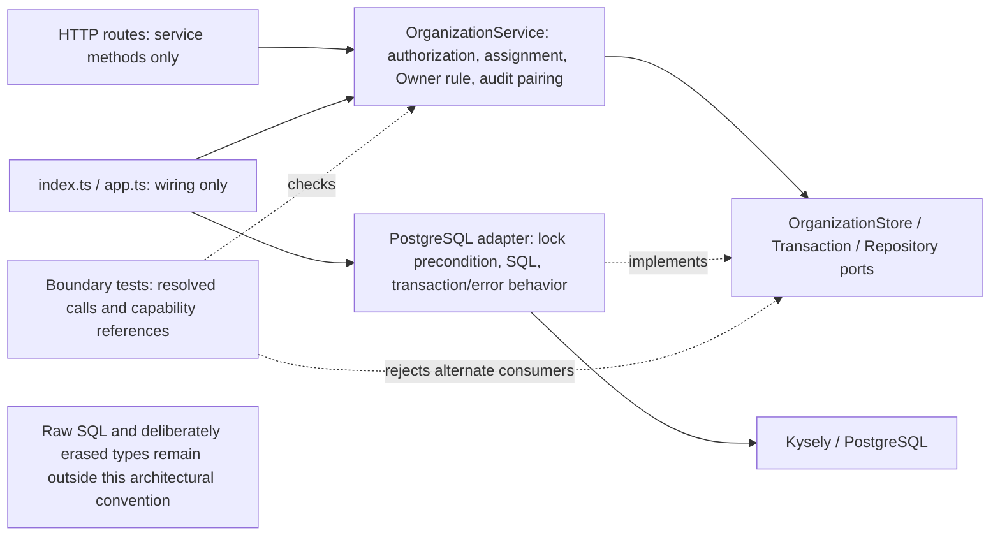

# LedgerFlow — Phase 2: Business Invariants & Transaction Safety

Date: **2026-10-21 (Africa/Cairo)**. Starting source baseline: `7e8e16023cefd6b46f960d1131ed8122418b328f`. Existing untracked review documents, including the completed [Phase 1 report](phase-1-postgres-verification.md), were preserved.

## 1. Executive Summary

**Verdict: PASS. Phase 2 is complete; Phase 3 is unblocked but has not been started.** Existing organization writers remain in `OrganizationService`. A small infrastructure guard now rejects existing-tenant mutation/Owner-check/audit calls unless that repository instance has successfully acquired its root write lock. Bootstrap remains limited to new roots created in the current creator-locked transaction.

A focused TypeScript-based architecture test detects alternate production consumers of the organization transaction/repository ports, including aliased/destructured/bracket calls. It also restricts persistence capability references and detects literal organization-table write calls outside the adapter. Authorization, Strict Option A, Owner retention, and matching audit orchestration remain service responsibilities; they were not duplicated in SQL or infrastructure.

Permanent PostgreSQL regressions cover callback failure, initial Owner insertion failure, audit failure, final idempotency persistence failure, complete rollback, and same-key retry/replay. Concurrency tests now observe real PostgreSQL lock waiters and use bounded authorization barriers, request deadlines, and guaranteed transaction release/settlement.

Final primary results: **120 passed, 0 failed, 0 skipped, 0 cancelled, 0 todo**: DB 28, API integration 50, API unit 34, web 8. Fresh build/lint/typecheck passed with zero cached tasks. A further organization-suite repeat passed 26/0/0. Execution used **Node 24.5.0 / npm 11.5.1 / PostgreSQL 16.11**. No schema, migration, dependency, lockfile, authentication policy, financial rule, isolation level, or public API contract changed. No commits or pushes were made.

## 2. Initial Risk Assessment

**Preventive hardening, not a newly discovered exploitable HTTP vulnerability.** Inspection confirmed all three current organization mutation entrypoints call the service. There is no other production consumer of `OrganizationStore.transaction`, `OrganizationTransaction`, or `OrganizationRepository`. Composition code only wires the dependencies. The existing raw repository could nevertheless be called without a root lock by a hypothetical future internal writer.

The new TDD regression demonstrated this missing internal precondition: before implementation, an unlocked `addMember` did not reject. That assertion caused callback rollback in the disposable test, so its test failure did not leave a committed mutation. Existing service rollback behavior was already correct. The new runtime guard prevents accidental omission of the lock; executable architecture checks help keep future callers within the service protocol.

**Explicit bound:** a trusted caller can still acquire a lock and deliberately use low-level methods without the service's capability/assignment/Owner/audit rules. TypeScript privacy, interfaces, module exports, and architecture tests are not a security boundary against arbitrary SQL, type erasure, or privileged database access. No universal invariant trigger, RLS, or generic unit-of-work framework was added.

## 3. Business Invariants Matrix

| Invariant | Enforcement in final code | Executed evidence |
| --- | --- | --- |
| **INV-01 Last active Owner** | Service `retainOwner` under the organization write lock; inactive Owners excluded. Adapter requires that lock for the predicate and role mutation. `service.ts:112–132`; `organization-store.ts:53–65`. | Sole Owner denial, inactive Owner exclusion, unchanged-role no-op, valid two-Owner demotion, rejected final demotion/no audit, and controlled concurrent self-demotion `[200,409]`. `organizations-postgres.test.mjs:424–462`. |
| **INV-02 Strict Option A** | Existing `policy.ts:5–15`, called by the service after post-lock authorization. Owner can assign all supported roles; Admin only standard roles and cannot edit self/Owners/Admins or promote to OWNER/ADMIN. | Existing complete assignment matrix and dynamic Viewer/Admin grants still cannot override structural restrictions. `organizations-postgres.test.mjs:277–391`; `capabilities.test.mjs:77–88`. |
| **INV-03 Authorized tenant access** | HTTP session authentication; service capability checks before/after root locking; active-membership factory; captured scope, parameterized predicates, trusted insert ownership, composite constraints. `routes.ts:19–39`; `service.ts:12–23`; `organization-store.ts:103–128`; `tenant-repository.ts:3–49`. | Unauthorized/inactive/foreign-tenant operations denied; foreign mutation remains 404 after acquiring the required lock; shared identities/pool reuse remain scoped. Tenant integration 10/0/0; existing organization HTTP cases passed. |
| **INV-04 Audit atomicity** | Service awaits matching audit in the mutation's transaction; unchanged roles/denials return without success history. Adapter validates trusted actor and enforces the write-lock precondition. PostgreSQL retains append-only/actor/target constraints. | Permanent callback/Owner/audit/final-idempotency rollback cases, complete table-count comparisons, same-key recovery, existing all-mutation audit-failure tests, and no-op/rejection audit assertions. `organization-write-safety-postgres.test.mjs:77–116`; `organizations-postgres.test.mjs:492–531`. |
| **INV-05 Authorization freshness** | Transaction-local capability snapshot explicitly invalidated after the root lock; refreshed READ COMMITTED query remains authoritative for that operation. `service.ts:12–23`; `capabilities.ts:14–43`. | Initial authorization observed, actual PostgreSQL blocking observed, grant/actor-role revocation committed, lock released, pending operation rejected with 403 and no member/success audit. `organizations-postgres.test.mjs:394–422,465–490`. |

Paths abbreviated above are under `apps/api/src/modules/organizations`, `apps/api/src/infrastructure`, or `apps/api/tests/integration` as named. Invariant policy remains in the service/domain boundary. The adapter does not independently authorize callers or verify audit pairing at callback completion.

## 4. Write-Path Inventory

All implemented production writes, explicit development/bootstrap exceptions, and organization transaction callers were searched. There are no implemented member-deletion/status-transition or organization-lifecycle endpoints.

| Operation | Entrypoint | Authorization | Lock/order | Transaction | Invariant | Audit | Risk/boundary |
| --- | --- | --- | --- | --- | --- | --- | --- |
| Create organization, initial Owner, creation response | HTTP `POST /organizations` → `service.create` (`routes.ts:23–25`, `service.ts:35–67`) | Authenticated active creator, validated input/key; no existing membership required | Global creator User `FOR UPDATE` → key lookup → new root/Owner inserts | One store READ COMMITTED transaction, return after commit | Bootstrap scope, one completed key response, active Owner | `ORGANIZATION_CREATED` in same transaction | Only roots inserted here receive bootstrap repository access; deliberately bypassing service remains trusted-code misuse |
| Replay creation | Same `service.create`, existing-key branch | Request hash/retention checks; current active creator membership rechecked | Creator User `FOR UPDATE` → existing root `FOR SHARE` → membership recheck | Same transaction; **no new business write** | Same response; different/expired key rejected | No extra event | Snapshot is historical, not fresh authority; uncertain-COMMIT recovery is not universally verified |
| Add member | HTTP `POST /:id/members` → `service.add` (`service.ts:97–109`) | Active tenant actor, `member:invite`, Strict Option A, active global target User | Initial authorization → root `FOR UPDATE` → refreshed authorization → target checks/write | One store transaction | Unique membership, trusted tenant, assignment | `MEMBER_ADDED` | Future writers must use this protocol; global target lookup is existence-only |
| Change role | HTTP `PATCH /:id/members/:userId` → `service.changeRole` (`112–125`) | `member:edit`, active actor, Strict Option A including protected targets | Root `FOR UPDATE` before refresh, target load, Owner predicate and update | One store transaction | Last active Owner, tenant/role limits | `MEMBER_ROLE_CHANGED` only for actual changes | Direct locked low-level calls can still bypass service policy; architecture check detects normal alternate consumers |
| Organization/membership reads and discovery | `service.get`, `members`, `list` (`71–94`) | Required tenant capability for scoped reads; discovery scoped by user | Scoped reads `FOR SHARE`; discovery has no root lock | The other **three** service calls to `OrganizationStore.transaction`; no writes | Scope and bounded pages | None | They do not receive write authority from a shared/read lock |
| Member insert/role update/Owner predicate/audit insert | Internal `ScopedOrganizationRepository` (`organization-store.ts:46–78`) | Service policy; factory captures active tenant identity; audit verifies actor | Runtime guard requires completed write lock on this instance; creator-locked new root exception | Uses enclosing transaction exclusively | Tenant predicates, actor scope; lock precondition | Service supplies matched event | Guard is not an independent Owner/assignment/audit-completeness engine |
| Root insert / creation-key insert | Internal transaction adapter (`organization-store.ts:144–166`) | `createOrganization` requires active creator lock; `saveCreation` validates created-root/creator scope | Creator before bootstrap writes | Enclosing service transaction | Scoped completed response; DB key/response constraints | Creation event is persisted by service before key | No standalone production caller; callback must await every operation |
| Session creation/rotation | Auth login → `PostgresAuthStore.createSession` (`auth-store.ts:21–32`) | Existing credential verification/active identity; replacement delete uses full selector/hash | Old credential delete → new insert; no organization lock | Separate auth transaction | Rotation rollback and credential scope | Session metadata; no organization business audit | Intentional global identity boundary; unchanged and covered by auth suite |
| Session logout/expiry cleanup | Auth logout / startup cleanup scheduler → auth store (`43–53`) | Full credential for logout; trusted bounded cleanup | Cleanup row locks with `SKIP LOCKED`, batch 1,000 | Single delete statement per call | Preserve live/foreign credentials | No organization business event | Global session operations; no organization lifecycle mutation; unchanged |
| Development fixture seed | Explicit guarded seed CLI → `packages/db/src/seeds/development.ts:7–29` | Local development administration; unusable password marker, CLI rejects production | New organization → user → membership | One seed transaction | Atomic new root/Owner chain, unique email | No organization command audit | Explicit fixture exception, not a runtime membership writer; does not demote existing Owners |
| Migrations/RBAC initial grants | Explicit migration CLI/provider (`packages/db/src/migrator.ts`) | Trusted deployment administration; no grant-writing HTTP API | Existing Kysely migration serialization | Existing transactional migrations | Schema and initial catalog constraints | No application mutation audit | Explicit administrative SQL boundary; no migration or grant-policy changes in this phase |

Search found exactly six organization store transaction calls, all in `service.ts:39,71,78,86,98,113`. The adapter's own Kysely transaction and auth/seed transactions are distinct. Startup `index.ts:25` constructs the store; `app.ts:65–67` injects it into the service; routes consume service methods. No production path was found bypassing the required authorization/invariants.

## 5. Implementation Changes

| File | Focused change / reason |
| --- | --- |
| `apps/api/src/infrastructure/organization-store.ts` | Repository-local `writeLocked` state, set only after an awaited successful `FOR UPDATE` query or a trusted current-transaction root insert. Guard add/change/Owner predicate/audit. Existing SQL, transaction isolation, error mapping, actor/tenant checks preserved. |
| `apps/api/src/modules/organizations/types.ts` | Document service ownership, lock/bootstrap preconditions, authorization refresh/policy/audit obligations, commit/rollback semantics, and callback lifetime; no signature/type-vocabulary change. |
| `apps/api/tests/integration/organization-write-safety-postgres.test.mjs` | New durable real-DB precondition and rollback/retry suite; unique schema, temporary CHECKs dropped in `finally`, pools/schema destroyed. |
| `apps/api/tests/integration/organizations-postgres.test.mjs` | Observe both competing lock waits; bound request/authorization waits; settle pending work on release/failure; add different-payload/expired-key contention and explicit valid/invalid two-Owner audit checks. |
| `apps/api/tests/integration/tenant-isolation-postgres.test.mjs` | Acquire required write lock in two existing direct-adapter tests; preserve foreign-target 404 and actor-substitution assertions. |
| `apps/api/tests/helpers/concurrency.mjs` | Test-only authorization observation, bounded promise wait, and actual lock-wait polling; no synchronization sleeps. |
| `apps/api/tests/organization-store-errors.test.mjs` | Deterministic `23505`/`40001`/`40P01`/unknown adapter failures and HTTP conflict/non-disclosure behavior. No expensive real deadlock fixture. |
| `apps/api/tests/organization-write-boundary.test.mjs` | Existing TypeScript compiler checks production port/capability ownership and literal table writes; synthetic aliased/destructured/bracket bypass proves detection. No new dependency. |
| `docs/features/organization-management.md`, `docs/03-high-level-architecture.md`, `docs/database.md` | Record runtime preconditions, service obligations, bootstrap exception, scope limits, and unchanged DB/architecture decisions. |
| `docs/reviews/phase-2-business-invariants.md` | This implementation/verification report and three diagrams. |

The original service/policies/capability resolver, authentication code, tenant base helper, API assembly/routes, migrations, manifests, and lockfile were not changed. Existing F01–F04 outward vocabulary/transport coupling and F05 correlated diagnostics were deliberately not refactored.

The five DB pillars were evaluated before implementation: **integrity** retains existing transactions/constraints with stronger mutation preconditions; **security** retains active tenant/actor scoping and service authority; **performance** adds only a local boolean check, no query/index; **scalability** introduces no global context/cache; **availability** retains existing per-root locks, pool/timeouts, and deployment behavior. No data migration/backfill or rollback plan is needed for schema changes because there are none.

DB checklist: schema/validation assessed and unchanged; no migration required; existing index patterns unchanged; tenant/authorization tests passed; transactions/idempotency retained; existing data/API callers assessed. Temporary failure constraints exist only in disposable test schemas.

## 6. Locking and Concurrency

READ COMMITTED and the per-organization serialization strategy remain unchanged. Existing-tenant access resolves capability before root lookup, acquires `FOR UPDATE` for mutations (`FOR SHARE` for reads), invalidates its request snapshot, then reloads authority before assignment/Owner checks. An unawaited lock request, read lock, another repository instance, or an earlier transaction cannot satisfy the new guard. The guard records completion only after a root row is returned.

Bootstrap locks the global creator User before key lookup; new roots are private uncommitted inserts. Replay subsequently takes the existing root's shared lock. Member mutations lock the root before membership checks/update and audit. No new lock order or global SERIALIZABLE change was introduced. Existing foreign-key locks still apply; arbitrary future writers could introduce inversions. No observed deadlock/serialization/timeout failure establishes universal deadlock freedom.

Controlled creation/Owner races hold the relevant User/root lock, start both HTTP attempts, and observe at least two dedicated-role PostgreSQL sessions actively waiting for locks before release. Revocation tests observe the pre-lock authorization read and at least one actual waiter before committing the grant/role change. The test cluster is dedicated and migration files serialized, so unrelated suite waiters do not satisfy these observations.

Wait/barrier deadlines are 2 seconds, HTTP requests 5 seconds, the organization parent suite 60 seconds, and write-safety parent suite 30 seconds. Existing production query/statement timeouts remain 3 seconds. Transaction callbacks release locks on any thrown timeout; `finally` settles started attempts, restores grants, and fixture cleanup destroys pools/schemas. No assertion was weakened or replaced by a sleep. These deadlines cover the modified coordination; they are not a universal bound on every possible operating-system/network failure.

Runtime sequence for an existing-tenant role mutation (the store/adapter implements the service's port):

```mermaid
sequenceDiagram
    participant H as HTTP/auth adapter
    participant S as OrganizationService
    participant P as Organization store/repository port
    participant D as PostgreSQL adapter + DB
    H->>S: changeRole(tenant, authenticated actor, target, role)
    S->>P: transaction(actor, callback)
    P->>D: BEGIN READ COMMITTED
    S->>P: active membership + capability check
    S->>P: scoped repository; organization(write)
    P->>D: SELECT root FOR UPDATE
    D-->>P: root returned; repository marks write lock acquired
    S->>P: invalidate snapshot; refresh authorization
    S->>S: assignment policy; no-op or Owner-retention check
    alt actual permitted mutation
        S->>P: scoped changeRole; matching audit
        P->>P: lock and trusted actor/tenant preconditions
        P->>D: UPDATE membership; INSERT audit
        P->>D: COMMIT after callback completes
        S-->>H: existing success DTO
    else denied or failed write
        P->>D: ROLLBACK on thrown callback
        S-->>H: existing mapped error; no success audit
    else unchanged authorized role
        P->>D: COMMIT with no mutation/audit
        S-->>H: existing membership DTO
    end
```

Runtime Owner-demotion serialization (both actors are initially active Owners; the strengthened test observes their lock waits):

```mermaid
sequenceDiagram
    participant A as Owner A service transaction
    participant R as Organization root lock
    participant B as Owner B service transaction
    A->>R: request FOR UPDATE
    B->>R: request FOR UPDATE; wait
    R-->>A: lock granted
    A->>A: refresh authority; another active Owner exists
    A->>A: demote A; append matching audit
    A->>R: COMMIT and release
    R-->>B: lock granted
    B->>B: refresh authority; A is now Admin
    B->>B: no other active Owner; reject demotion
    B->>R: ROLLBACK; release
    Note over A,B: Exactly one active Owner, one changed-role audit, responses 200 and 409
```

## 7. Transaction Atomicity

`organization-write-safety-postgres.test.mjs:77–116` permanently converts the important successful Phase 1 probes into tests:

- Throw the same sentinel Error after a successful organization insert through the real store; the error propagates and all four business table counts equal baseline.
- Inject a real PostgreSQL CHECK failure at initial OWNER insertion, creation audit insertion, or the final idempotency insert, after progressively more writes have occurred. Each expected `23514` leaves organization/membership/audit/idempotency counts unchanged.
- Remove each temporary constraint in `finally`; retry the same key successfully; verify exactly one additional row in each business table and identical replay without further rows.

Existing HTTP audit-failure injection for creation, member add, and role change still passes, including generic 503 and no partial success history. Session-rotation rollback and failed migration historical-data preservation also remain green. SQL CHECK injection uses trusted test table/constraint identifiers and a generated key, in a random disposable schema; historical migrations were not modified.

The adapter still awaits Kysely commit before resolving. These tests cover callback/statement failures, not every network interruption or uncertain COMMIT acknowledgment. No claim of universal recovery was added.

## 8. Tenant Isolation

The base tenant helper and existing composite constraints are unchanged. Captured user identity, active-membership factory, parameterized tenant predicates, trusted insert ownership, and audit actor/target consistency remain in force. Existing API tenant integration passed **10/0/0**, including 20 concurrent alternating-tenant transactions using the shared pool. Foreign membership mutations still return 404 without changing the other tenant; the test now obtains the required lock first so it continues testing tenant scope rather than stopping at the new guard.

Historical bad replay snapshots fail closed; global identities can have independent memberships in multiple tenants. The DB migration suite again rejects cross-tenant references and inconsistent creator/snapshot scope. RLS was not added: these are application authorization, repository scoping, and relational integrity guarantees, not row-level authorization for arbitrary SQL.

## 9. SOLID / Clean Architecture Impact

**Improved within scope:** runtime lock preconditions stay in infrastructure; services continue depending on their existing inward ports; the architecture test makes write ownership reviewable and executable. No new outward dependency was added to business code. No new layer, framework, repository hierarchy, DI container, generic unit of work, or aggregate was introduced.

- **SRP:** service remains policy/transaction/audit orchestration; adapter remains persistence/locks/error translation. Test helpers contain synchronization, not application logic.
- **OCP:** dynamic grants and the five-role assignment model are unchanged; no speculative extension framework.
- **LSP:** lawful service callers retain return/error/commit behavior; the existing implicit root-lock precondition is now explicit and checked. Tests demonstrate the bootstrap exception, missing/read/unawaited/other-instance lock rejection, rollback/error behavior, and unchanged tenant responses after satisfying the precondition.
- **ISP/DIP:** there is one cohesive current service consumer; splitting read/write ports would add machinery without another real consumer. Existing feature-specific ports were retained, documented as service-owned, and guarded by tests. Concrete wiring stays at startup/app assembly.

Compile-time dependency/wiring diagram; arrows below do **not** represent request execution. Runtime guards and service policies are annotated at their owning implementation:



Existing F01 DB-owned vocabulary, F02 HTTP-coded domain errors, F03/F04 auth coupling, and F05 logging correlation remain separate remediation. This phase improves protocol enforcement without claiming full Clean Architecture compliance.

## 10. Test Execution Matrix

All primary commands used **Node v24.5.0 / npm 11.5.1 / PostgreSQL 16.11**. This phase explicitly requested Node 24/npm 11, and those satisfy `package.json:5`; the recorded package-manager version remains npm 11.6.2. No engine or package-manager field was changed. The existing bundled npm CLI was called through a temporary launcher so the Windows global-prefix shim could not silently select npm 10. No download/install was necessary.

Database target: new native PostgreSQL cluster in this run's unique temporary directory; SQL verified its `data_directory`, PostgreSQL 16.11 server identity, loopback-only **127.0.0.1:62975**, empty initial user schemas/public tables, and dedicated `phase2_test` role/database `ledgerflow_phase2_test`. Role was non-superuser with no CREATEDB/CREATEROLE/replication and had schema CREATE permission. Generated credentials were not printed. No Docker/development volume was used.

The runner explicitly constructed `TEST_DATABASE_URL` for that target and set parent `DATABASE_URL` to `postgresql://127.0.0.1:1/phase1_forbidden`, preventing `.env` fallback. Existing lifecycle tests set their child URL to their own disposable schema. Temporary npm configuration/cache and offline/telemetry settings were process-local. DB files/suites ran sequentially using the existing scripts.

| Exact primary command from repository root | Pass | Fail | Skip | Runner duration / command wall time | Fresh/cache; exit |
| --- | ---: | ---: | ---: | --- | --- |
| `npm.cmd run build -- --force` | N/A | N/A | N/A | Turbo 20.403 s / 23.836 s | 4 successful, **0 cached**; 0 |
| `npm.cmd run test --workspace=@ledgerflow/db` | 28 | 0 | 0 | Node 5.424 s / 10.564 s | Fresh build/tests; 0 |
| `npm.cmd run test:integration --workspace=@ledgerflow/api` | 50 | 0 | 0 | Node 12.007 s / 17.490 s | Fresh build/tests; 0 |
| `npm.cmd run test --workspace=@ledgerflow/api` | 34 | 0 | 0 | Node 6.931 s / 13.035 s | Fresh build/tests; 0 |
| `npm.cmd run test --workspace=@ledgerflow/web` | 8 | 0 | 0 | Node 1.768 s / 2.358 s | Fresh tests; 0 |
| `npm.cmd run lint -- --force` | N/A | N/A | N/A | Turbo 15.974 s / 16.550 s | 6 successful, **0 cached**; 0 |
| `npm.cmd run typecheck -- --force` | N/A | N/A | N/A | Turbo 16.514 s / 17.171 s | 6 successful, **0 cached**; 0 |

**120 passing Node test entries, 0 failed/skipped/cancelled/todo.** PostgreSQL-backed entries are **78**: DB 28 + API integration 50. Node totals include parent tests and nested subtests, not 120 independent scenarios. API integration is auth 8, write safety 6, organization 26, tenant repositories 10. API unit coverage increased by 9 entries (7 conflict/HTTP tests + 2 boundary checks); integration increased by 8 (6 write-safety + 2 organization cases) from Phase 1's 103 total. Expected sanitized error events were emitted by deliberate failure tests; quality gates reported no new warning. Repository lint remains TypeScript/route diagnostics, not an independent security/style scanner.

Earlier focused executions and resolved test-development failures are recorded separately, not added to unique coverage or hidden:

| Command / stage | Pass/fail/skip | Result |
| --- | --- | --- |
| `npm.cmd run build --workspace=@ledgerflow/api` | N/A | Exit 0 before focused green run. |
| `node --test --test-concurrency=1 apps/api/tests/integration/organization-write-safety-postgres.test.mjs` — red | **4/2/0**, 1.563 s | Intended missing-lock rejection failed, also failing its parent. Demonstrated the old internal precondition gap; no confirmed HTTP exploit. |
| Same exact write-safety command — green | **6/0/0**, 1.674 s | New guard and all rollback cases passed. Final suite reran the strengthened unawaited-lock assertion too. |
| `node --test apps/api/tests/organization-store-errors.test.mjs apps/api/tests/organization-write-boundary.test.mjs` | **8/0/0**, 4.222 s | Initial focused unit checks, before adding the boundary check's negative fixture. |
| `node --test --test-concurrency=1 apps/api/tests/integration/organizations-postgres.test.mjs apps/api/tests/integration/tenant-isolation-postgres.test.mjs` | **36/0/0**, 6.073 s | Strengthened races and preserved tenant assertions. |
| `node --test apps/api/tests/organization-write-boundary.test.mjs` — initial negative fixture | **1/1/0**, 9.417 s | Low-severity test-harness issue: Windows slash mismatch omitted the virtual fixture, so its expected detection failed. No production defect. |
| Same exact boundary command — corrected | **2/0/0**, 5.799 s | Normalize fixture paths and assert fixture inclusion; aliases/destructured/bracket calls detected. Final unit gate also passed the literal-write assertion. |
| `node --test --test-concurrency=1 apps/api/tests/integration/organizations-postgres.test.mjs` — final repeat | **26/0/0**, 4.027 s | Third successful execution of modified organization races, after focused and full runs; no observed flakiness. |

No failures were skipped, assertions weakened, or errors silently reclassified. No production source fix was needed for conflict mapping; it was already correct and now has focused regression coverage. Browser E2E, production failover/restore, performance/load, dependency audit, and ambiguous-COMMIT fault injection were not run.

Cleanup reverified cluster identity and **zero residual test schemas, zero public tables, zero other connections**. Server stop succeeded; status reported no server (expected exit 3). Only checked absolute paths under this run's exact directory were removed: disposable data, credentials, temporary launcher/cache/configs. Earlier test resources, system binaries, development data, and review reports were preserved. Normal ignored build artifacts remain. Credential-free logs, preflight hashes, execution results, and cleanup evidence remain in:

```text
C:\Users\youse\AppData\Local\Temp\ledgerflow-phase2-90e8d04db8c54c8999370d529b161560
```

## 11. Remaining Risks

1. **Proven boundary limit:** acquiring a lock alone does not authorize or enforce Owner/assignment/audit policy. The sole supported service writer does; architecture tests reject ordinary alternate consumers. Deliberate SQL, raw tagged SQL/dynamic table names, erased types, or intentional changes to the test allowlist are not universally prevented. Any additional writer needs explicit review and invariant tests.
2. **Point-in-time freshness:** revocation committed before the post-lock query is observed. Logout, global identity inactivation, or grant changes after that query do not instantly cancel an authorized transaction. No lifecycle policy was invented.
3. **Future writer races:** no deletion/inactivation/suspension API exists. Combined future lifecycle/removal/role races are not implemented or verified. Current per-root protocol must be shared or deliberately redesigned before such writers are introduced.
4. **Audit/Owner policies are application-owned:** the adapter does not count pending audits at callback completion, and PostgreSQL has no universal last-Owner trigger. The development seed is an explicit non-command fixture exception. No protection against a schema owner disabling guards is claimed.
5. **Operational limits unchanged:** no production least-privilege/TLS/proxy/failover/restore or representative contention evidence. Migration 005's PostgreSQL 16 stored-column rewrite/maintenance-window exception and reviewed timeout requirements remain. No zero-downtime production claim follows from disposable fixtures.
6. **Deferred architecture/diagnostics:** F01–F04 and Medium F05 remain; no new confirmed Critical/High defect. F05 again emits uncorrelated sanitized expected-error events. Generic frameworks/RLS remain unjustified by this phase's evidence.

## 12. Phase 2 Exit Criteria

- [x] **PASS** — Current mutation paths and every organization store transaction caller inventoried, including auth/development/administrative exceptions.
- [x] **PASS** — INV-01 through INV-05 and runtime versus application/DB enforcement boundaries documented.
- [x] **PASS** — No confirmed current production path bypasses authorization or mandatory invariants; executable port-consumer check passes.
- [x] **PASS** — Minimal runtime lock precondition and focused architecture guard implemented and tested, with explicitly bounded policy/audit/SQL limitations.
- [x] **PASS** — Last active Owner retention passes observed real PostgreSQL contention tests.
- [x] **PASS** — Strict Option A and five-role behavior preserved under dynamic grants.
- [x] **PASS** — Post-lock capability and actor-role revocation tests pass with bounded synchronization.
- [x] **PASS** — Current mutation/audit atomicity passes regression tests; no-op/denial creates no success audit.
- [x] **PASS** — Callback, initial Owner, audit, and final idempotency rollback probes are permanent PostgreSQL tests.
- [x] **PASS** — Tenant isolation, trusted inserts, composite references, and actor attribution remain verified.
- [x] **PASS** — Modified concurrency tests use observed waits, deadlines, deterministic lock release, and settlement/cleanup.
- [x] **PASS** — No new Clean Architecture dependency violation introduced; service/policy boundaries preserved.
- [x] **PASS** — All seven applicable gates pass with Node 24/npm 11/PostgreSQL 16; forced Turbo checks fresh.
- [x] **PASS** — No unresolved confirmed Critical/High defect identified; no hidden/skipped failure.
- [x] **PASS** — Evidence, resolved development failures, remaining risks, and three final-code Mermaid diagrams recorded.

## 13. Final Verdict

**PASS — Phase 2 complete. Phase 3 is unblocked under its own authorized scope; it was not started here.** The existing write protocol is clearer, accidental unlocked adapter use fails at runtime, ordinary alternate application consumers are caught by tests, and previously temporary rollback observations are durable regressions. No existing business rule, endpoint, response/error contract, schema, or isolation strategy was changed. Keep the documented limitations and separate production deployment gates; do not interpret this milestone as universal database enforcement or a full architectural refactor.
