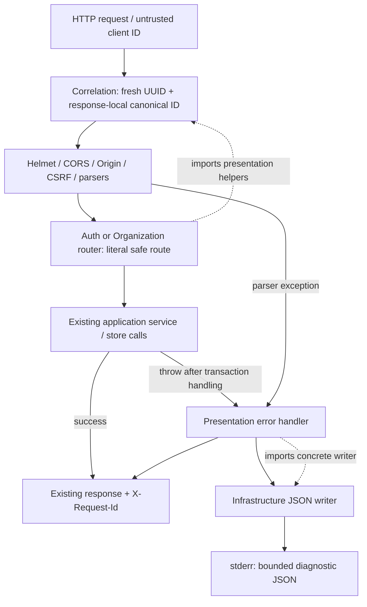
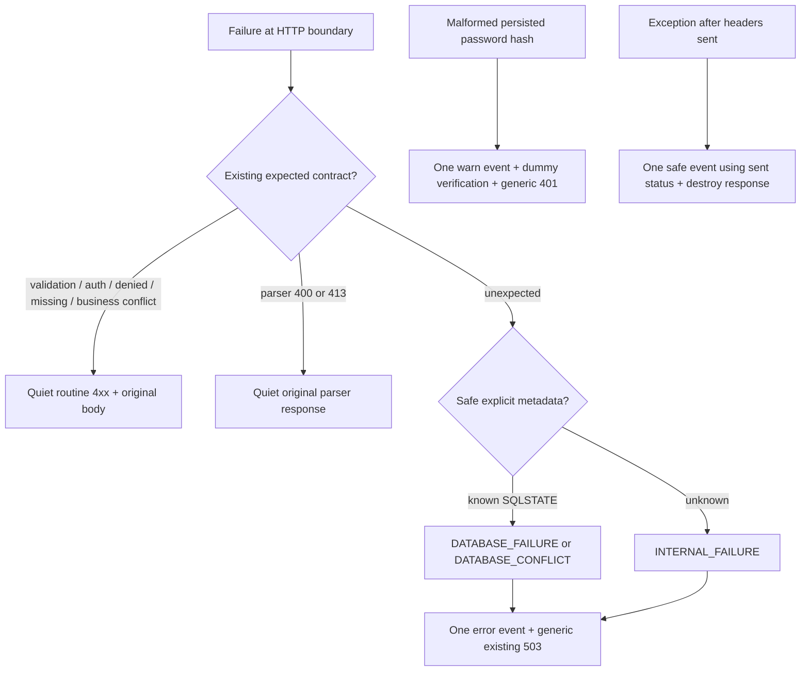
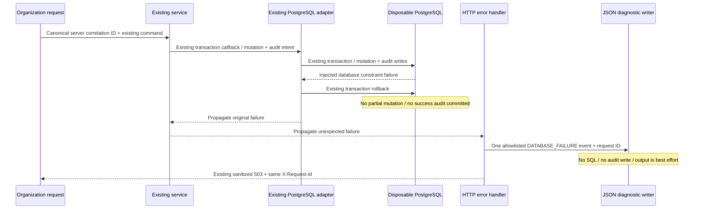

# LedgerFlow — Phase 3: Observability & Structured Logging Hardening

Verification date: October 21, 2026. Scope: F05 only, on top of the completed Phase 2 working tree (Git HEAD `7e8e16023cefd6b46f960d1131ed8122418b328f`). Earlier reports remain historical evidence. No commit or push was made.

## 1. Executive Summary

**PASS — Phase 3 complete.** F05 is addressed with early server-generated request IDs, a small allowlisted JSON writer, presentation-owned failure classification, and regression tests that inspect emitted output. All **138 test entries passed, zero failed/skipped/cancelled**, and forced build/lint/typecheck passed with zero cache hits. API response bodies/statuses, authentication policies, Organization invariants, transaction ownership, locks, migrations, and database schemas are preserved. Phase 4 is unblocked and has not started.

## 2. Original F05 Finding

The original central handler emitted only `level` and `event`. Unrelated unexpected failures were indistinguishable: no request ID, safe route, method, status, timestamp, or category. Organization-only correlation missed Auth, health, unmatched paths, and some middleware responses. Failed transactions correctly lack success audits, so business audit history could not diagnose those failures. The safe omission of raw exceptions is retained.

## 3. Observability Inventory

| Component | Before / gap | Implemented behavior |
| --- | --- | --- |
| Express middleware | Organization-prefix UUID; missing API-wide coverage | Global correlation before Helmet/CORS, Origin/CSRF, JSON/cookie parsing, authentication, and rate limiting; relative security ordering unchanged |
| Auth routes/session middleware | Minimal unexpected-failure event; malformed Argon2 hash had an uncorrelated event | Central correlated event for lookup, session creation/rotation, logout persistence, and authentication-store failures; one correlated malformed-hash warning |
| Organizations | Audit ID read from response header; generic failure event | Immutable response-local canonical ID feeds both audit actor and diagnostics; literal safe templates; existing replay/audit semantics |
| PostgreSQL adapters | Existing transaction/error translation; no request context | Unchanged; errors propagate to HTTP boundary; approved SQLSTATE metadata classified there, without SQL or exception serialization |
| Central handler | Sanitized responses; minimal stderr; delegated partial responses to Express | Same safe status/body mapping; one failure event; close partial responses without a second body or raw default stack output |
| Expected failures | Existing validation/auth/permission/conflict/limiter responses | Quiet routine 4xx, including 429; no identity-level credential tracing |
| Health | DB outage swallowed into established DOWN response | One correlated dependency failure event; identical DOWN response |
| Session cleanup | Minimal process failure event | Structured process event; no fabricated request context; scheduling, batch size, and stop semantics unchanged |
| API lifecycle | Plain startup/shutdown failure messages; no positive events | Structured start/stop info and operational failure events; same shutdown/exit behavior |
| DB package / administrative CLIs | Fixed sanitized idle-pool message; migration/seed operational text | Unchanged outside this HTTP/API logger; not falsely represented as structured or correlated |
| Startup configuration validation | Fail-fast exceptions before listening | Unchanged; not converted into request events |

## 4. Request Correlation Design

`correlateRequest` calls Node's cryptographic `randomUUID()` once per request, defines a non-writable response-local `requestId`, and sets `X-Request-Id`. It never reads the client's ID. The Organization actor reads the same trusted local value; successful audit correlation therefore matches the response. Replays get fresh request IDs without creating another business audit.

CORS still exposes `X-Request-Id` to the allowed origin and retains its existing permitted request headers/methods. Correlation covers health, Auth, Organization, unmatched 404, preflight, origin/CSRF/content-type rejection, parser errors, and throttling when Express receives the request. Rejections before Express, a disconnected client, or a socket that cannot send headers cannot be promised a usable response header. There is no AsyncLocalStorage or global mutable request context.



Solid arrows show runtime flow; dotted arrows show source dependencies. Services do not import the HTTP diagnostics or logger.

## 5. Structured Logging Design

The writer emits newline-delimited JSON, with an ISO UTC `timestamp`, allowlisted `level`, and stable `event`. HTTP failure events additionally contain `requestId`, `method`, `route`, `statusCode`, and `errorCategory`. `headersSent: true` appears only for a partial response. Process events contain timestamp/level/event and, for failures, a category; they have no invented request ID.

| Events | Level / channel |
| --- | --- |
| `api_request_failed` | error / stderr |
| `password_hash_verification_failed` | warn / stderr |
| `session_cleanup_failed`, `api_start_failed`, `api_shutdown_failed`, `database_shutdown_failed` | error / stderr |
| `api_started`, `api_stopped` | info / stdout |

The writer rebuilds records from explicit fields. It accepts UUIDv4 strings, a fixed HTTP-method set (fallback `OTHER`), integer statuses 100–599 (fallback 500), literal routes, and the categories below. Invalid IDs fall back to `unavailable`; extra fields are ignored. Nothing spreads or serializes the input exception/request. Payloads over 2,048 UTF-8 bytes are dropped.

Safe routes: `/health`, `/auth/login`, `/auth/logout`, `/auth/me`, `/organizations`, `/organizations/:id`, `/organizations/:id/members`, `/organizations/:id/members/:userId`, `organizations_authentication`, and `unmatched`. Organization router-level authentication happens before route matching, so its stage identifier preserves that ordering. Early parser errors use `unmatched`; raw paths/queries are never substituted.

Output is best effort: synchronous sink errors, rejected promises, serialization/clock failures, write callbacks, and standard-stream error events cannot recursively log or replace an operation's result. No retries, collector, queue, dependency, persistence guarantee, or application-wide logging abstraction was introduced.

## 6. Error Classification

| Existing error / trusted metadata | Category | Event / unchanged response |
| --- | --- | --- |
| OrganizationError 400 | `VALIDATION_FAILURE` | Quiet; existing 400 body |
| OrganizationError 401 | `AUTHENTICATION_FAILURE` | Quiet; existing 401 body |
| OrganizationError 403 | `AUTHORIZATION_FAILURE` | Quiet; existing 403 body/non-disclosure |
| OrganizationError 404 | `RESOURCE_NOT_FOUND` | Quiet; existing 404 body |
| OrganizationError 409, including adapter-translated conflicts | `BUSINESS_CONFLICT` | Quiet; existing 409 body |
| Parser status 400 / 413, including inherited status | `VALIDATION_FAILURE` | Quiet; existing Invalid JSON / body-too-large response |
| Untranslated SQLSTATE `40001` / `40P01` | `DATABASE_CONFLICT` | Error; existing generic 503 mapping |
| SQLSTATE `23502`, `23503`, `23505`, `23514`, `22P02`, `42P01`, `42703`, `53300`, `57P01`, `08000`, `08003`, `08006`, `XX000` | `DATABASE_FAILURE` | Error; existing generic 503 mapping |
| Failed dedicated health DB-check port | `DATABASE_FAILURE` | Error; established health DOWN 503 body |
| Unknown callback/exception/code | `INTERNAL_FAILURE` | Error; existing generic 503 body |
| Unexpected malformed persisted Argon2 hash | `INTERNAL_FAILURE` | Warning; dummy verification and generic invalid-credentials 401 |

Only data properties are examined for status/code, with bounded prototype traversal and no invocation of exception getters. Original messages, SQL details, causes, and stacks are not classifiers. A generic 503 is not assumed to be a database outage. Auth's explicit 400/401/429 and middleware's explicit 403/415 remain quiet. No error taxonomy refactor of F02 was attempted.



## 7. Security and Redaction

Tests inspect actual serialized output, including the default stderr stream and a child process's real stdout/stderr. Synthetic markers cover login password, Argon2 hash, session cookie/token, bearer/Authorization secret, email/name/user ID, idempotency key, body values, SQL, database password/URL, error message/cyclic cause, and attacker path/query. They are absent from emitted records. Every tested request failure has valid JSON, required fields, the response's canonical server ID, safe template/method, category, timestamp, and severity. Concurrent failures are matched by response ID, not execution order.

Extra objects, exception `toJSON`, unsafe strings, and an object pretending to be a UUID are rejected/ignored rather than recursively sanitized. No raw exception reaches Express's default handler on the partial-response path. Unknown errors retain generic client responses. Expected errors and throttling do not produce misleading internal-failure events. No account-existence tracing was added.

## 8. Implementation Changes

Phase 3's complete file inventory (earlier uncommitted Phase 1/2 work is excluded):

| File | Purpose |
| --- | --- |
| **Added** `apps/api/src/infrastructure/logger.ts` | Primitive allowlists, bounded JSON, severity/channels, output failure containment |
| **Added** `apps/api/src/presentation/request-diagnostics.ts` | Canonical context, safe templates, error classification, centralized handler |
| `apps/api/src/app.ts` | Early correlation, diagnostics dependency wiring, health/error boundary integration |
| `apps/api/src/modules/auth/routes.ts` | Route identity and malformed-hash diagnostic callback |
| `apps/api/src/modules/auth/password.ts` | Optional failure notification preserving verification/fallback behavior |
| `apps/api/src/modules/organizations/routes.ts` | Canonical audit actor context and safe templates |
| `apps/api/src/infrastructure/session-cleanup.ts` | Structured process failure event |
| `apps/api/src/index.ts` | Structured API lifecycle events |
| **Added** `apps/api/tests/request-correlation.test.mjs` | Four request correlation/compatibility/default-output tests |
| **Added** `apps/api/tests/observability.test.mjs` | Thirteen classification/redaction/concurrency/output failure tests |
| `apps/api/tests/integration/organizations-postgres.test.mjs` | Extend existing three audit-failure probes; add one creation/replay/transport regression |
| `apps/api/tests/integration/auth-postgres.test.mjs` | Assert structured source/compiled start/stop output, retaining previous assertions |
| `docs/authentication.md` | API-wide correlation and diagnostic confidentiality contract |
| `docs/03-high-level-architecture.md` | Implemented diagnostic responsibilities and audit separation |
| **Added** `docs/reviews/phase-3-observability.md` | This evidence report and three Mermaid diagrams |

No package manifest, dependency, lockfile, migration, schema, service, policy, store implementation, authentication/session contract, or financial rule was changed by Phase 3. SHA-256 comparison against the pre-Phase-3 working-tree snapshot distinguishes these edits from earlier uncommitted work.

## 9. Clean Architecture / SOLID Impact

Presentation owns UUIDs, HTTP context/templates, classification, and response mapping. Infrastructure owns output and lifecycle integration. Organization services/policies/stores remain unchanged. Auth's existing Express router remains presentation code; the password helper receives only a small optional callback and does not import the logger. No application/domain consumer requires a new logger port.

- **SRP:** diagnostics are separate from business orchestration and transaction persistence.
- **OCP:** category/template allowlists are maintained in two focused files without changing services.
- **LSP:** existing store contracts, propagation, and transaction behavior are unchanged and regressions pass.
- **ISP:** one small concrete `log` surface; no oversized interface or DI framework.
- **DIP:** no new Express or concrete logging import in domain/application services. Existing F01–F04 findings remain explicitly deferred to Phase 4, not silently refactored.

The existing executable Organization write-boundary tests remain intact and pass, including aliased/destructured/bracket-call bypass probes. This is bounded architectural evidence, not a proof about every possible future module.

## 10. Transaction and Audit Safety

Diagnostics run at the HTTP boundary after the existing adapter's transaction handling. They perform no SQL and do not add an audit event. The dedicated PostgreSQL tests inject audit CHECK failures for creation, membership addition, and role changes; all preserve the original generic 503, emit exactly one `DATABASE_FAILURE` event matching the response ID/template, and retain the existing assertions for unchanged membership, organization count, audit count, and absent failed-creation idempotency record. Constraint/SQL/private identifiers are absent from those events.

The additional real-DB creation/replay case uses a broken diagnostic sink: creation commits, replay returns the same snapshot, only one business audit exists, spoofed IDs are ignored, and that audit retains the original creation response's correlation ID. Replay has a fresh HTTP ID. Successful operations deliberately do not emit per-request diagnostics. A separate unit/HTTP test actually triggers failing output, then confirms successful login/cookie issuance; other tests exercise failure handling and cleanup with throwing/rejecting sinks.

Phase 2's callback, initial Owner, final idempotency-write rollback, last-Owner contention, Option A, post-lock revocation, tenant isolation, runtime write-lock guard, and audit atomicity tests run unchanged. No isolation level, lock order, retry policy, authorization refresh, or commit/rollback ownership changed.

Database pillars: **integrity**—no schema/write change and atomicity regressions; **security**—no diagnostic identities/secrets/SQL and tenant/RBAC regressions; **performance**—no added queries/transactions, bounded fields; **scalability**—per-response context with no shared mutable request state; **reliability**—best-effort non-recursive output cannot alter business results. DB-change checklist: schema/migration/index changes **not applicable**; tenant/authorization and transactions/idempotency verified; existing data protected by an independently provisioned disposable cluster.



## 11. Test Execution Matrix

The final run used the following exact commands, in this order. Counts use Node's reported test entries, including enclosing tests with subtests, consistently with the Phase 2 baseline; they are not counts of individual assertions. Test durations below are the runner's `duration_ms`; gate wall time also includes npm and prerequisite compilation.

| Command | Passed / failed / skipped | Exit | Gate wall ms | Test runner ms / cache |
| --- | --- | --- | --- | --- |
| `npm.cmd run build -- --force` | 4/4 tasks | 0 | 18,584 | 0 cached / 4; remote cache disabled |
| `npm.cmd run test --workspace=@ledgerflow/db` | 28 / 0 / 0 | 0 | 10,964 | 5,761.3234; real execution |
| `npm.cmd run test:integration --workspace=@ledgerflow/api` | 51 / 0 / 0 | 0 | 25,425 | 12,834.2912; real execution |
| `npm.cmd run test --workspace=@ledgerflow/api` | 51 / 0 / 0 | 0 | 19,676 | 12,087.7578; real execution |
| `npm.cmd run test --workspace=@ledgerflow/web` | 8 / 0 / 0 | 0 | 3,189 | 2,499.1765; real execution |
| `npm.cmd run lint -- --force` | 6/6 tasks including prerequisites | 0 | 20,485 | 0 cached / 6; remote cache disabled |
| `npm.cmd run typecheck -- --force` | 6/6 tasks including prerequisites | 0 | 19,365 | 0 cached / 6; remote cache disabled |

**Total: 138 passed / 0 failed / 0 skipped / 0 cancelled / 0 todo.** The increase from 120 is 17 new API tests and one new PostgreSQL integration subtest. Existing assertions were retained; existing audit-failure and lifecycle cases gained assertions. No quality-gate warning was introduced; expected synthetic failure diagnostics appear in test output and are not failed tests. Git's existing LF/CRLF conversion notices are separate from quality-gate diagnostics; `git diff --check` passed.

Toolchain: Node **24.5.0**, npm **11.5.1**, PostgreSQL **16.11** (Visual C++ 1944, 64-bit). Root engines require Node `>=24 <25` and npm `>=11 <12`; `packageManager` records npm 11.6.2. The already installed npm 11.5.1 is supported and matches Phase 2; 11.6.2 was not safely present. A temporary `npm.cmd` wrapper invokes the installed Node/direct npm CLI, avoiding the unrelated global npm 10 shim. No download, installation, dependency/lockfile change, or system-wide replacement occurred. npm is offline with empty isolated configuration/cache; telemetry/update notifications are disabled.

Fresh native cluster: unique run-owned temp directory, explicit `initdb` with SCRAM passwords, `listen_addresses=127.0.0.1`, port **52766**, database `ledgerflow_phase3_test`, role `phase3_test`. `SHOW data_directory`, server version, address/port, database, and current role were checked. The test role is not superuser and cannot create databases/roles or replicate; it owns only this new test database and can create test schemas. Initial user schemas/public tables were zero. No Docker, external provisioning, or development connection was used.

The initial native startup command reported a ready server but its wrapper did not resume. A separate local provisioning command verified that exact run-owned data directory and completed only the dedicated role/database, then verified the preflight above. After shutdown, the original blocked wrapper resumed, its connection to the now-stopped test port was refused, and it exited 1 without altering another database. This was an orchestration issue, not a failed application test or a reason to use a shared database; the completed preflight and all gates used the independently verified test instance.

`TEST_DATABASE_URL` is explicitly constructed from this run's generated credentials. Runner `DATABASE_URL` is deliberately invalid (`127.0.0.1:1/phase1_forbidden`); no fallback is allowed. The existing auth entrypoint fixture explicitly sets its child's `DATABASE_URL` to a random schema on this same disposable test connection because the production entrypoint requires that variable. DB and API integration gates run one after the other, and both use existing `--test-concurrency=1`; random schema setup/finally cleanup is retained. Other gates also run sequentially. No test is disabled or skipped.

Development evidence (not final-gate totals):

| Execution | Result / investigation |
| --- | --- |
| Initial `node --test apps/api/tests/request-correlation.test.mjs` before implementation | 1 passed / 3 failed / 0 skipped; exposed missing health/Auth/concurrent correlation |
| First implementation correlation run | 3 passed / 1 failed / 0 skipped; 413 parser mapping regressed to 503 because status was inherited; fixed data-descriptor prototype lookup, keeping the 413 assertion |
| First combined focused run | 11 passed / 1 reported failed; Auth-on-Organization fixture had not mounted Organization router (404); additionally stdout mocking disturbed runner reporting of later cases. Fixed fixture and moved stdout/stderr channel verification into a child process; no production response change |
| Corrected focused run | 17 passed / 0 failed / 0 skipped; 1,809.1446 ms |
| Preliminary complete gate run | 138 passed / 0 failed / 0 skipped, all seven gates green; superseded by final rerun after primitive-ID guard and stronger successful-login/output-failure assertion |

No early failure was hidden or converted into a skip. Representative performance/load, real production HTTPS/proxy cookies, deployment collectors, and failover/restore were not tested.

Cleanup passed: verified the same `data_directory`, **0 leftover test schemas, 0 public tables, 0 other connections**, stopped that cluster, and verified `pg_ctl status` exit 3 (not running). Removed only this run's data directory, generated password files, temporary npm wrapper/configuration, and isolated npm cache after checking absolute paths stay under the exact run root. No development database or pre-existing temporary resource was cleaned.

Raw gate logs, preliminary results, development red/green logs, `execution-results.json`, and `cleanup-evidence.json` remain outside the repository at:

```text
C:\Users\youse\AppData\Local\Temp\ledgerflow-phase3-712d55477ae440e9acad8b6702a3cc83
```

Installed runtimes are unchanged. Hash comparison verified that every pre-existing working-tree file outside the ten intentionally modified existing files in section 8 is unchanged, including the Phase 1/2 reports, Phase 2 runtime guard/contract/helper/boundary tests, stores/services/policies, manifests, lockfile, and migrations. This report and four new source/test files are the additional Phase 3 files.

## 12. Non-Functional Requirements

| Requirement | Status | Evidence / limit |
| --- | --- | --- |
| Observability | VERIFIED for Phase 3 HTTP scope | Correlated classified events, lifecycle output, literal templates, concurrent IDs; best-effort delivery |
| Security | VERIFIED for covered diagnostic boundaries | Actual-output secret-marker absence, explicit allowlists, generic responses, tenant/auth regressions; deployment security not claimed |
| Reliability | VERIFIED for tested output failure modes | Throwing/rejecting sinks, invalid clock/serialization, stream errors, partial-response close, rollback/cleanup regressions; no durability guarantee |
| Maintainability | VERIFIED within current scope | Two focused helpers, no dependency/framework, stable schema, preserved service/store boundaries |
| Testability | VERIFIED | Injected clock/output, real HTTP capture, child output, real PostgreSQL failures, deterministic concurrency/deadlines |
| Performance | PARTIALLY VERIFIED | Bounded record fields and prototype traversal; no new SQL/transactions/arbitrary-object serialization; no representative benchmark |
| Scalability | PARTIALLY VERIFIED | Per-response context and concurrent isolation tests; no production multi-replica/backpressure/load test |

## 13. Remaining Risks

1. Diagnostic output is best effort and can be lost when streams fail or the process exits. Node's standard streams can buffer under sustained backpressure; the per-event cap is not a durable bounded logging pipeline. No collector, delivery acknowledgment, sampling policy, or performance benchmark is claimed.
2. Failures before Express, before startup configuration completes, or after connection loss may lack a response correlation header. Partial responses retain the already-sent status and close; the logged status is not rewritten to 503.
3. The fixed DB idle-pool message and administrative migration/seed text are outside this API logger and remain uncorrelated/plain. No dependency from the reusable DB package back into the API was introduced.
4. Routine 4xx and rate-limit outcomes intentionally remain quiet. Diagnostics are not a comprehensive security/access audit, and no sensitive identity trace is retained. New routes/categories must extend the explicit allowlists.
5. Unknown failures remain `INTERNAL_FAILURE`; this favors honest safe classification over guessing a dependency from the status or message. No stack/SQL details are available in normal events.
6. F01–F04, production privilege/TLS/proxy/shared throttling, migration 005's documented maintenance exception, representative contention, and restore/failover evidence remain separate work. Existing Phase 2 limits concerning deliberate alternate SQL writers and future lifecycle races remain unchanged. No confirmed unresolved Critical/High defect was identified in this scope.

## 14. Phase 3 Exit Criteria

| Criterion | Status | Evidence |
| --- | --- | --- |
| Existing observability paths inventoried | PASS | Section 3; API and DB/CLI exclusions explicit |
| Canonical request IDs consistently server-generated | PASS | UUIDv4, spoof rejection, concurrent success/failure tests |
| Applicable HTTP responses expose X-Request-Id | PASS | Health/Auth/Organization/404/preflight/parser/security/limiter cases |
| Organization audit correlation correct | PASS | Creation/role audit assertions, real-DB spoofed creation and replay |
| Structured JSON logging implemented | PASS | Actual stream/serialized-output tests and source/compiled lifecycle tests |
| Unexpected failures safely classified | PASS | Explicit SQLSTATE/business metadata and unknown fallback tests |
| Safe method/route identifiers recorded | PASS | Literal templates, stage/unmatched fallbacks, attacker path/query markers absent |
| Auth and Organization failure paths covered | PASS | Lookup/session/rotation/logout/middleware/hash and three Organization mutations |
| Client bodies/statuses remain compatible | PASS | Existing full regression suite and focused exact-body/status assertions |
| Expected 4xx not misclassified as internal errors | PASS | Quiet validation/auth/denied/missing/conflict/limiter assertions; malformed-hash infrastructure warning explicitly separate |
| Raw exceptions/sensitive requests not logged | PASS | Primitive reconstruction; no messages, causes, stack, SQL, or request serialization |
| Redaction tests prove synthetic secrets absent | PASS | Emitted output tested with distinctive secret markers |
| Logging failures do not break business operations | PASS | Throw/reject/clock/stream tests, successful login, DB creation/replay, failed-response and cleanup assertions |
| Rollback and audit atomicity correct | PASS | All three real-DB audit failure injections plus unchanged Phase 2 probes |
| Tenant isolation/authorization no regression | PASS | Real PostgreSQL tenant, five-role/Option A, dynamic grant/revocation, and Owner concurrency suites |
| No new Clean Architecture dependency violation | PASS | Service/store/policy hashes unchanged; presentation/output separation and executable boundary checks |
| All new and existing tests pass | PASS | 138/0/0, no skips/cancellations |
| Supported-toolchain build/lint/typecheck pass | PASS | Node 24.5.0/npm 11.5.1, forced 4/6/6 tasks with zero cache hits |
| No unresolved confirmed Critical/High defect | PASS within reviewed scope | No such defect identified; remaining bounded/deployment risks in section 13 |
| Documentation/diagrams reflect implementation | PASS | Sections 4/6/10 diagrams, exact file inventory, final evidence and limitations |

## 15. Final Verdict

**PASS — Phase 3 complete; F05 resolved for the implemented API boundary. Phase 4 is unblocked and was not started.** All 138 test entries and seven gates pass under the supported toolchain, disposable resources are cleaned, and previous verification evidence is preserved. This closes the scoped diagnostics gap; it does not certify production deployment observability, performance, or universal SQL-writer enforcement. No confirmed remaining Phase 3 defect/blocker was found.
