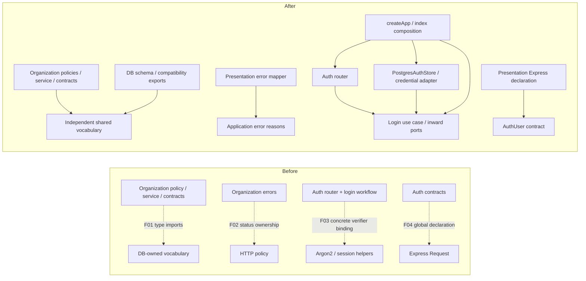
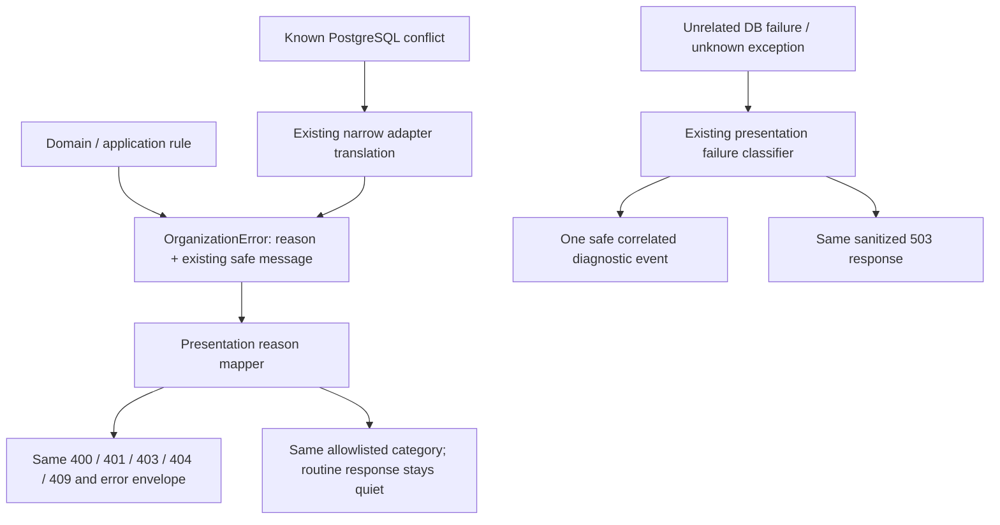
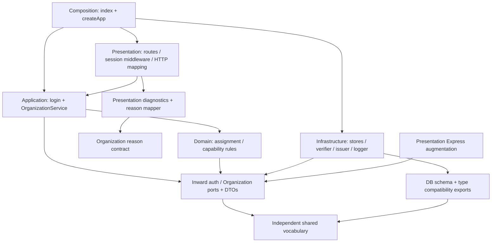
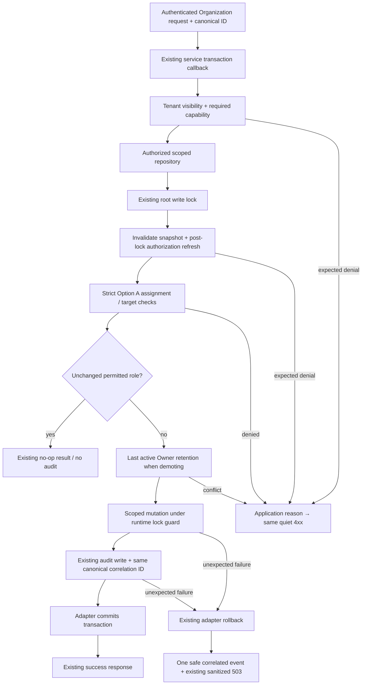

# LedgerFlow — Phase 4: Clean Architecture & SOLID Refactoring

Date: October 21, 2026. Scope: implemented Authentication/Organizations and F01–F04/F06. Baseline: completed Phase 3 working tree, Git HEAD `7e8e16023cefd6b46f960d1131ed8122418b328f`. Earlier uncommitted work and review reports are preserved. No commit or push was made.

## 1. Executive Summary

**PASS.** F01–F04 are resolved within the implemented scope; F06 now has executable dependency governance and negative fixtures alongside the unchanged Phase 2 write-boundary tests. The modular monolith, existing HTTP contracts, authorization rules, database schema/migrations, locking, transaction ownership, audit/idempotency, and Phase 3 diagnostics remain intact.

All **155 test entries passed, zero failed/skipped/cancelled**, on Node **24.5.0**, npm **11.5.1**, and fresh disposable PostgreSQL **16.11**. Forced build/lint/typecheck passed with zero Turbo cache hits. The disposable instance and generated credentials were cleaned. Continued financial-feature development is unblocked; no financial module was implemented here and production deployment readiness is not claimed.

## 2. Initial Architecture Baseline

Reviewed the original architecture review, Phases 1–3 reports, domain model, high-level architecture, database/authentication guides, Organization feature contract, source, exports, workspace manifests/lock metadata, TypeScript configurations, and test scripts. API and DB use strict NodeNext TypeScript; shared emits declaration exports. There are no project references to repoint; Turbo's workspace `^build` ordering is the existing build mechanism.

| Component / initial source evidence | Initial dependency/responsibility | Confirmed finding |
| --- | --- | --- |
| `modules/organizations/types.ts:1`, `service.ts:2`, `policy.ts:1`, `validation.ts:1` | DB-owned MembershipRole/Status and OrganizationStatus; type-only outward edges | F01 |
| OrganizationError in `types.ts`; policy/capabilities/service/adapter throw sites | Numeric HTTP statuses owned by inner errors | F02 |
| `modules/auth/routes.ts` login handler | Lookup, verifier binding, ACTIVE eligibility, credential issuance, expiry, rotation, cookie/HTTP mapping | F03 |
| `modules/auth/types.ts` | Inward AuthStore/AuthUser contracts also declare global Express Request fields | F04 |
| Existing `organization-write-boundary.test.mjs` | Protects Organization port consumption and literal mutation calls, not all import directions | F06 remaining governance gap |
| `app.ts`, `index.ts`, PostgreSQL adapters | Existing composition, persistence implementation, transaction handling | Valid responsibilities retained |
| Phase 3 presentation diagnostics/logger | Canonical IDs, allowlisted categories, safe JSON, non-fatal output | F05 already resolved; only targeted F02 compatibility adaptation |

Type-only imports are real compile-time dependencies, not evidence of runtime SQL. Planned expenses, invoicing, accounting, transfers, workers, and other placeholder features are outside the implemented compliance claim.

Before/after diagram: arrows in this diagram describe source/compile-time dependencies and composition wiring, **not** runtime call direction. Dotted before-edges are removed or replaced.



## 3. F01 Remediation

`packages/shared/src/organizations.ts:1` owns frozen runtime role/status tuples and their derived literal unions. Values are unchanged: roles OWNER, ADMIN, ACCOUNTANT, FINANCE_MEMBER, VIEWER; membership statuses ACTIVE/INACTIVE; Organization statuses ACTIVE/SUSPENDED. There is one current TypeScript definition per concept. Historical migration enum literals remain immutable migration history.

Organization contracts, policy, service, and validation now depend on shared. Validation uses those same tuples; accepted roles/statuses and DTO serialization remain equivalent. The PostgreSQL Organization adapter imports MembershipRole from shared and Database from DB. `packages/db/src/schema.ts:2` consumes shared types and re-exports them; the existing DB index re-exports through schema, preserving old type consumers. `UserStatus` is unaffected.

The only dependency metadata addition is `@ledgerflow/shared: "*"` to DB's existing workspace manifest and the corresponding single lockfile package entry. No external package or version changed, no installation/download occurred, and no new workspace was created. Package direction is API → DB/shared; DB → shared; shared → neither API nor DB. The package-cycle test passes. Root Turbo build supplies shared declarations before DB; standalone DB compilation requires shared built first, now documented in `docs/database.md`.

Evidence: two vocabulary tests verify all values, frozen arrays, validator behavior, and compiler-checked exact equivalence between shared unions, existing DB exports, and Kysely selectable column types. Source import governance includes type-only imports and workspace export resolution. No migration or physical schema change is required.

## 4. F02 Remediation

`modules/organizations/types.ts:89` defines the closed application reason union and `types.ts:92` the OrganizationError with its safe existing message. There is no HTTP `status`/`statusCode` on the error. Existing throw-site conditions and message strings are unchanged; the reason replaces only the old numeric constructor argument.

`presentation/organization-errors.ts:4` owns an exhaustive typed mapping:

| Application reason | Existing HTTP status | Existing diagnostic category / behavior |
| --- | --- | --- |
| VALIDATION_FAILED | 400 | VALIDATION_FAILURE; quiet |
| UNAUTHENTICATED | 401 | AUTHENTICATION_FAILURE; quiet |
| PERMISSION_DENIED | 403 | AUTHORIZATION_FAILURE; quiet |
| RESOURCE_NOT_FOUND | 404 | RESOURCE_NOT_FOUND; quiet, same non-disclosing messages |
| BUSINESS_CONFLICT | 409 | BUSINESS_CONFLICT; quiet |
| CONCURRENT_CONFLICT | 409 | BUSINESS_CONFLICT; quiet, preserving already-translated conflict behavior |

The mapper recognizes only the trusted error class and known reasons. Unknown/malformed reasons are not reflected to clients. Presentation retains `{ error: existingMessage }`; unexpected failures retain generic 503 `{ error: "Service is unavailable." }` with INTERNAL_FAILURE or safely identified DB category. No public fields were added.

Adapter translation is unchanged in scope (`infrastructure/organization-store.ts:181`): only SQLSTATE 23505 **with** `memberships_organization_user_unique` becomes BUSINESS_CONFLICT with `Membership already exists.`; 40001 and 40P01 become CONCURRENT_CONFLICT with `Concurrent update conflict. Retry the request.` Unrelated unique violations and unknown exceptions propagate unchanged. SQLSTATE is not part of the domain taxonomy. Raw untranslated DB failures still follow the existing Phase 3 classification/fallback logic.

Two new business-error tests verify the transport-independent shape and every HTTP/category/body mapping, canonical headers, quiet output, and unknown-reason fallback. Existing adapter translation tests now assert reasons and retain exact messages/error identity; HTTP assertions remain 409/503. Direct service/repository rejection assertions use equivalent reasons; HTTP non-disclosure/status assertions are retained. This is a contract-refactor test adaptation, not removal of a guarantee.



This diagram shows runtime error propagation/mapping. The dependency direction is mapper/adapter → inward reason contract, never reason contract → HTTP.

## 5. F03 Remediation

`modules/auth/login.ts:15` exports a small `createLogin` function. It receives a narrow Pick of AuthStore (lookup/createSession), verifier function, credential issuer, and clock. It imports only inward auth contracts and the framework-independent session policy, with no Express, PostgreSQL, Argon2, logger, cookie, or HTTP-status dependency.

Successful workflow order remains lookup → password verification → ACTIVE eligibility → fresh credential issuance → clock/24-hour expiry → atomic persistence/rotation → safe result. Verification still runs exactly once for missing and inactive identities. All credential denials return the same undefined application result, mapped by the router to the unchanged generic 401. Lookup/verifier/issuer/persistence exceptions propagate unchanged; no success response/cookie is produced before persistence resolves.

The result contains an explicit safe AuthUser and separate cookie-delivery token/expiry. It excludes password hashes, session token hashes, account status, and persistence metadata. The token is necessary private delivery material, not a new JSON response field. The router serializes only `{ user: result.user }` and sets the existing HttpOnly cookie.

`app.ts:72` is the existing outer composition boundary: it wires PostgresAuthStore supplied by startup, the existing Argon2 helper, `issueSessionCredential`, and clock once per app. No per-request DI container or expensive construction was introduced. `infrastructure/session-credentials.ts` contains the unchanged UUID/256-bit secret format, parser, and SHA-256 hashing; old `auth/session.ts` helper exports remain compatible. The feature-local `auth/password.ts` remains the concrete Argon2 adapter; it is classified explicitly as infrastructure, not treated as application merely because of its directory.

The router retains credential/body validation, cookie parsing, bounded user-agent/IP extraction, throttling, Origin/CSRF controls, cookie policy, response mapping, and context-bound diagnostics. The optional verifier failure notification carries no HTTP objects into the use case; the router closes over presentation context for the existing malformed-hash warning. Logout/session middleware behavior is retained. TTL and cleanup interval move to neutral `session-policy.ts` with compatible config re-exports, so infrastructure cleanup no longer imports HTTP/environment config.

Ten new transport-independent tests cover success and call order, safe result, missing/invalid/inactive denial with verification, lookup/verifier/issuer/persistence failures, complete previous-credential forwarding, exact clock/expiry, and failure-notification forwarding. Existing real Argon2/HTTP/PostgreSQL tests remain mandatory and pass.

```mermaid
sequenceDiagram
    participant Client
    participant Router as Express Auth router
    participant Login as Injected login use case
    participant Verify as Verifier function port / Argon2 adapter
    participant Issuer as Issuer function port / crypto adapter
    participant Store as AuthStore port / PostgresAuthStore
    participant PG as Disposable PostgreSQL
    Client->>Router: Existing login JSON / optional session cookie
    Router->>Router: Existing validation + throttling / metadata extraction
    Router->>Login: Valid input + transport-neutral metadata
    Login->>Store: findUserByEmail
    Store->>PG: Existing lookup
    PG-->>Store: User or absent
    Store-->>Login: LoginUser or undefined
    Login->>Verify: Verify once, including absent/inactive user
    Verify-->>Login: Boolean / existing failure notification
    alt Missing / invalid / inactive
        Login-->>Router: Same generic denial result
        Router-->>Client: Existing generic 401
    else Eligible
        Login->>Issuer: Fresh credential
        Login->>Login: Injected clock + existing 24-hour expiry
        Login->>Store: createSession(new session, full previous credential)
        Store->>PG: Existing atomic rotation transaction
        PG-->>Store: Commit
        Store-->>Login: Completion
        Login-->>Router: Safe identity + private cookie-delivery material
        Router-->>Client: Existing cookie + 200 user JSON
    end
    Note over Login,Store: Port dispatch is implemented by injected adapters; source dependencies point inward
    Note over Router,PG: Unexpected failures propagate to the existing correlated safe 503 handler; no cookie success before persistence
```

## 6. F04 Remediation

The identical optional `user?: AuthUser` and `userId?: string` Express fields move from `modules/auth/types.ts` to `presentation/express.d.ts:1`. AuthStore/AuthUser/NewSession/SessionKey remain framework independent and behaviorally unchanged. There is one augmentation; the existing API `include: ["src/**/*.ts"]` includes `.d.ts`, so no compiler configuration expansion or runtime import is needed. Full build/lint/typecheck and source/compiled HTTP startup/shutdown tests pass.

## 7. Automated Architecture Enforcement

New `architecture-dependencies.test.mjs` uses the installed TypeScript compiler through a small test helper. Existing API `tests/*.test.mjs` picks it up automatically; the Phase 2 write-boundary file is unchanged. The final source dependency inventory records **115 edges from 34 importing source files**, including type-only edges, with **zero violations**; files with no imports naturally have no edges. The raw inventory is retained with execution logs.

| Rule | Executed protection |
| --- | --- |
| Domain/application independence | Default API inner files may reach only inward/shared source or approved `node:crypto` / `node:buffer` primitives; forbidden dependencies checked transitively |
| Shared ownership | Shared cannot depend on DB/API/framework source; package direction/cycle assertions |
| Infrastructure direction | No HTTP/presentation/composition dependencies; DB package additionally cannot import any API source |
| Presentation responsibility | Resolved AuthStore lookup/session-creation calls outside the login use case are rejected in presentation; aliased concrete adapter construction in presentation is rejected |
| Composition | Existing `app.ts` / `index.ts` are valid outer wiring; their legitimate dependencies are not prohibited |
| Error/declaration ownership | Inner Error subclasses with status/statusCode and inner Express augmentation are rejected |
| Organization mutation protocol | Existing separate checker still resolves port aliases/destructuring/bracket calls and protects literal Organization table writes |

Supported dependency forms: static/value/type-only imports, re-exports, literal import type queries, import-equals require, literal dynamic import/require calls, relative paths, workspace package exports, configured aliases, and transitive local barrels. `ts.resolveModuleName` resolves targets; built workspace declaration exports are normalized to their corresponding source for graph traversal. The checker uses resolved method signatures/symbol aliases for the targeted login/construction rules.

Three in-memory positive fixtures prove inward auth/standard-library/shared imports and outer-to-inner contract dependencies are allowed. **18 negative fixtures** are included in the actual TypeScript program and independently checked to be valid TypeScript before their architectural violations are asserted: DB vocabulary import, concrete store alias, Express type, DB→API service, infrastructure→router, concrete password adapter, DB re-export barrel, transitive barrel consumer, import type query, literal dynamic import, computed dynamic import, import-equals PG type, configured alias, inner Express declaration, HTTP-coded Error subclass, router-level lookup, aliased adapter construction, and shared→DB.

The first negative-fixture run exposed a missing DB→API application restriction. That rule was corrected and its fixture remains. Test code does not create probe files on disk or change source allowlists to accommodate violations.

Limits: these checks classify conventional source locations and supported static forms. They do not prove business responsibility from arbitrary algorithm bodies or analyze arbitrary reflection, `eval`, disguised loaders, generated code, deliberate SQL, or unknown alternate build resolvers. Literal `require` is recognized syntactically; computed inner loading is rejected, while computed outer loading is not universally modeled. No current source dynamic import/require usage was found in the scanned API/DB/shared source. All new features must retain these gates and explicitly review any new outer adapter exception. The checker is development governance, not runtime authorization.

## 8. Final Architecture Inventory

| Layer / source | Final imports / responsibility | Result |
| --- | --- | --- |
| Domain vocabulary: shared organizations/index | Frozen literals + derived unions; no DB/API dependency | Inward authority |
| Domain behavior: Organization policy | Shared MembershipRole + Organization contracts; Strict Option A | No infrastructure/HTTP |
| Domain/application contracts: Organization types/capabilities | Shared vocabulary, feature ports/reasons; immutable request capability snapshots | Framework neutral; existing type-only mutual reference retained |
| Application: OrganizationService | node:crypto, policy/capabilities, pure validation guard, Organization ports/types | Existing transaction/invariant orchestration |
| Pure boundary validation: Organization validation | Shared vocabulary + inward DTO/reason contract; Intl/Buffer | No Express/DB dependency |
| Application: auth login/session policy/types | AuthStore/DTOs, injected functions/clock, constants | Independently executable without HTTP |
| Presentation: auth/Organization routes, auth session/config, express declaration | Use cases/DTOs, transport/security helpers, diagnostic helpers | HTTP/cookie/context ownership |
| Presentation: Organization mapper/request diagnostics | Application reasons → existing HTTP and safe categories; logger output | No inner status policy |
| Infrastructure: Postgres stores/tenant repository | Kysely/DB schema + inward ports/shared vocabulary | Parameterized SQL, existing transactions and scope |
| Infrastructure: session credentials / feature-local password adapter | Node crypto / Argon2 + inward types | Injected implementations |
| Infrastructure: logger/cleanup/health | Output, AuthStore, neutral cleanup policy, dependency health | Existing operational responsibilities |
| DB package | Kysely/pg, Node migration utilities, shared schema vocabulary | No API dependency; old type exports retained |
| Composition: index/createApp | DB/pool/stores, application functions, concrete crypto, routers/logger | Only designated outer concrete assembly |
| Architecture tests | Compiler-resolved source graph, package graph, negative/positive fixtures, original write guard | Executed in normal API unit gate |

Compile-time/source layer map; arrows do not constrain runtime interface dispatch:



No remaining F01–F04 dependency violation was found in the implemented scope. The feature-local verifier and existing mixed feature-folder organization are intentional layer assignments, not claims that every file under `modules/` is domain code. No generic use-case/repository framework, DI container, new service, or universal architectural certification was introduced.

## 9. SOLID Compliance Scorecard

| Principle | Status within implemented scope | Source / executed evidence |
| --- | --- | --- |
| SRP | VERIFIED | Login workflow extracted; routers retain transport, mapper owns statuses, adapters own persistence/crypto; OrganizationService remains cohesive |
| OCP | VERIFIED for present extension points | Store/verifier/issuer/clock injection; exhaustive reason mapper; existing dynamic-grant tests. Adding a role/reason still intentionally requires explicit vocabulary/policy review |
| LSP | VERIFIED for tested current adapters | Existing undefined/missing/conflict/propagation contracts, rollback/rotation tests, unchanged real PostgreSQL suite; no claim about unimplemented alternative adapters |
| ISP | VERIFIED | Login consumes only AuthStore lookup/createSession; existing capability source and feature transaction interfaces remain focused |
| DIP | VERIFIED within checked source graph | Shared-owned vocabulary, reason contracts, injected login dependencies, inward infrastructure ports; 18 rejected negative fixtures and zero actual violations |

These are evidence-scoped assessments, not numeric scores or a claim that file movement alone proves SOLID.

## 10. Business Invariant Preservation

The final integration suite retains existing HTTP assertions for all five roles, dynamic grants, Strict Option A assignment, self/Owner/Admin editing restrictions, missing/inactive/foreign membership non-disclosure, concurrent duplicate membership/creation, and no-op/denied audit behavior. The only necessary direct-error assertions change from status to corresponding reason. The separate mapper/HTTP tests prove the original status/message envelope remains unchanged.

OrganizationService's root lock, capability cache invalidation/post-lock refresh (`service.ts:12`), assignment policy (`policy.ts:11`), and last-active-Owner query/check (`service.ts:128`) retain their conditions/order. The adapter's runtime write-lock precondition (`organization-store.ts:23`) is untouched. No new writer, status/lifecycle/removal path, retry, RLS policy, or business authorization rule exists.

Runtime mutation sequence (source dependencies remain those in section 8):



This diagram describes the role-change path; membership addition uses the same authorization/assignment/mutation/audit protocol without a demotion Owner check. Bootstrap creation keeps its separate existing creator-row lock and initial Owner exception.

## 11. Authentication Security Preservation

- Existing Argon2id adapter and dummy verification implementation are byte-identical to the Phase 3 baseline. Generic unknown/wrong/inactive/unusable credential responses and malformed-hash warning/fallback tests pass.
- The token format and hashing implementation moved without semantic changes; existing helper imports remain available. Real persistence tests still store only the token hash, verify full credentials, reject forged secrets, and enforce exact expiry/ACTIVE eligibility.
- Complete prior credential forwarding reaches the unchanged PostgresAuthStore transaction; failed insertion rolls back rotation, forged previous credentials cannot revoke another session, and unrelated sessions remain valid.
- Existing production Secure/HttpOnly/SameSite/host cookie assertions, 24-hour expiry, non-sliding session checks, logout, bounded cleanup, CSRF/Origin/CORS, metadata bounds, JSON limits, forwarded-IP distrust, and ten-attempt rate limiting pass.
- Neither the application result nor client JSON contains password/session token hashes. The private issued token is used only for the existing cookie. No raw credential/body/context logging was added.

The baseline cookie/throttle/deployment limitations remain; production HTTPS/proxy browser behavior was not re-certified by local fixtures.

## 12. Transaction and PostgreSQL Verification

Fresh native PostgreSQL **16.11**, loopback **127.0.0.1:57498**, database `ledgerflow_phase4_test`, role `phase4_test`, under this run's unique temp data directory. `SHOW data_directory`, version, current database/user, listen address/port, privileges, and initial counts were verified before tests. The role is non-superuser, cannot create databases/roles/replicate, and owns only the new disposable database with schema creation rights. Initial user schemas/public tables were zero.

`TEST_DATABASE_URL` was explicitly set to the new database. Parent `DATABASE_URL` was deliberately invalid (`127.0.0.1:1/phase1_forbidden`); tests never use it as a fallback. The existing production-entrypoint fixture explicitly sets its child's required `DATABASE_URL` to a random schema on this same disposable connection. No environment-file/development database value was used for a DB connection. DB then API integration suites ran sequentially; existing `--test-concurrency=1` and random-schema finally cleanup remain.

The unchanged DB suite passed 28 entries. API integration passed 51 entries, including observed last-Owner/duplicate/revocation contention, atomic callback failure, initial Owner/audit/final idempotency write failure, same-key retries/replay, all three mutation audit rollback probes, tenant predicates/composite references, and auth rotation/cleanup/migration/lifecycle. No statements, isolation level (`read committed`), transaction ownership, lock order, indexes, physical constraints, migration history, or seed semantics changed.

Five DB pillars: **integrity**—existing exact constraints and atomicity retained; **security**—tenant/RBAC/full credential regressions and disposable least-privilege role; **performance**—no new SQL/round trips/transactions; **scalability**—existing per-root locks and request-local state retained; **reliability**—rollback/cleanup/error propagation retained. Checklist: schema/validation vocabulary semantically equivalent; migration/index changes not applicable; tenant/authorization and idempotency/transaction tests pass; existing data protected by verified independent cluster identity.

Cleanup verified zero leftover test schemas, zero public tables, and zero other DB connections; stopped this exact instance and verified `pg_ctl status` exit 3. Only run-created data, password files, isolated npm wrapper/config/cache were removed after absolute-path validation. Installed runtimes, other temp runs, and development data remain untouched.

## 13. Observability Regression Verification

F05 was not redesigned. Phase 3's logger implementation, request UUID initialization, safe templates, immutable local context, redaction rules, channels/levels, payload bound, stream failure isolation, health handling, and lifecycle behavior remain intact. The central handler/classifier now consults the presentation reason mapper instead of `OrganizationError.status`.

The original 17 Phase 3 tests execute successfully, retaining exact-body/status/output assertions; only OrganizationError fixture construction changes to reason values. They cover successful/early/malformed/oversized/authenticated/unmatched requests, spoofed IDs, concurrent IDs/failures, Auth persistence/verifier failures, template identifiers, parser 400/413 compatibility, quiet 4xx/429, unknown fallback, partial-response close, default output channels, throwing/rejecting sinks, and successful login despite failed output.

Synthetic password/hash/cookie/bearer/email/name/user/key/body/SQL/connection/error/path/query markers remain absent from actual emitted JSON. Existing real-DB audit failure probes still emit one DATABASE_FAILURE event with the response ID and no success audit/partial mutation; successful creation/replay still preserves original audit correlation and fresh replay response IDs. No diagnostic SQL, audit event for failure, duplicate high-severity event, or domain-error serialization was added. Safely translated concurrent conflicts remain quiet BUSINESS_CONFLICT 409s; untranslated unknown failures retain their existing category/fallback.

## 14. Non-Functional Requirements

| Requirement | Status | Actual evidence / limit |
| --- | --- | --- |
| Maintainability | VERIFIED within current scope | Single vocabulary owner, explicit reasons/mapper, extracted workflow, declaration separation, executable rules |
| Testability | VERIFIED | Ten HTTP-independent login tests; mapping/type/validation tests; compiler-program positive/negative fixtures; real DB regressions |
| Security | VERIFIED for covered behavior | Auth/RBAC/tenant and secret-output assertions pass; no policy change; production proxy/TLS not established |
| Data integrity | VERIFIED for current paths | Real rollback/concurrency/audit/idempotency/constraint suites and unchanged mutation guard |
| Performance | PARTIALLY VERIFIED | Same lookup/verification/persistence sequence; no new SQL/transactions or per-request dependency construction; no representative benchmark |
| Scalability | PARTIALLY VERIFIED | Existing stateless request handling/captured tenant context and concurrency regressions; no multi-replica/load test |
| High availability | NOT VERIFIED for deployment | Refactoring does not improve or certify HA; failover/restore/network infrastructure not tested |
| Observability | VERIFIED for Phase 3 scope | Correlated allowlisted JSON, safe classification, redaction/output failure tests; best-effort delivery remains |

## 15. Test Execution Matrix

Toolchain: Node **24.5.0** (`C:\Users\youse\AppData\Roaming\nvm\v24.5.0\node.exe`); direct bundled npm CLI **11.5.1** in that same installation; PostgreSQL **16.11**, Visual C++ 1944, 64-bit. Root engines remain Node `>=24 <25`, npm `>=11 <12`, and recorded `packageManager` remains npm 11.6.2. Version 11.6.2 was not locally available; supported installed 11.5.1 avoids a download/system replacement and matches the verified baseline. A run-local npm wrapper fixes the unrelated global npm 10 shim. Isolated empty npm config/cache, offline mode, disabled update/audit/fund/telemetry, no installation, no engine relaxation.

All seven final commands ran in this order on the final production/test code. Docs-only completion followed. Counts are Node test entries, including enclosing tests with subtests, consistently with the prior milestones; they are not assertion counts.

| Command | Passed / failed / skipped | Exit | Gate wall ms | Test runner ms / cache |
| --- | --- | --- | --- | --- |
| `npm.cmd run build -- --force` | 4/4 tasks | 0 | 31,437 | 0 cached / 4 |
| `npm.cmd run test --workspace=@ledgerflow/db` | 28 / 0 / 0 | 0 | 13,729 | 6,424.5375; real execution |
| `npm.cmd run test:integration --workspace=@ledgerflow/api` | 51 / 0 / 0 | 0 | 19,655 | 11,900.22; real execution |
| `npm.cmd run test --workspace=@ledgerflow/api` | 68 / 0 / 0 | 0 | 19,487 | 13,518.1538; real execution |
| `npm.cmd run test --workspace=@ledgerflow/web` | 8 / 0 / 0 | 0 | 2,642 | 1,938.3684; real execution |
| `npm.cmd run lint -- --force` | 6/6 tasks including prerequisites | 0 | 17,763 | 0 cached / 6 |
| `npm.cmd run typecheck -- --force` | 6/6 tasks including prerequisites | 0 | 19,583 | 0 cached / 6 |

**Total: 155 passed / 0 failed / 0 skipped / 0 cancelled / 0 todo**, versus baseline 138. Additions: 10 login, 2 error, 2 vocabulary, and 3 architecture test entries. All forced Turbo tasks bypassed local cache and remote caching was disabled. No quality-gate warning was introduced. Expected synthetic diagnostic events are not failed tests. Git's existing LF/CRLF conversion notices are separate from build/lint/typecheck diagnostics.

Development/focused evidence, excluded from final totals:

| Step / exact command or operation | Result / resolution |
| --- | --- |
| Before edits: `node --test apps/api/tests/*.test.mjs` on existing compiled Phase 3 | 51 passed / 0 failed / 0 skipped; 9,434.5078 ms |
| F01: shared build → DB build → API typecheck; `node --test apps/api/tests/capabilities.test.mjs apps/api/tests/organization-write-boundary.test.mjs` | All compile steps exit 0; 9 passed / 0 failed / 0 skipped, 7,117.2143 ms |
| F02 red: `node --test apps/api/tests/business-errors.test.mjs` before reason implementation | 0 passed / 1 failed / 0 skipped; legacy error lacked code, as expected |
| First F02 API build | Exit 2; six numeric adapter constructor arguments missed because OneDrive reparse entries were excluded by the temporary edit helper; corrected only the intended throw sites, preserving messages/conditions |
| F02 green: API build + business-errors/capabilities/organization-store-errors/observability/request-correlation files | Build exit 0; 33 passed / 0 failed / 0 skipped, 2,542.6081 ms |
| F03 red: `node --test apps/api/tests/login.test.mjs` before extracted module exists | Test file fails to load missing use-case module; 0 passed / 1 failed / 0 skipped |
| F03/F04 green: API build + login/auth/observability/request-correlation files | Build exit 0; 38 passed / 0 failed / 0 skipped, 3,790.0379 ms |
| Initial architecture/vocabulary run | 4 passed / 1 failed / 0 skipped; negative fixture exposed missing DB→API application prohibition; corrected analyzer, retained fixture |
| Corrected architecture focused run | 3 passed / 0 failed / 0 skipped, 8,754.865 ms; later extended positive/computed/require fixtures also pass in final unit gate |
| Focused `npm.cmd run test:integration --workspace=@ledgerflow/api` | 51 passed / 0 failed / 0 skipped, 13,548.4931 ms on verified disposable instance |
| First disposable startup helper | Local PowerShell `node -e` quoting failure before server startup; file-based helper completed the same new cluster, then verified version/identity/privileges/empty target. No shared DB fallback |

Raw logs, baseline hashes, source dependency inventory, command result JSON, and cleanup evidence are retained outside the repository:

```text
C:\Users\youse\AppData\Local\Temp\ledgerflow-phase4-e30aa3de53b34e3981b423973f39deea
```

No failed check was suppressed or turned into a skip. No browser E2E, production deployment, representative performance benchmark, dependency security audit, or failover/restore exercise is claimed by this run.

## 16. Files Changed

Exact Phase 4 inventory relative to the pre-Phase-4 working-tree hash snapshot, including previously untracked Phase 3 files. Existing earlier-phase changes are not attributed to Phase 4.

| Added file | Rationale |
| --- | --- |
| `packages/shared/src/organizations.ts` | Authoritative frozen vocabulary and derived types |
| `apps/api/src/modules/auth/login.ts` | Transport-independent login workflow/ports/result |
| `apps/api/src/modules/auth/session-policy.ts` | Neutral TTL/cleanup policy constants |
| `apps/api/src/infrastructure/session-credentials.ts` | Concrete unchanged credential generation/hashing + issuer wiring |
| `apps/api/src/presentation/organization-errors.ts` | Exhaustive reason→HTTP/category mapping |
| `apps/api/src/presentation/express.d.ts` | Existing Request augmentation at correct layer |
| `apps/api/tests/login.test.mjs` | Ten independent workflow/security/error tests |
| `apps/api/tests/business-errors.test.mjs` | Reason shape and compatible HTTP/output mappings |
| `apps/api/tests/domain-vocabulary.test.mjs` | Runtime validation/freeze and compiler type compatibility |
| `apps/api/tests/architecture-dependencies.test.mjs` | Actual source, positive/negative fixtures, package direction/cycles |
| `apps/api/tests/helpers/architecture.mjs` | Small compiler-based test analyzer |
| `docs/reviews/phase-4-clean-architecture.md` | This evidence-based review and five diagrams |

| Modified file | Rationale |
| --- | --- |
| `packages/shared/src/index.ts` | Export authoritative vocabulary |
| `packages/db/src/schema.ts` | Consume shared vocabulary / preserve compatible type exports |
| `packages/db/package.json` | Declare existing shared workspace dependency |
| `package-lock.json` | Matching single local workspace metadata edge; no version changes |
| `apps/api/src/modules/organizations/types.ts` | Shared imports + reason-based error contract |
| `apps/api/src/modules/organizations/service.ts` | Shared role import + equivalent reasons at unchanged throw sites |
| `apps/api/src/modules/organizations/policy.ts` | Shared role import + permission reason |
| `apps/api/src/modules/organizations/capabilities.ts` | Equivalent absence/permission reasons |
| `apps/api/src/modules/organizations/validation.ts` | Shared tuples + validation reason |
| `apps/api/src/modules/organizations/routes.ts` | Equivalent unauthenticated reason only |
| `apps/api/src/infrastructure/organization-store.ts` | Shared role import + equivalent application reasons; SQL/guard/translation scope retained |
| `apps/api/src/presentation/request-diagnostics.ts` | Delegate Organization HTTP/category mapping to reason mapper |
| `apps/api/src/modules/auth/routes.ts` | Delegate workflow; retain transport/security/diagnostics |
| `apps/api/src/modules/auth/session.ts` | Keep middleware/cookies and compatible re-exports of moved crypto helpers |
| `apps/api/src/modules/auth/config.ts` | Compatible re-exports of neutral policy constants |
| `apps/api/src/modules/auth/types.ts` | Remove only Express global declaration |
| `apps/api/src/infrastructure/session-cleanup.ts` | Import interval from inward policy rather than HTTP config |
| `apps/api/src/app.ts` | Wire login, verifier, issuer, clock at composition boundary |
| `apps/api/tests/capabilities.test.mjs` | Direct rejection assertions use corresponding reasons |
| `apps/api/tests/organization-store-errors.test.mjs` | Assert exact conflict reason/message and preserve HTTP tests |
| `apps/api/tests/observability.test.mjs` | Construct reason-based fixtures; keep categories/status/body/secret assertions |
| `apps/api/tests/request-correlation.test.mjs` | Equivalent reason-based 404 fixture |
| `apps/api/tests/integration/organizations-postgres.test.mjs` | Direct post-lock denial assertions use permission reason; HTTP/invariant assertions retained |
| `apps/api/tests/integration/tenant-isolation-postgres.test.mjs` | Equivalent direct reason assertions, retaining non-disclosing messages |
| `docs/03-high-level-architecture.md` | Implemented ownership, wiring, and enforcement |
| `docs/authentication.md` | Login extraction/ports and unchanged security behavior |
| `docs/database.md` | Shared vocabulary/build order/type compatibility; no migration |
| `docs/features/organization-management.md` | Internal reason/vocabulary ownership with unchanged contract |

Removed files: **none**. Prior review reports, migrations, seed, AuthStore implementation, password verifier, logger, lifecycle entrypoint, tenant repository, original write-boundary test/helper, and rollback/runtime-guard test remain byte-identical to their Phase 3 baseline hashes. No unrelated web source or engine requirements changed. Final inventory verification covers 28 modified existing files and 12 added files. The whitespace check identified a trailing blank line left by declaration removal; it was removed, without a semantic code change. Final diff checks pass.

## 17. Remaining Risks

**Confirmed defects:** no unresolved confirmed Critical/High defect or scoped F01–F04 violation identified. No separate correctness/security fix was required.

**Architectural limitations:** static checks depend on conventional layer locations and declared composition exceptions; they do not infer arbitrary responsibilities or prove all runtime behavior. Existing type-only Organization contract/capability mutual references remain, without a package cycle or new runtime infrastructure dependency. The feature-local verifier is intentionally an outer adapter. New adapters/reasons/roles require explicit review rather than a generic plugin framework.

**Test coverage gaps:** current adapters and paths are tested; no universal alternative-store contract certification, arbitrary future writer/lifecycle race proof, production load benchmark, or new browser E2E run. Stored credentials necessarily traverse the verifier/store port and private delivery token necessarily reaches the cookie adapter; neither enters diagnostic context/client JSON.

**Deployment-readiness gaps:** reviewed proxy boundary/shared rate limiting, production HTTPS/site cookies, least-privilege deployed DB roles, migration 005's documented maintenance/rewrite/timeout exception, backups/restore/failover, observability collection/retention/alerting, and representative production plans/volumes remain separate operational gates. Best-effort stdout/stderr diagnostics can be lost or buffered under backpressure. Refactoring is not improved HA evidence.

**Deferred improvements:** future financial modules need their own exact-decimal/accounting/idempotency/approval designs and invariant tests; arbitrary raw SQL or privileged writers can bypass application-owned Owner/assignment/audit policies, as documented in Phase 2. No RLS, lifecycle API, financial feature, tracing framework, or dependency-analysis framework was introduced. Standalone package compilation must respect the shared→DB prerequisite, as documented.

## 18. Phase 4 Exit Criteria

| Mandatory criterion | Status | Evidence |
| --- | --- | --- |
| Current architecture/findings revalidated | PASS | Source/config/export/docs review and baseline unit execution |
| F01 vocabulary ownership resolved | PASS | Shared tuples/unions, schema imports, compatibility tests |
| F02 HTTP-coded business errors resolved | PASS | Reason contract and exhaustive presentation mapper |
| F03 login extracted from Express | PASS | Injected pure use case + ten independent tests |
| F04 Request augmentation separated | PASS | Presentation declaration; contract has no Express declaration |
| Domain/application forbidden dependencies removed | PASS within checked source | Zero source graph violations, including type-only/transitive edges |
| DB no circular/outward API service dependency | PASS | Package graph + DB-specific source rule / negative fixture |
| Concrete wiring remains outer | PASS | index/createApp wiring, presentation construction check |
| Automated dependency tests pass | PASS | Three architecture entries execute in API unit gate |
| Negative fixtures demonstrate detection | PASS | 18 valid-TypeScript in-program fixtures rejected |
| Existing Phase 2 write-boundary tests pass | PASS | Original file unchanged; both entries pass |
| Login has transport-independent tests | PASS | Ten deterministic dependency-injected tests |
| Authentication security preserved | PASS | Existing real Argon2/HTTP/PostgreSQL tests + new workflow tests |
| HTTP status/body contracts unchanged | PASS | Exact-body/status and real integration assertions retained |
| Phase 3 correlation/logging preserved | PASS | All 17 original observability/correlation tests pass |
| Sensitive-data logging protections verified | PASS | Actual-output synthetic marker assertions retained |
| Strict Option A unchanged | PASS | Same matrix/conditions; dynamic-grant/role tests |
| Last active Owner PostgreSQL concurrency passes | PASS | Existing observed-contention integration tests |
| Tenant isolation verified | PASS | DB/API tenant/actor/pool/composite reference suites |
| Rollback and audit atomicity verified | PASS | Callback/Owner/audit/idempotency failure and three mutation rollback tests |
| Idempotency and session rotation correct | PASS | Replay/retry/concurrency and full-credential rotation regressions |
| No physical schema/historical migration changes | PASS | Hashes unchanged for migrations; only schema TypeScript imports/aliases changed |
| All applicable unit/integration/web tests pass | PASS | 155/0/0, no cancellations or todo |
| Supported-toolchain build/lint/typecheck pass | PASS | Node 24/npm 11, forced 4/6/6 tasks, zero cache hits |
| No unresolved confirmed Critical/High defect | PASS within reviewed scope | No such defect identified; explicit gaps in section 17 |
| SOLID/dependency compliance documented | PASS | Sections 7–9, source inventory, execution evidence |
| Final Mermaid diagrams match implementation | PASS | Five diagrams distinguish source dependencies from runtime dispatch |
| Report contains actual results/limitations | PASS | Final matrix, development failures, cleanup, bounded claims |

## 19. Final Architecture Verdict

**PASS — Clean Architecture compliance achieved for the implemented, checked Authentication/Organization scope.** F01, F02, F03, and F04 are resolved; F06 now has meaningful executed governance. Dependency Inversion is enforced through inward ports/shared vocabulary and automated checks with known limits. Login is independent of Express/concrete crypto/persistence; business errors are transport independent; existing invariants, security, diagnostics, and HTTP responses remain verified. All 155 regression entries and seven mandatory gates pass.

Feature developers have executable protection against ordinary accidental dependency and mutation-boundary violations. LedgerFlow is ready for the next financial-feature development milestone under the same review/test discipline. Production deployment still needs the operational evidence in section 17; future financial modules are neither implemented nor automatically certified by this refactoring.
