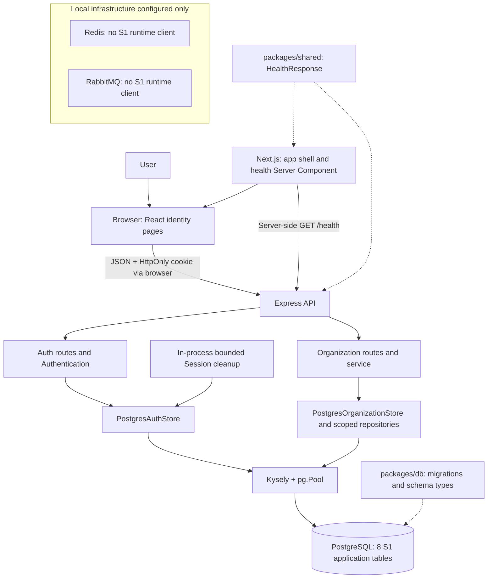
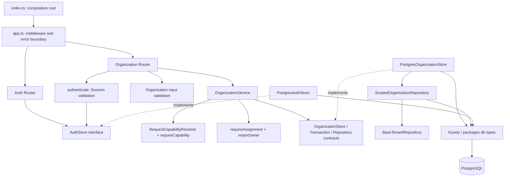
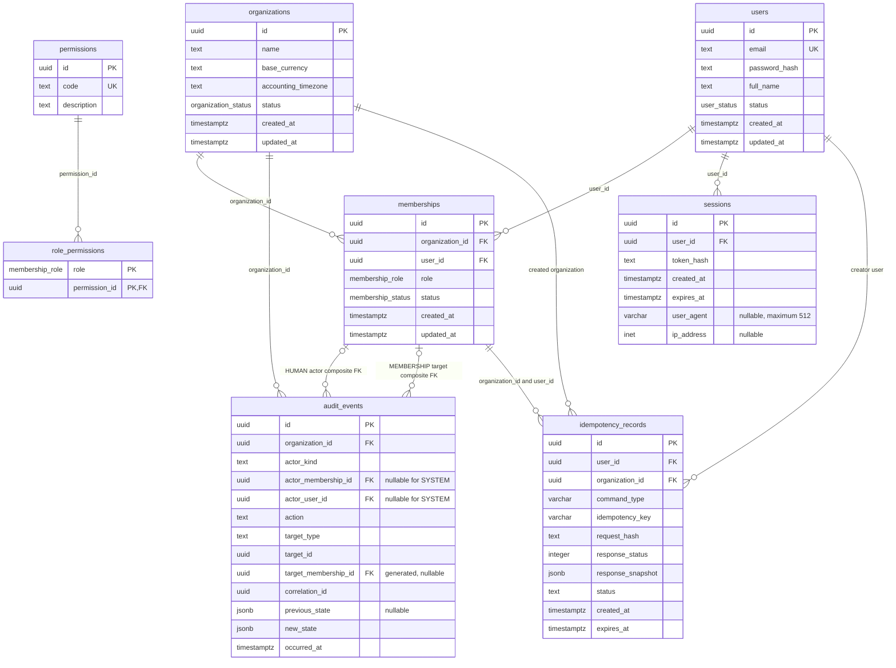
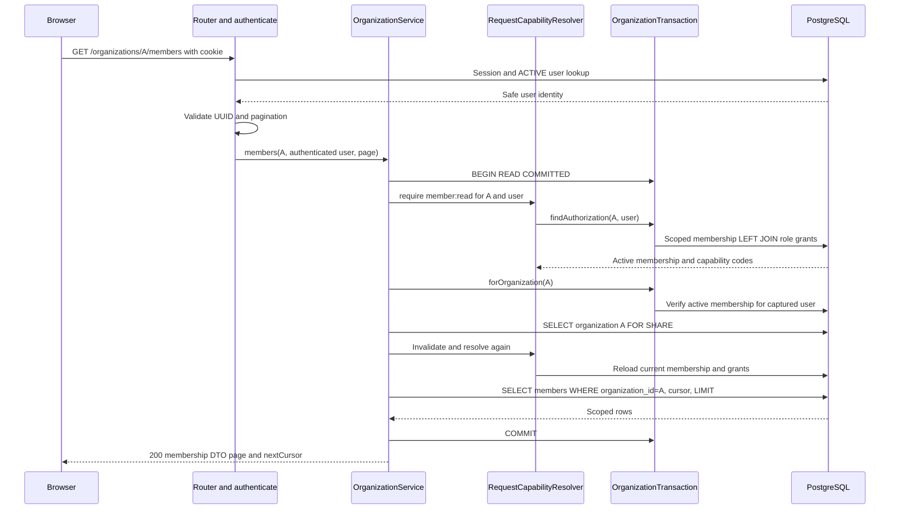
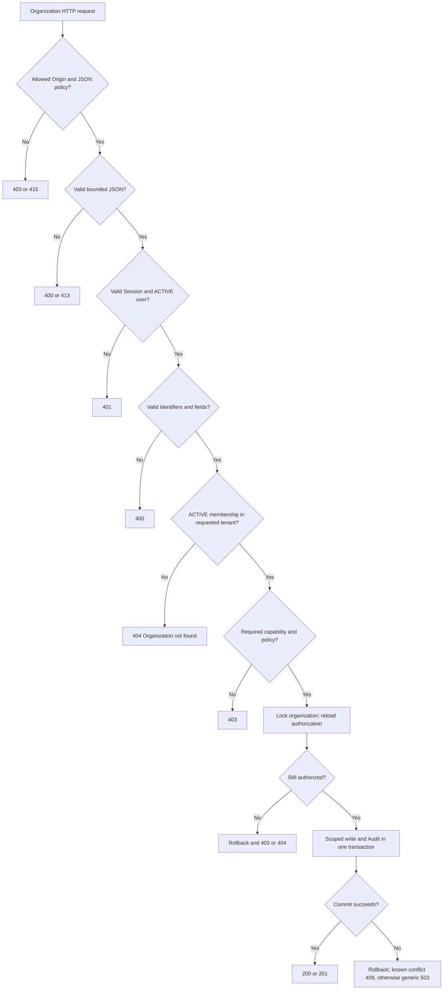
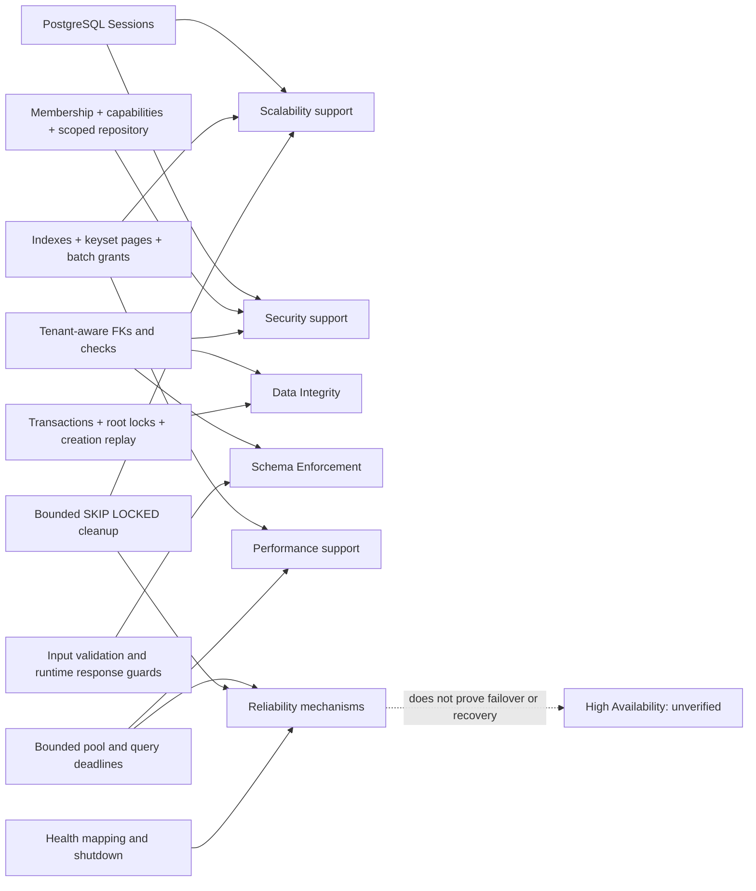

# مراجعة S1 التقنية — LedgerFlow

تاريخ المراجعة: **20 أكتوبر 2026 — Africa/Cairo**. النسخة اللي اتراجعت: `7e8e16023cefd6b46f960d1131ed8122418b328f`.

## 1. الخلاصة التنفيذية وحدود الدليل

S1 بنى أساس الـ Identity والـ Organization والـ Authorization اللي أي شغل مالي بعد كده هيعتمد عليه. عندنا User عالمي، Session محفوظة في PostgreSQL، Membership مستقلة لكل منظمة، و Organization APIs بتطبق الصلاحيات وبتكتب Audit جوه نفس الـ Transaction. الواجهة بتوصل الرحلة دي من Login لاختيار المنظمة وإدارة الأعضاء. **لسه مفيش Ledger أو عمليات مالية منفذة**؛ وجود أسماء Sales و Banking في الـ sidebar مش معناه إن الموديولات دي شغالة.

أقوى قرارات التنفيذ هي فصل Authentication عن Authorization، عدم تخزين الصلاحيات في الـ Session، تحميل Membership وصلاحياتها من الـ DB لكل طلب، إعادة التحقق بعد انتظار الـ organization lock، والـ composite FKs اللي بتمنع ربط Audit أو creation result بمنظمة تانية. الـ Tenant Repository بيضيف scope للقراية والتعديل والحذف، وبيشتق `organization_id` وقت الإدخال بدل قبوله من العميل. [ORG-SERVICE] [ORG-STORE] [TENANT-BASE] [M005]

**الحكم:** الأساس مناسب نبدأ نبني عليه S2 بشكل مشروط، لكنه مش إثبات جاهزية Production أو صحة مالية. مفيش tenant leak اتثبت في المراجعة دي، وده مختلف عن إثبات غياب أي ثغرة. محتاجين إعادة تشغيل PostgreSQL integration suites على DB معزولة، وحسم وتطبيق سياسة `SUSPENDED` قبل ربطها بأوامر مالية. التوسع لعدة replicas محتاج معالجة throttling و proxy trust، و Production محتاج runtime DB role محدود الصلاحيات وخطة تشغيل فعلية.

### لغة الحالة المستخدمة

| العلامة | معناها هنا |
|---|---|
| **منفذ ومتحقق جزئيًا/بالاختبارات المذكورة** | قرينا الكود وشغّلنا الاختبار المحدد بنجاح؛ ده إثبات داخل حدود الاختبار بس |
| **منفذ، التحقق الحالي ناقص** | الكود موجود، لكن الجزء المعتمد على PostgreSQL أو Browser أو نشر فعلي ما اتشغّلش هنا |
| **جزئي** | جزء من الرحلة موجود وفيه أجزاء معلنة مؤجلة |
| **مخطط فقط** | موجود في وثائق التصميم من غير تنفيذ فعلي |
| **غير قابل للتحقق هنا** | محتاج بيانات تشغيل/بيئة غير متاحة أو خارج نطاق المراجعة |

كل توصيف «اختبار موجود» معناه مراجعة source الاختبار، مش إعلان نجاحه. نتائج التشغيل الجديدة متجمعة في القسم 10. الاستنتاجات والقيود متعلمة صراحة في مواضعها. المراجعة ما استخدمتش اتصال DB، ما شغلتش migrations/seed، وما قرأتش قيم credentials في التقرير.

### إزاي اتحدد Scope الـ S1 من Git؟

اتراجع `git status --short` و`git log -12 --oneline` و`git show --stat` للـ commits الأساسية. الـ working tree كان نظيف قبل المراجعة؛ مفيش تغييرات غير committed محتاجة تدخل في التقييم. التقرير ده هو الإضافة المقصودة الوحيدة.

| Commit | اللي يثبته الـ diff |
|---|---|
| `95a1489` | monorepo و Docker foundation قبل S1 |
| `72c1ec8` | walking skeleton: Web → API → DB health |
| `be39d05` | App shell و design tokens والـ UI primitives |
| `7af8adf` | organization feature documentation |
| `0b0c453` | تنفيذ Tasks 1.1–1.6: identity schema، Sessions، organizations، dynamic RBAC، tenant repositories، identity UI واختباراتهم؛ 64 ملف في الـ commit |
| `7e8e160` | hardening لاحق: authenticated repository factory، immutable scope capture، قيود Audit target و idempotency، migration 005، واختبارات isolation إضافية؛ 18 ملف |

مفيش Sprint plan مستقل باسم S1/S2 اتلاقى تحت `docs/` وقت المراجعة. اعتبار Tasks 1.1–1.6 والـ hardening هم S1 مبني على docs وعناوين Git وتنفيذهم، مش على acceptance checklist منفصلة. أمثلة S2 المالية هنا مستمدة من product/domain/architecture docs، ومش ادعاء إن فيه Sprint backlog محدد. [ARCH] [DATABASE] [ORG-DOC]

الـ README فيه فقرات محدثة عن Authentication و Organizations، لكن قسم Status لسه بيقول إن schema/tests مؤجلة. الكود والـ migrations بيخالفوا الوصف القديم؛ استخدمنا التنفيذ كمرجع للحالة، والتصميم كمرجع للنية فقط. [README]

## 2. Feature implementation inventory

| Feature | إيه اتنفذ وليه | المسؤول والتفاعل | الحالة وما ينقصها |
|---|---|---|---|
| Monorepo/toolchain | 4 npm workspaces، Turbo، strict TS، lockfile committed | root `package.json` و`turbo.json`؛ packages بتتبني قبل consumers | منفذ؛ typecheck/build نجحوا. npm المتاح 10 بدل المطلوب 11 |
| DB client | Kysely فوق `pg.Pool`؛ deadlines وحد أقصى connections | API بيعمل pool واحدة من `packages/db/src/index.ts` | منفذ؛ مفيش load/recovery benchmark هنا [DB-CLIENT] |
| Identity/tenancy schema | organizations/users/memberships؛ enums و UUID و FKs و uniqueness | migration 001؛ users global و membership tenant-owned | منفذ؛ DB suites ما اتشغلتش هنا [M001] |
| Sessions | selector + secret hash، TTL، rotation، logout و cleanup | auth routes → AuthStore → sessions/users | منفذ؛ HTTP tests مع MemoryStore نجحت، PostgreSQL verification ناقص [AUTH-ROUTES] [AUTH-STORE] |
| Login UI | validation و pending/error ثم organization selection | `/login` → direct credentialed API call → provider | منفذ؛ unit tests نجحت، Browser E2E ما اتشغّلش [LOGIN-UI] |
| Organization bootstrap | org + initial OWNER + Audit + idempotency record ذريًا | service transaction، creator row lock، scoped repository | منفذ؛ API فقط، مفيش creation UI [ORG-SERVICE] |
| Organization discovery | قائمة المنظمات النشطة للمستخدم الحالي + live grants، keyset pagination | `/organizations` GET؛ scope من authenticated user | منفذ؛ DB tests موجودة مش منفذة هنا [ORG-STORE] |
| Organization settings | read-only name/currency/timezone/status | selection context → `GET /organizations/:id` | منفذ؛ مفيش update settings endpoint [SETTINGS-UI] |
| Membership management | Direct Add لمستخدم موجود و role update؛ inactive duplicates تفضل conflicts | Owner/Admin policy + capability + transaction + audit | منفذ؛ مفيش invite lifecycle أو removal/reactivation API [ORG-POLICY] [MEMBERS-UI] |
| Dynamic Authorization | `permissions` و`role_permissions`؛ cache لكل request، refresh بعد lock | DB left join → resolver → `requireCapability` | منفذ؛ unit coverage نجحت، live DB mutation tests موجودة [CAPABILITIES] [M004] |
| Tenant isolation | scope captured مرة واحدة، factory بتثبت membership، insert ownership داخلي | BaseTenantRepository + scoped organization repository | منفذ؛ SQL compilation tests نجحت؛ real-DB isolation مش معاد تشغيله [TENANT-BASE] [TENANT-TEST] |
| Tenant-aware relationships | actor/target membership FKs و creation snapshot checks | migrations 003 و 005 | منفذ؛ مفيش RLS [M003] [M005] |
| Last active Owner | منع آخر active OWNER من demotion تحت organization lock | `retainOwner` داخل role-change transaction | منفذ؛ DB race test موجود؛ مش invariant DB شامل لكل writer [ORG-SERVICE] [ORG-TEST] |
| Audit | append-only events للـ 3 management mutations، correlation و before/after | نفس transaction؛ DB trigger و composite actor FK | منفذ؛ مفيش Audit browsing API أو financial audit بعد [M003] |
| Creation idempotency | نفس user/command/key + normalized request hash + stored response | lockCreator → findCreation → saveCreation | منفذ؛ 24h replay ثم 409، مفيش cleanup [ORG-SERVICE] |
| UI foundation | responsive shell، Radix controls، semantic tokens، loading/error states | web components و globals.css | منفذ؛ static rendering tests نجحت، visual/a11y runtime مش مثبت هنا [SHELL] [WEB-TEST] |
| Health | DB `SELECT 1` و API status، web refresh كل 5 ثواني | Server Component → `/health` → DB factory | منفذ؛ mapping tests نجحت؛ مش HA proof [HEALTH] [HOME] |
| Local infrastructure | Docker Compose PostgreSQL/Redis/RabbitMQ و volumes/healthchecks | services موجودة في config | config موجود؛ Docker ما اتشغّلش هنا؛ مفيش Redis/AMQP clients [COMPOSE] |
| Signup/reset/status lifecycle | مفيش تسجيل مستخدم أو password reset أو suspension API | docs بتؤجلهم صراحة | مخطط/مؤجل؛ الـ seed password غير قابل للـ login [SEED] [AUTH-DOC] |
| Money/ledger/financial controls | التصميم موجود فقط؛ مفيش amounts أو posting أو journal tables | shared فيه HealthResponse حاليًا | مش منفذ؛ مفيش إثبات balancing/financial idempotency [SHARED] [DOMAIN] |
| Workers/outbox/providers/storage/AI | architecture roadmap | مفيش worker entrypoint أو adapters شغالة | مخطط فقط؛ Docker queue لوحده مش تنفيذ async workflows [ARCH] |

اعتماد المستقبل هنا واضح: أي Expense أو Invoice محتاج نفس tenant/actor boundary، capability جديدة، exact Money، Transaction، وقيود العلاقات. إنشاء Organization دلوقتي **مش** معناه إنشاء chart of accounts أو فتح accounting period أو الاستعداد للـ posting.

## 3. المعمارية الحالية

### 3.1 تقسيم الريبو والـ responsibilities

`apps/web` فيه Next.js App Router و React. الـ root page Server Component للـ health، بينما login/selection/settings صفحات Client Components. `IdentityProvider` ماسك user والـ selected organization في الذاكرة، والـ browser بيكلم Express مباشرة بالـ cookie. مفيش Next auth proxy، مفيش access token في localStorage، ومفيش server-persisted selected organization. [WEB-PROVIDER] [WEB-API] [HOME]

`apps/api` فيه composition root في `src/index.ts` و middleware/error boundary في `app.ts`. Organizations متقسمة routes → service → policies/contracts → infrastructure. Auth use case أصغر: validation/login orchestration في routes، Session parsing و Authentication في session.ts، و DB خلف `AuthStore`. مش كل module لازم يكون عنده folders منفصلة لكل layer عشان يحقق الفصل. [APP] [API-ENTRY] [ORG-ROUTES] [AUTH-TYPES]

`packages/db` مالك connection factory و schema types و migration registry والـ seed؛ business rules زي Last Owner موجودة في API service. `packages/shared` فيه `HealthResponse` والـ runtime guard بس؛ الـ organization/auth DTOs متكررة بشكل صغير ومتحقق منها runtime في web بدل عقد مشتركة كاملة. ده acceptable حاليًا، لكن تغيير contracts محتاج اختبار توافق. [DB-SCHEMA] [MIGRATOR] [SHARED] [WEB-IDENTITY]

### Diagram A — S1 System Architecture



1. المستخدم بيتعامل مع React pages؛ الـ Cookie بيتبعت عن طريق الـ browser، مش عن طريق JavaScript بيقرأ قيمته.
2. Authentication و Organization calls رايحين للـ API مباشرة؛ health لوحده بيتجاب server-side من Next.
3. Stores بتوصل PostgreSQL عن طريق نفس pool في process الـ API. الـ cleanup شغل مؤقت داخل نفس process، مش worker platform مستقلة.
4. Redis و RabbitMQ مرسومين كـ configured infrastructure بلا أسهم runtime؛ مفيش كود S1 بيستخدمهم.

التقسيم ده مناسب modular monolith صغير: أسهل في الفهم وفي عمل Transaction محلية من إدخال distributed boundaries بدري. حد الأمان الحقيقي عند Express/service/repository و DB constraints؛ عرض صفحة محمية client-side مش بديل له. [API-ENTRY] [COMPOSE]

### Diagram B — Backend Module Dependencies



1. الـ composition root هو اللي بيركب implementations؛ OrganizationService مش بيستورد PostgresOrganizationStore.
2. الـ router بيتأكد من Session وبيحول HTTP input لقيم validated، والـ service بيملك use case و Transaction و Authorization.
3. Capability مصدرها DB من خلال contract؛ policy مستقلة بتحدد مين يقدر يعيّن roles حتى لو معاه capability.
4. Infrastructure بيطبق interfaces ويضيف tenant predicates و locks و DB error translation.
5. الأخطاء بتطلع لحد `app.ts`؛ `OrganizationError` له status/message مقصودين، والـ unknown failures بتبقى generic 503.

الاتجاه ده بيخلّي business policy قابلة للاختبار من غير DB، وفي نفس الوقت بيخلي SQL/locking في infrastructure. الاستثناء العملي إن auth routes بتنسق login بنفسها، لكن مفيش financial rules في UI أو controller. [ORG-TYPES] [ORG-SERVICE] [ORG-STORE]

### 3.2 API request lifecycle وحدود الخطأ

الترتيب الفعلي في `createApp`: correlation UUID لمسارات organizations → Helmet → credentialed CORS → no-store و Origin/Fetch-Metadata/Content-Type guards → JSON parser بحد 8 KiB → cookie-parser → route → error handler. بالتالي malformed JSON ممكن يتترفض **قبل** Authentication؛ ده parser rejection طبيعي، مش تسريب بيانات منظمة. [APP]

الـ CORS middleware يقدر يخلص الـ preflight لوحده قبل اللي بعده؛ الـ requests الفعلية عليها Origin check برضه. GET/HEAD/OPTIONS معفيين من شرط JSON، لكن وجود Origin غير مسموح بيترفض. الطلب unsafe من CLI من غير Origin مسموح لو JSON ومش معلّم cross-site؛ CSRF الحماية هنا متصممة لحدود الـ browser، مش لإثبات هوية كل HTTP client.

| Boundary | النتيجة الحالية |
|---|---|
| JSON/body parser | malformed → 400، oversized → 413؛ body مش بيتطبع |
| Origin/media-type | 403 أو 415 قبل business work |
| Authentication | invalid/missing/expired/revoked cookie →401 |
| Tenant visibility | missing/inactive Membership →404 بنفس رسالة nonexistent tenant |
| Capability/assignment |403 من غير محاولة mutation ناجحة |
| Business conflict |409 duplicate/last Owner/idempotency mismatch أو conflict معروف |
| Unexpected DB/app failure | generic503 و event log من غير DB internals |
| Unknown route | مفيش JSON 404 handler صريح؛ Express default response، راجع F08 |

الـ JSON error format الحالي `{ error: string }`، مش error code catalog. `X-Request-Id` متاح لمسارات organizations بما فيها parser errors؛ unknown-error log نفسه مش بيربطه بالـ UUID. [APP] [WEB-API]

## 4. قاعدة البيانات والعلاقات الفعلية

### Diagram C — S1 ERD



1. الـ User identity عالمية؛ نفس الشخص ممكن يكون OWNER في A و VIEWER في B عن طريق Memberships مختلفين.
2. الـ Session مربوطة بالـ User؛ مفيهاش tenant أو role، فلا اختيار منظمة ولا تغيير role محتاج إعادة إصدارها.
3. الـ Audit مرتبط بمنظمته، وبـ actor Membership من نفس المنظمة ونفس المستخدم. الـ SYSTEM actor مفيهوش human membership/user، والـ service الحالي بيكتب HUMAN بس.
4. لو Audit target عضوية، الـ generated column بيبقى `target_id` وبيخش في FK مركب مع tenant. لو target منظمة، CHECK بيفرض `target_id = organization_id`.
5. creation idempotency record لازم creator membership موجودة في نفس المنظمة، والـ response snapshot لازم يحمل نفس organization/user identifiers.
6. `role_permissions.role` PostgreSQL enum، مش FK لجدول roles. مفيش جدول roles منفصل، ومفيش علاقة FK من Membership إلى grant rows؛ الـ join منطقي على enum value.

رسم actor/target بعلاقة optional سببه وجود SYSTEM و ORGANIZATION-target events، مش إن HUMAN actor اختياري. الـ ERD فيه 8 application tables فقط؛ Kysely migration metadata مش domain tables. مفيش جداول مؤقتة من tests أو financial tables في الرسم. [DB-SCHEMA] [M001] [M002] [M003] [M004] [M005]

### 4.1 Constraints ومعناها العملي

| المستوى | Enforcement فعلي | حد الضمان |
|---|---|---|
| الهوية | UUID PK؛ unique case-sensitive email؛ nonblank email/hash/name؛ user status enum | DB مش بيتحقق من email syntax أو إن hash Argon2 صالح؛ boundary/provisioning مسؤول |
| المنظمة | required name/currency/timezone؛ status enum؛ currency regex `^[A-Z]{3}$` | supported currency و timezone validity و max lengths enforced في API أكتر من DB |
| العضوية | required role/status، FKs RESTRICT، unique `(organization_id,user_id)` حتى inactive | العضوية لا تتكرر؛ DB لا يضمن وجود active Owner عند أي direct SQL write |
| Actor keys | unique `(organization_id,id)` و`(organization_id,id,user_id)` | ممكن إنشاء composite FK يثبت tenant وال actor identity معًا |
| Session | hash 64 lowercase hex، expiry بعد creation، user FK، inet و varchar512 | metadata مؤقتة، مش immutable login audit |
| Audit | constrained action/target pairs، object JSON، actor nullability، append-only trigger | JSON object shape مش business schema كاملة؛ privileged DB owner يقدر يغيّر DDL |
| Creation replay | unique user/command/key؛ key/hash format؛ COMPLETED و 2xx؛ expiry؛ snapshot scope | DB يسمح 2xx عمومًا، التطبيق بيكتب 201؛ الـ object check مش بديل للـ runtime guard |
| Permissions | unique code regex و nonblank description؛ composite grant PK و permission FK | grants عالمية لكل tenants؛ مفيش tenant-custom role management |

من أمثلة الفرق بين التطبيق والـ DB: `ZZZ` يوافق three-uppercase-letters في migration 001 لكنه مش موجود في `Intl.supportedValuesOf('currency')`، فيترفض في creation API. وبرضه DB بيشترط timezone مش فاضية، لكن API هو اللي يختبرها بـ `Intl.DateTimeFormat` ويرفض numeric offsets. ده مش وعد إن direct SQL ممكن يتعامل معاه كأنه نفس API. [ORG-VALIDATION] [M001]

`created_at/updated_at` defaults مش trigger لتحديث الوقت؛ writers لازم يعملوا update صريح. `MembershipsTable.organization_id` ومعاه tenant columns لبعض الجداول معرفين بـ `ColumnType<..., ..., never>` عشان يمنعوا update typed عادي، لكن ده TypeScript guard، مش immutability trigger على كل tenant key. [DB-SCHEMA]

### 4.2 Transactions و Concurrency

Creation بيقفل صف المستخدم بـ `FOR UPDATE`؛ أي create requests لنفس المستخدم بتتسلسل حتى لو keys مختلفة. ده اختيار بسيط يحمي bootstrap قبل وجود tenant، مع ثمن throughput محدود لكل creator. Organization reads بتاخد `FOR SHARE`، والـ membership writes بتاخد `FOR UPDATE` على organization root. عشان كده competing writes لنفس المنظمة بتتسلسل، لكن منظمات مختلفة تقدر تتقدم بالتوازي في حدود pool/DB. [ORG-SERVICE] [ORG-STORE]

`READ COMMITTED` معناه إن query الصلاحيات الجديدة بعد انتظار lock تقدر تشوف role/grant commit حصل أثناء الانتظار. الـ resolver بيتعمله invalidate قبل إعادة القراءة. لكن مش معناه إن grant revocation متسلسل مع كل in-flight request: تعديل global grants مباشرة بعد آخر check ممكن يسبق commit الطلب؛ مفيش grant row locking protocol شامل. حدود in-flight revocation محتاجة سياسة قبل sensitive workflows، ومفيش ادعاء linearizable revocation. [CAPABILITIES] [ORG-TEST]

كل mutation والأثر بتاعها في Audit في transaction واحدة؛ Audit insert failure لازم يرجع تغيير العضوية/المنظمة/idempotency معاه. الكود بيحافظ على atomicity؛ real-DB failure injection tests موجودة لكن ما اتشغلتش هنا. unique membership violation بيتترجم 409، و`40001/40P01` بيتترجموا conflict409؛ FK أو check unexpected بيتحول generic503، مش client validation error تلقائيًا. [ORG-STORE] [ORG-TEST]

### 4.3 Migrations والتشغيل الآمن

`createMigrator` عنده registry صريح 001–005، و`migrate.ts` بيعمل `migrateToLatest` ويقفل pool في finally. ملفات down موجودة، لكن down لـ 001–004 ممكن تمسح schemas/tables/history؛ وجود rollback code مش معناه إنه آمن على persistent data. ما اتشغّلش أي migrate أو down هنا. [MIGRATOR] [MIGRATE]

Migration005 additive في الـ logical contract لكنها مش zero-downtime: إضافة stored generated column في PostgreSQL 16 بتعمل physical table rewrite، ومعها schema locks و FK validation/index work. docs موثقة maintenance-window exception؛ ده مش موافقة جديدة من المراجعة. نفس factory فيها 3s statement/query deadline و CLI بيستخدمها، فالتنفيذ على Audit كبيرة محتاج migration runner policy وخطة مساحة/وقت. مفيش قياس هنا لمدة الـ lock. [M005] [DB-CLIENT] [DATABASE-DEPLOY]

الـ preflight queries الموجودة في database guide بتعد invalid historical targets/creator memberships/snapshots؛ لازم صفر قبل النشر. migration failure على تاريخ غير صالح المفروض يرجع ذريًا، مش يصلّح أو يمسح Audit بصمت. tests بتغطي ده في disposable schemas، لكن نجاحها الحالي مش متحقق هنا. rollback005 بيشيل guards و generated value ويحتفظ بأصل البيانات، لكنه بيضعف العزل. [TENANT-DB-TEST]

## 5. Functional workflows من UI لحد DB

### 5.1 Login و Session lifecycle

| الخطوة | التنفيذ الفعلي |
|---|---|
| Trigger/entry | submit في `/login` → `apiRequest('/auth/login', ..., POST)` |
| Validation | HTML required/type=email + server string/type/length/email checks؛ email trim و case محفوظ؛ password whitespace محفوظ |
| Authentication | `findUserByEmail` ثم `verifyPassword` بـ Argon2id؛  ACTIVE user فقط؛ مفيش tenant Authorization في login |
| Business logic | random UUID selector +32 random bytes secret؛ hash SHA-256 للـ secret؛ expiry24h ثابت |
| DB | transaction: delete previous session بالـ id **وال hash** لو cookie قابلة للفهم، ثم insert الجديدة |
| Response |200 safe `{user:{id,email,fullName}}` + Set-Cookie بعد نجاح store؛ React user يتحدث والاختيار القديم يتمسح |
| Failure |400 input، 401 generic credentials، 429 limiter، 503 store failure؛ مفيش cookie نجاح قبل commit |
| Coverage | MemoryStore HTTP login/rotation/expiry/security نجحت؛ PostgreSQL rotation/metadata constraints موجودة مش معادة هنا |

المراجع: [LOGIN-UI] [WEB-API] [AUTH-ROUTES] [AUTH-PASSWORD] [AUTH-SESSION] [AUTH-STORE] [AUTH-TEST] [AUTH-PG-TEST].

### Login و validation و logout sequence

```mermaid
sequenceDiagram
  actor U as User
  participant B as Browser
  participant A as Auth Router
  participant H as Argon2id
  participant S as PostgresAuthStore
  participant D as PostgreSQL
  U->>B: Submit email and password
  B->>A: POST /auth/login JSON, credentials include
  A->>A: Origin, JSON, rate limit, credentials validation
  A->>S: findUserByEmail(email)
  S->>D: SELECT global user projection
  D-->>A: User or missing identity
  A->>H: Verify stored hash or dummy hash
  H-->>A: Verification result
  alt Invalid password or inactive user
    A-->>B: 401 generic error
  else Valid active user
    A->>A: Generate fresh selector and secret; hash secret
    A->>S: createSession(new, previous credential)
    S->>D: BEGIN; DELETE matching previous; INSERT new; COMMIT
    A-->>B: 200 safe user and HttpOnly Set-Cookie
    B->>A: GET /auth/me with cookie
    A->>S: findSessionUser(id, hash, now)
    S->>D: JOIN sessions and ACTIVE user; expires_at greater than now
    D-->>A: Safe user or no row
    A-->>B: 200 user or 401
    U->>B: Sign out
    B->>A: POST /auth/logout with JSON content type
    A->>S: deleteSession(full credential)
    S->>D: DELETE WHERE id and token_hash match
    A-->>B: 204 and expired cookie
    B->>B: Clear identity and organization; navigate to login
  end
```

1. الـ password بيتحقق server-side؛ unknown/inactive/wrong credentials بيرجعوا نفس الرسالة. dummy verification يقلل فرق الشغل، مش دليل على identical timing.
2. الـ browser بياخد raw token في HttpOnly cookie، و DB بياخد hash فقط. UUID لوحده مش كفاية للـ authentication.
3. كل protected request بيقارن hash و expiry و current user status، ف cleanup مش شرط لانتهاء الـ Session.
4. Logout ما بيحتاجش valid active Session عشان يكون repeatable؛ بيحذف لو فيه full matching credential، وي clear cookie بعد نجاح العملية. لو DB فشلت يرجع 503 من غير ادعاء نجاح revocation.

الـ Session مش sliding: مفيش تمديد مع كل request، ومفيش refresh-token lifecycle. Login جديد بيبدل presented credential المطابق بس؛ sessions الأجهزة التانية بتفضل موجودة. rotation المتزامنة ممكن تنتج أكتر من Session جديدة صحيحة؛ مفيش single-session-per-user invariant أو global logout حاليًا. [AUTH-STORE]

### 5.2 Authenticated request و Membership validation

الـ trigger هو أي call لمسار `/organizations`. الـ router بيستخدم `authenticate` على كل مساراته. Cookie malformed/forged/expired/revoked أو inactive user →401 قبل خدمة المنظمة. بعد نجاحه بيتحط `request.user` و`request.userId` كـ safe identity؛ actor user مش مقروء من body أو header. [ORG-ROUTES] [AUTH-SESSION]

Tenant ID بييجي من path ويتعمله UUID validation. ده **requested tenant** مش صلاحية. `tenantAccess` بيطلب capability من Membership scoped بنفس organization/user، وبعدها factory بتثبت active membership مرة تانية، ثم root lock، ثم invalidate/re-resolve. بعد ده scoped repository هي اللي تعمل SQL ب tenant filter. [ORG-SERVICE] [ORG-STORE]

### Protected request sequence



1. Authentication مستقل عن transaction المنظمة، وكل tenant authorization جوه transaction المنظمة.
2. فيه أكتر من query مقصودة: Session lookup، pre-lock authorization، factory membership check، root lock، post-lock authorization، ثم data query. الـ resolver cache مش معناه إن الطلب كله query واحدة.
3. التكرار اللي بعد lock بيقفل stale authorization أثناء الانتظار؛ root share lock يمنع cooperative membership writer من تغيير الحالة تحت نفس البروتوكول أثناء القراءة.
4. DTO بيخفي global user profile والـ password/session metadata؛ members endpoint بيرجع userId/organizationId/role/status فقط.

مفيش external network call جوه transaction دي. ده يحافظ على قصرها نسبيًا، لكن كل read بياخد lock وبالتالي فيه contention cost لازم يتقاس قبل التوسع. [ORG-STORE] [ORG-TEST]

### 5.3 إنشاء Organization

Trigger الحالي API client؛ **مفيش زر أو form لإنشاء منظمة في الـ web الحالي**. Entry `POST /organizations` بجسم دقيق فيه name/baseCurrency/accountingTimezone و`Idempotency-Key`. Authentication لازم ACTIVE user، لكن مفيش Membership مطلوبة قبل إنشاء tenant جديد. `org:create` موجودة في catalog لكنها structural bootstrap rule، مش role grant بيتم فحصه. [ORG-ROUTES] [M004]

### Organization creation sequence

```mermaid
sequenceDiagram
  participant C as Authenticated API client
  participant R as Organization Router
  participant S as OrganizationService
  participant T as OrganizationTransaction
  participant D as PostgreSQL
  C->>R: POST /organizations + Idempotency-Key
  R->>R: Authenticate; validate exact fields and key
  R->>S: create(server actor, validated input, key)
  S->>S: Hash normalized fields in fixed order
  S->>T: BEGIN READ COMMITTED
  T->>D: Lock ACTIVE creator user FOR UPDATE
  T->>D: Lookup user + organization:create + key
  alt Existing completed record
    T-->>S: Hash, expiry, organization and stored snapshot
    S->>S: Reject changed payload or expired key with 409
    S->>D: Check active membership; lock root; recheck membership
    S->>S: Validate snapshot shape and user/tenant scope
    S->>T: COMMIT
    S-->>C: 201 original snapshot
  else No record
    T->>D: INSERT organization
    S->>T: forOrganization(new root created here)
    T->>D: INSERT initial ACTIVE OWNER membership
    T->>D: INSERT ORGANIZATION_CREATED audit
    T->>D: INSERT COMPLETED idempotency response
    S->>T: COMMIT all effects
    S-->>C: 201 organization and membership
  end
```

1. normalization بيحصل قبل hashing؛ ترتيب مفاتيح JSON اللي بعته العميل مش بيغيّر retry identity، والـ name بيتعملها trim.
2. قفل creator بيخلي concurrent same-key requests يوصلوا لنفس record؛ retry مش هيعمل org أو Audit زيادة.
3. الـ factory تسمح bootstrap بس لمنظمة اتعملت في نفس transaction بعد creator lock؛ مفيش flag من العميل يفتح الاستثناء لأي tenant قديم.
4. فشل Owner insert أو Audit أو idempotency insert يلغي كل الإنشاء. الاستجابة بتطلع بعد commit.
5. Replay مش tenant discovery bypass: العضوية لازم تفضل ACTIVE، والـ snapshot لازم ينتمي لنفس user/tenant. لكنه original snapshot، مش current role/settings response، ومش بيعمل capability check زي `org:read`.

لو نفس key اتستخدم بعد 24h بيترد 409 حتى لو record لسه موجود؛ الكود ما بيعملش record deletion. لو HTTP response ضاعت بعد commit، retry بنفس key/payload يرجع نفس النتيجة. ده خاص بإنشاء المنظمة، مش idempotency framework لكل future commands. [ORG-SERVICE] [ORG-STORE] [ORG-VALIDATION]

### 5.4 Discovery واختيار أوتغيير المنظمة

`OrganizationSelectionPage` بيطلب `/auth/me` ثم `GET /organizations?limit=25`. الـ transaction بيصفّي Memberships بـ captured authenticated user و ACTIVE status، و organizations بـ ACTIVE. بعد pagination بيجيب grants لكل roles الموجودة دفعة واحدة؛ مفيش query لكل organization. empty list ليها رسالة واضحة: اطلب من Owner/Admin يضيف User ID. [SELECTION-UI] [ORG-STORE]

### Organization switching sequence

```mermaid
sequenceDiagram
  actor U as User
  participant UI as React app and IdentityProvider
  participant A as API
  participant D as PostgreSQL
  U->>UI: Open menu and choose Switch organization
  UI->>UI: Clear selected organization; route to /organizations
  UI->>A: GET /auth/me with existing cookie
  A->>D: Validate Session and ACTIVE user
  UI->>A: GET /organizations with cursor limit
  A->>D: Discover ACTIVE memberships and ACTIVE organizations
  A->>D: Batch role grants
  A-->>UI: Organization access hints
  U->>UI: Choose organization B
  UI->>UI: Store B in React memory; route to settings
  UI->>A: GET /auth/me then GET /organizations/B
  A->>D: Revalidate membership, capability and scope for B
  A-->>UI: Authorized details or 401/403/404
```

1. Switch عملية UI؛ مفيش `/switch-organization` endpoint ومفيش update للـ Session.
2. الاختيار بيعرف UI هتبعت أي path؛ ما بيمنحش صلاحية. API بتراجع B من الصفر.
3. refresh بيفقد selected context؛ لو Session سليمة المستخدم بيرجع selection، مش بيسترجع tenant من storage.
4. capabilities اللي في discovery hints للعرض؛ ممكن تبقى stale، ف backend checks هي المرجع. Browser script الموجود بيختبر selection، لكنه مش بيثبت switching متكرر بين tenant ين ولا cross-tab synchronization. [WEB-PROVIDER] [FRAME] [UI-BROWSER-TEST]

### 5.5 إضافة عضو وتغيير دوره

| الجزء | Direct Add | Change role |
|---|---|---|
| Trigger | Add member drawer بـ User UUID و role صريحة | select في صف العضو |
| Entry |POST `/organizations/:id/members` |PATCH `/organizations/:id/members/:userId` |
| Validation |exact `{userId,role}`، UUID و enum |exact `{role}` و path UUIDs |
| Authentication |Session و ACTIVE user |نفسه |
| Authorization |ACTIVE Membership + `member:invite` + structural assignment |ACTIVE Membership + `member:edit` + current target role/requested role policy |
| Logic |رفض existing membership بأي status؛ target user موجود و ACTIVE |no-op لو نفس role بعد policy check؛ otherwise Last Owner check |
| DB |root FOR UPDATE، insert membership، Audit |root FOR UPDATE، scoped update updated_at، Audit before/after |
| Response |201 Membership DTO؛ العضو ACTIVE فورًا |200 DTO؛ unchanged role لا يكتب Audit وهمي |
| Errors |403 policy، 404 target user unavailable، 409 duplicate، 503 unexpected |403 protected target، 404 target absent/inaccessible org، 409 last Owner/concurrency، 503 unexpected |
| UI recovery |retain input on errors؛ uncertain writes تعمل refresh قبل retry |reload committed rows after conflict؛ self role change يمسح الاختيار ويرجع discovery |

OWNER يقدر يعيّن كل roles. ADMIN يعيّن ويعدّل ACCOUNTANT/FINANCE_MEMBER/VIEWER فقط؛ ما يعدّلش OWNER/ADMIN ولا نفسه، حتى لو معاه كل capabilities. VIEWER لو اتمنحت له capability mutation في DB هيفضل assignment policy ترفض العملية. مفيش permission fallback لمجرد إن role اسمها OWNER. [ORG-POLICY] [CAPABILITIES]

`retainOwner` بيعد ACTIVE OWNER memberships التانية، مش global ACTIVE users. فتعطيل حساب آخر Owner من direct administration أوتغيير status مباشرة ممكن يسيب المنظمة بلا Owner قادر على الدخول؛ مفيش status lifecycle هنا يدعي إنه حل ده. لازم writers المستقبلية تلتزم بنفس lock/invariant policy، مع تحديد معنى effective Owner. [ORG-SERVICE] [ORG-STORE]

### 5.6 Frontend loading/error states

Login بيقفل controls أثناء submit ويعرض alert بدل redirect عند invalid credentials. Selection فيها loading/empty/error/retry و first/next pages. Settings بتعمل Session check، ترجع selection لو مفيش context، وتعرض تفاصيل من API بعد response guard و scope check. [LOGIN-UI] [SELECTION-UI] [SETTINGS-UI]

Members بتصفّر الصفحة أثناء التحميل؛ sequence ref يمنع older member-list response من استبدال الأحدث. mutation uncertain بـ network0 أو 409/502/503 بتعيد تحميل committed state، ولو reload فشل بتوقف mutations. permission loss أثناء mutation بتوقفها لحد تبديل المنظمة. ده conservative UX؛ مش automatic retry ممكن يكرر تغييرات. [MEMBERS-UI]

ApiAlert ليه `role=alert`، server text بيتعرض escaped بواسطة React، و 403 لها Permission Denied و request reference لو موجودة. drawer عنده labels و field errors و focus للـ invalid field، و Radix Sheet للـ dialog behavior. static tests بتثبت شوية semantics، مش full keyboard/contrast audit. [ADD-UI] [WEB-TEST]

## 6. Security و Tenant isolation بالتفصيل

### 6.1 طبقات العزل والـ exceptions المقصودة

1. **Authentication:** كل organization route وراه Session validation؛ مفيش actor userId من العميل.
2. **Tenant membership:** `findAuthorization` scoped بـ organization/user و ACTIVE؛ factory ما تفتحش existing organization من غير active membership.
3. **Capability:** permission codes من DB؛ no grants يعني 403 حتى Owner. missing membership يعني 404 عشان عدم الإفصاح.
4. **Domain policy:** assignment limits و Last Owner؛ grants لوحدها ما تسمحش بالتصعيد.
5. **Repository:** private captured tenant/user، parameterized predicate، scoped update/delete، insert ownership داخلي، returned-resource guard.
6. **DB relationships:** مركّبة على tenant و membership؛ تمنع cross-tenant references في Audit/idempotency.

الـ User lookup والـ Session lookup global بطبيعتهم. discovery user-scoped بدل selected-tenant-scoped لأنه هو اللي بيكتشف المنظمات. permissions/grants global catalog مقصودة. bootstrap استثناء محصور في root اتخلق في نفس transaction. دي مش unscoped business-data exceptions. [AUTH-STORE] [ORG-STORE] [TENANT-BASE]

**RLS مش مطبّقة.** مفيش `CREATE POLICY` أو`ENABLE ROW LEVEL SECURITY` في migrations001–005. composite FK تمنع علاقة غلط، لكن ما تمنعش `SELECT` غير scoped من قراءة rows سليمة لمنظمة تانية. BaseTenantRepository بيقلل نسيان scope، لكنه مش sandbox للـ developer: كود infrastructure يقدر يتجاوز helpers ويستخدم Kysely مباشرة. factory/store بيعتمدوا على trusted application wiring لتمرير identity؛ مش بيتحققوا من cookie جوه data layer. [MIGRATOR] [DATABASE]

### Unauthorized / cross-tenant attempt sequence

```mermaid
sequenceDiagram
  participant C as User in organization A
  participant R as API Router
  participant S as OrganizationService
  participant D as PostgreSQL
  C->>R: PATCH /organizations/B/members/target with valid Session
  R->>D: Validate Session for user
  D-->>R: Authenticated identity
  R->>S: changeRole(B, authenticated actor, target, role)
  S->>D: BEGIN; query ACTIVE membership for B and user
  D-->>S: No membership
  S->>S: requireCapability throws non-disclosing 404
  S->>D: ROLLBACK
  S-->>C: 404 Organization not found
  Note over S,D: No membership UPDATE or success Audit
```

1. Session صالحة في A تثبت الشخص بس؛ ما بتفتحش B.
2. lookup بـ B والشخص نفسه بيرجع missing، فالتنفيذ يقف قبل تحميل target أو role update.
3. نفس status/message لو B غير موجودة أصلًا؛ valid UUID لوحده مش permission.
4. الاختبار في `organizations-postgres.test.mjs:195` بيجرب read/list/add/patch ضد foreign ومفقود tenants ويشيك إن B ما اتغيرتش. ده موجود في suite، مش نتيجة تشغيل جديدة هنا. [ORG-TEST]

### Failure-flow — رفض الطلب من غير side effects



1. diagram ده لمسار tenant mutation، مش bootstrap اللي محتاج creator lock بدل existing membership.
2. مفيش success response قبل commit. business validation failures ما بتكتبش success Audit.
3. unexpected DB error مش بيتحوّل للسماح؛ بيطلع 503، والـ frontend يراجع state قبل retry عند uncertainty.
4. الرسم بيرسم actual guards فقط؛ مفيش صندوق `organization ACTIVE` لأن الشرط ده غايب فعلًا من direct tenant access. [APP] [ORG-SERVICE]

### 6.2 Cookie و CSRF و Session security

في development الاسم `ledgerflow_session`، وفي production `__Host-ledgerflow_session`. cookie HttpOnly و Path=/ و SameSite=Lax و host-only؛ Secure في production. config بيشترط WEB_ORIGIN HTTPS في production. HTTP tests اتأكدت من attributes، لكن ما اتعملش HTTPS/browser/proxy deployment verification هنا. HttpOnly يقلل سرقة قيمة الـ cookie بـ JS؛ مش حماية عامة من كل XSS actions. [AUTH-CONFIG] [AUTH-SESSION] [AUTH-TEST]

CSRF protection مركبة من exact-origin checks، رفض `Sec-Fetch-Site: cross-site` للـ unsafe methods، JSON-only mutations اللي بتفرض preflight في browser، و SameSite. مفيش CSRF token منفصل. صلاحية ده مرتبطة بالنشر المتوثق: web/API على نفس schemeful site. لو API/web على domains unrelated، cookie policy الحالية مش promised إنها تشتغل؛ ما نغيّرش SameSite=None تلقائيًا. [APP] [AUTH-DOC]

Login limiter10 attempts/IP/15min داخل process. trust proxy مش مفعّل عمدًا، وبالتالي forwarded IP غير موثوق. ده سليم قبل تعريف proxy boundary، لكن خلف proxy كل العملاء ممكن يتحسبوا على IP واحد؛ ومع replicas limit مش shared. malformed JSON/origin failures اللي بتقف قبل login router مش بيتحسبوا بنفس limiter. مفيش adaptive account-based throttling أو credential-stuffing detection. [AUTH-ROUTES] [APP]

مفيش secrets في response projections أو logs اللي اتراجعت. `.gitignore` بيستبعد `.env` و keys، لكن ده مش secret scanner ولا إثبات إن كل Git history خالية من secrets. ما اتعملش secret-history scan أو dependency vulnerability audit في الجولة دي، ومفيش TLS/production secret manager/runtime DB grants متحققين. ما نقلناش أي real credential للتقرير.

## 7. Edge-case handling matrix

**API✓ / Web✓** معناهم اختبار اتنفذ هنا ونجح. **PG source** معناها اختبار PostgreSQL موجود واتراجع، لكنه ما اتشغّلش في الجولة دي. **غير مغطى** يعني ما اتلاقاش اختبار محدد. Risk بتوصف الفجوة المتبقية؛ مش كل صف bug.

| Feature | Edge Case | Current Handling | Evidence | Test Coverage | Risk | Status |
|---|---|---|---|---|---|---|
| Login | بيانات غلط أو User مجهول أو INACTIVE | 401 بنفس الرسالة؛ dummy verification للمجهول أو hash غير مدعومة | [AUTH-ROUTES] [AUTH-PASSWORD] | API✓ | Minor: مفيش timing study | handled عند HTTP boundary |
| Login | بيانات ناقصة/types غلط/object injection | type/pattern/length checks؛ 400 قبل query للـ invalid input | [AUTH-ROUTES] | API✓ | منخفض | handled |
| Login | password spaces و email case | password محفوظ؛ email trim بس؛ lookup case-sensitive | [AUTH-ROUTES] [M001] | API✓ | provisioning لازم يتبع السياسة | contract واضحة |
| Session | expiry عند 24h بالظبط | expires_at أكبر من now؛ equality →401 من غير انتظار cleanup | [AUTH-STORE] | API✓؛ PG source | clock skew بين replicas مش مقاس | PG pending |
| Session | revoked Session أو logout متكرر | row المحذوفة لا تصادق؛ logout تاني 204 | [AUTH-ROUTES] [AUTH-STORE] | API✓؛ PG source | منخفض | handled |
| Session | missing/malformed/JSON-cookie/forged secret | strict regex ثم full credential lookup؛ 401؛ forged logout لا يحذف Session سليمة | [AUTH-SESSION] [AUTH-STORE] | API✓؛ PG source | منخفض | handled |
| Session | fixation أو UUID معروف | fresh random credential لكل login؛ replacement بالـ id والـ hash معًا | [AUTH-SESSION] [AUTH-STORE] | API✓؛ PG source للـ atomicity | لا timing guarantee مطلق | منفذ |
| Session | أجهزة أو logins متعددة | Sessions مستقلة؛ rotation تخص previous بس | [AUTH-STORE] | PG source تبين بقاء Session أخرى؛ HTTP race غير مغطى | Minor: لا cap أو global revoke | supported بحدود |
| Session | concurrent login/logout لنفس previous | Transactions تحمي writes؛ أكتر من new Session ممكنة | [AUTH-STORE] | race غير مغطاة | single-session semantics مش contract | جزئي التحقق |
| Identity | User بقى INACTIVE | كل lookup يشترط current ACTIVE user | [AUTH-STORE] | API✓؛ PG source | in-flight request قديمة مش بتتلغي | next lookup handled |
| Identity | password change أو reactivation | تغيير password لا يلغي Sessions؛ reactivation ممكن تعيد صلاحية غير منتهية | [AUTH-STORE] [AUTH-DOC] | workflow مؤجلة | Major عند إضافة reset بلا revocation policy | مؤجل |
| Login | محاولات كتير |429 بعد 10 requests وصلت للـ limiter | [AUTH-ROUTES] | API✓ | Major خلف proxy/replicas؛ F02 | single-process handled |
| CSRF | Origin غريب/simple form/cross-site metadata |403/415؛ credentialed CORS للـ exact origin | [APP] | API✓؛ organization PG source | Production browser policy غير متحققة | handled داخل الحدود |
| Organization | Session سليمة بدون Membership في tenant |404 non-disclosing | [CAPABILITIES] [ORG-STORE] | unit✓؛ PG source | يلزم fresh DB run | منفذ |
| Tenant | resource ID من B تحت A | scoped lookup/update لا تلمس B؛ FKs تمنع wrong links | [TENANT-BASE] [M005] | SQL compilation✓؛ PG source | Blocker لو bypass حصل؛ لم يثبت هنا | PG pending |
| UI context | مفيش selection أو refresh | Session check ثم selection؛ لا fallback tenant | [SETTINGS-UI] [WEB-PROVIDER] | Browser source فقط | منخفض | Browser pending |
| Organization | invalid UUID أو context ناقصة |400 identifier؛ unknown route default404؛ root list/create مختلفين | [ORG-ROUTES] [ORG-VALIDATION] | PG source | Minor: default error format | منفذ |
| Membership | inactive/revoked Membership |404 في Authorization و factory | [CAPABILITIES] [ORG-STORE] | unit✓؛ PG source | arbitrary SQL ممكن يتجاوز lock protocol | handled عند check جديدة |
| Authorization | no grants حتى OWNER |403؛ left join يحافظ على Membership بدون grant | [CAPABILITIES] [ORG-STORE] | unit✓؛ PG source | منخفض | منفذ |
| Authorization | stale role/grant أثناء lock wait |invalidate وإعادة القراءة بعد lock | [ORG-SERVICE] | unit✓؛ PG source lock tests | revocation بعد آخر check مش serialized | handled للسيناريو |
| UI | stale capabilities بعد grant/revoke |server حاسم؛ hints تفضل لحد reselection؛ mutation denial يوقف التعديل | [MEMBERS-UI] [WEB-PROVIDER] | Web✓ للـ policy؛ Browser source revoke | Minor F06: new grants مش بتظهر فورًا | جزئي |
| Organization | SUSPENDED مع known ID |discovery يخفيها؛ direct get/add/patch بلا status guard | [ORG-STORE] [ORG-SERVICE] | in-memory get probe رجع SUSPENDED؛ لا PG regression | Major F01 | policy غير enforced |
| Membership | Admin يصعّد أويمس OWNER/ADMIN/نفسه |403 بغض النظر عن grants | [ORG-POLICY] | unit✓؛ PG source | منخفض | handled |
| Membership | duplicate حتى INACTIVE/concurrent Add |precheck409 و unique DB؛ root lock يسلسل writes | [M001] [ORG-STORE] | PG source | لا automatic reactivation | PG pending |
| Membership | target User مجهول/INACTIVE |404 User unavailable بعد tenant Authorization | [ORG-SERVICE] [ORG-STORE] | PG source | status ممكن تتغير بعد lookup؛ lifecycle protocol مؤجلة | جزئي concurrency |
| Owner | demotion لآخر ACTIVE OWNER |409 تحت root write lock؛ inactive Owners مش بيتحسبوا | [ORG-SERVICE] | PG source عند 392 | Major لو future writers تجاوزوا البروتوكول | PG pending |
| Owner | simultaneous self-demotions |واحدة تنجح والتانية 409 لما يفضل Owner واحد | [ORG-STORE] | PG source عند 408 | مش ضمان ضد direct SQL | PG pending |
| Role | نفس role الحالية |200 no-op بعد policy check؛ لا fake Audit | [ORG-SERVICE] | PG source | منخفض | handled |
| Schema | null/types/enums/blanks غلط |API validation و DB NOT NULL/enum/checks | [ORG-VALIDATION] [M001] [M002] | API✓ لبعض الحالات؛ PG source | DB أقل تفصيلًا في currency/timezone | طبقات متكاملة |
| DB | FK/unique violation |DB ترفض؛ membership unique →409؛ unexpected FK/check →503 | [ORG-STORE] [M005] | PG source | لازم client errors تتفلتر قبل DB | PG pending |
| Audit | actor/target foreign tenant أو actor user مزور |composite FKs و authenticated actor assertion و target CHECK | [ORG-STORE] [M003] [M005] | PG source | لا RLS؛ privileged DB خارج boundary | PG pending |
| Audit | UPDATE/DELETE/TRUNCATE |trigger يرفع 23514 | [M003] | PG source عند 571 | privileged DDL يقدر يعطلها؛ F04 | PG pending |
| Transaction | Audit insert فشلت |rollback لكل mutation؛ 503 بلا success | [ORG-SERVICE] | PG source عند 453 | failure injection لم تُنفَّذ هنا | متغطي source |
| Creation | response ضاعت ونفس key/payload |stored201 replay؛ لا org أو Audit زيادة | [ORG-SERVICE] | PG source عند 160 | fresh key ممكن تعمل org تانية | PG pending |
| Creation | changed payload/expired key |409؛ retained expired key لا تُستخدم تاني | [ORG-SERVICE] | PG source عند 183 | Minor F09: retention غير محدودة | operational gap |
| Replay | malformed/foreign snapshot |runtime shape/scope guard و 005DB checks؛ fail closed | [ORG-VALIDATION] [M005] | PG source [TENANT-TEST] | snapshot أصلية مش current authority | PG pending |
| API | malformed/oversized JSON |400/413؛ request ID من قبل parser | [APP] | API✓؛ PG source correlation |8KiB تتراجع مع future bulk requests | handled لـ S1 |
| Outage | store failure أثناء login/logout/me |generic503؛ لا success cookie أو claimed logout | [APP] [AUTH-TEST] | API✓ باستخدام throws | مش إثبات HA/reconnect | fail closed متحقق |
| Outage | real DB outage/recovery |timeouts و health503؛ pool error handler؛ cleanup interval retry | [DB-CLIENT] [HEALTH] | mapping✓؛ real outage لم تُنفَّذ | Major operational gap | جزئي |
| Pagination | empty/end/invalid/foreign cursor |empty items/null cursor؛ limit1–100؛ member cursor tenant-bound | [ORG-VALIDATION] [ORG-SERVICE] | PG source عند 495/525 | keyset مش snapshot ثابت أثناء additions | PG pending |
| UI | delayed responses/uncertain write |sequence guard؛ reload؛ لا automatic retry؛ disable لو reload فشل | [MEMBERS-UI] | Browser source لبعض conflicts؛ race غير مغطاة | Minor: reload الصفحة مش targeted recovery | جزئي |
| Scale | lists/expired Sessions كتير |bounded pages و cleanup1000 مع SKIP LOCKED | [ORG-STORE] [AUTH-STORE] | PG source فيها 1001 expired rows | backlog ممكن يكبر؛ لا throughput proof | غير مقاس |

## 8. NFR assessment

التقييم للـ S1 الحالي، مش لكل التصميم المالي. **Verified** تنفع لميكانيزم داخل اختبار معلوم؛ الهدف الأوسع يفضل **Partially Verified** لما DB/runtime/deployment evidence ناقصة. مفيش نسب أو latency/throughput أرقام مخترعة.

| NFR | Implemented Mechanisms | Evidence | Verification | Gaps | Assessment |
|---|---|---|---|---|---|
| Scalability | DB Sessions؛ request cache؛ pool max 10/process؛ keyset limits؛ batch grants؛ bounded cleanup | [AUTH-STORE] [ORG-STORE] [DB-CLIENT] | scope unit✓؛ build✓؛ DB concurrency source | local limiter؛ locks؛ creator serialization؛ pool budget؛ load tests غايبة | **Partially Verified** |
| High Availability | deadlines؛ fail closed؛ health503؛ cleanup retry؛ shutdown10s؛ Docker restart/health | [DB-CLIENT] [APP] [API-ENTRY] [COMPOSE] | simulated outages✓؛ mapping✓ | single configured Postgres؛ failover/restore غير مثبتين؛ 005 maintenance | **Designed but Unverified** على مستوى HA |
| Security | Argon2id؛  hashed Sessions؛ cookie/origin/JSON policy؛ capabilities/policy؛ tenant scope/FKs؛ Helmet | [AUTH-SESSION] [APP] [CAPABILITIES] [M005] | auth/policy/scope tests✓؛ stub probe | no RLS؛ suspension gap؛ DB privileges/TLS/proxy/shared limiter غير متحققين؛ PG pending | **Partially Verified** |
| Performance | indexes؛ projections؛ pagination؛ batch grants؛ timeouts؛ memoization | [ORG-STORE] [M001] [M002] [M004] [M005] | SQL compilation✓؛ EXPLAIN source | لا fresh EXPLAIN/benchmark؛ lock/Argon2/polling costs غير مقاسة | **Designed but Unverified** للأداء الحقيقي |
| Data Integrity | Transactions؛ PK/FK/unique/checks؛ append-only Audit؛ Owner locks؛ creation idempotency | [M001] [M003] [M005] [ORG-SERVICE] | inspection؛ PG rollback/race source؛ scope unit✓ | PG مش منفذة هنا؛ Owner مش DB invariant لكل writers | **Partially Verified**؛ financial invariants **Not Applicable to S1** |
| Schema Enforcement | DDL/enums/nullability؛ API validation؛ strict TS؛ response/snapshot guards | [ORG-VALIDATION] [DB-SCHEMA] [MIGRATOR] | typecheck/build✓؛ guards/input tests✓ | API/DB مش متطابقين بالتفصيل؛ deployment schema غير متحققة | **Partially Verified** |

### 8.1 Scalability: الهدف والتنفيذ وحد الإثبات

الهدف إن زيادة المستخدمين والمنظمات ما تعتمدش على memory بتاعة instance واحدة، وإن lists ما تسحبش كل البيانات. DB Sessions و request-local Authorization بيسمحوا بتوزيع requests على instances متصلة بنفس DB. selected tenant في browser مش server state. لكن limiter لسه process-local، وإجمالي connections هيبقى عدد processes ×10؛ مفيش global pool budget أو PgBouncer في الريبو. [DB-CLIENT] [AUTH-ROUTES]

Members بتستخدم keyset على organization/user، و discovery عندها user index وبعده ترتيب بالـ organization ID. grants بتتجاب batch للـ roles الموجودة في الصفحة. مفيش N+1 لعضو وراه profile query؛ API أصلًا ما بتجيبش profiles. Authorization join ممكن ترجع row لكل permission؛ catalog صغيرة حاليًا ومش واجهة مفتوحة للمستخدمين. [ORG-STORE]

الاختبارات فيها 20 concurrent tenant transactions و duplicate/Owner races. ده correctness على fixtures، مش scale proof. الإثبات الأقوى: fresh DB suites و EXPLAIN على volume معقول وقياسات lock waits/pool usage، ثم shared throttling لو deployment بعدة instances. [TENANT-TEST] [ORG-TEST]

### 8.2 High Availability: الهدف والتنفيذ وحد الإثبات

الهدف إن failures ما تفسدش البيانات ومسار الاسترداد يبقى معروف. pool idle error handler ما بيطبعش connection details. cleanup failure بتتسجل وتتجرب في interval بعدها. shutdown بيقفل server ثم ينتظر cleanup ويعمل db.destroy مع timeout 10s. دي reliability mechanisms فعلية؛ اختبار source/compiled startup-shutdown موجود في PostgreSQL auth suite ولم يُشغَّل هنا. [API-ENTRY] [CLEANUP] [AUTH-PG-TEST]

Compose فيها Postgres واحدة و volume محلية؛ restart مش replication ولا backup. مفيش restore test أو PITR config أو failover routing. health بتعمل SELECT 1 بس؛ ممكن تبقى UP والـ migrations ناقصة. liveness/readiness مش endpoints منفصلين. نجاح 503 عند throw ما يثبتش HA أو استرداد بعد network partition. [HEALTH] [COMPOSE]

قبل نشر جدي:حدد RPO/RTO مناسبين، وجرّب backup/restore و DB outage/recovery في بيئة معزولة، وخلي schema readiness وتطبيق migrations واضحين. مش محتاجين microservices عشان ده.

### 8.3 Security: الهدف والتنفيذ وحد الإثبات

الهدف إن Actor authenticated ما يتجاوزش Membership/capability/tenant boundary، و Session credentials ما تتسربش. الاختبارات الجديدة بتثبت cookie attributes و forgery/expiry/error behavior و scope SQL generation. real DB authorization/revocation/FK tests موجودة، لكن مش fresh execution. Production cookie policy محتاجة HTTPS browser deployment check؛ CORS headers لوحدها مش إثبات لسلوك cookies. [AUTH-TEST] [TENANT-DB-TEST]

حدود الحماية:runtime DB privileges مش provisioned كحساب مستقل، RLS غايبة، grant administration شغل trusted DB administration، و suspension مش guard. مفيش grant-writing API مفتوحة ولا arbitrary SQL/LLM actions في S1. server checks تفضل المرجع لما UI hints تبقى قديمة.

### 8.4 Performance: الهدف والتنفيذ وحد الإثبات

الهدف queries محدودة و Transactions قصيرة من غير external network calls. auth projections ما بترجعش hashes للـ browser، والـ lists محدودة. Session lookup بالـ PK selector، و cleanup عندها expiry index و SKIP LOCKED. [AUTH-STORE] [M002]

لكن tenant read فيها queries إضافية مقصودة للأمان و root share lock، وكل membership write لنفس tenant بتتسلسل. Argon2 شغل مكلف مقصود ومفيش قياس له هنا. health refresh كل 5s بيعمل server render و API/DB check لكل tab مفتوحة؛ تكلفة تتراجع لما الاستخدام يكبر. font من next/font/google جزء من build؛ نجاح build هنا مش إثبات offline reproducibility. [HOME] [WEB-LAYOUT]

بعض EXPLAIN tests بتعطل sequential scans محليًا على tiny fixtures لإثبات index eligibility. ده لا يثبت اختيار planner طبيعيًا على production data، ولا optimal plan أو latency. مفيش benchmark أو query-count budget test. [RBAC-TEST] [TENANT-DB-TEST]

### 8.5 Data Integrity: الهدف والتنفيذ وحد الإثبات

S1 مفيهاش amounts. المطلوب حاليًا منع orphan Membership و wrong-tenant Audit و partial bootstrap و duplicate retry وآخر Owner demotion عبر API. Transactions و constraints والـ locks بيخدموا دول. نفس ACID pattern ينفع يتوسع، لكن مفيش إثبات balancing أو exact decimal أو immutable financial posting لأن الجداول والـ logic لسه غايبين. [DOMAIN] [ORG-SERVICE]

Audit immutability مدعومة trigger، لكن مش tamper-proof قدام DB owner. Last Owner بروتوكول للمسارات الحالية، مش constraint تمنع أي direct SQL status update. future financial FKs بين tenant-owned entities لازم تحمل organization_id؛ UUID وحدها مش tenant consistency. [M003] [M005]

### 8.6 Schema Enforcement: الهدف والتنفيذ وحد الإثبات

API validation بتقلل bad inputs؛ TypeScript بيحمي المطور؛ DB بتحمي persisted types/relations. دي حدود مختلفة. مفيش Zod؛ validators والـ guards مكتوبين يدويًا، وده مش failure لو coverage كفاية. auth credentials بتقبل extra object fields، بينما organization payloads strict. [AUTH-ROUTES] [ORG-VALIDATION]

الإثبات الأقوى محتاج migrations من الصفر وعلى historical fixtures، ورفض null/enum/foreign scope، و upgrade failure atomicity. tests الموجودة بتغطي ده في disposable schemas. startup لوحدها ما بتتحققش إن deployment عليها 005. [MIGRATOR] [IDENTITY-DB-TEST] [TENANT-DB-TEST]

### Diagram — الميكانيزمات بتدعم أنهي أهداف؟



1. الميكانيزم ممكن يخدم أكتر من هدف؛ Tenant FK بتحفظ integrity وبتقلل wrong-tenant writes.
2. indexes و limits بتدعم performance/scale، لكن الأسهم مش benchmarks.
3. Sessions المشتركة في DB بتدعم توزيع API instances، مع بقاء DB shared dependency والـ limiter المحلية.
4. reliability mechanisms مش بديل عن failover/restore evidence؛ عشان كده السهم إلى HA متقطع.

## 9. Findings و Technical risks

**مفيش Blocker مثبتة في الجولة دي.** Blocker معناها vulnerability أو tenant break أو critical integrity failure مثبتة. Major ممكن تبقى verification gap أو deployment risk. أي DB reproduction هنا مخصصة لمستقبل التحقق على **disposable DB فقط**؛ لم تُنفَّذ على persistent data.

### F01 — Major — SUSPENDED مش enforced في direct operations

- **Affected component:** tenantAccess و creation replay. discovery بتشترط organization ACTIVE، والـ direct read/write لا.
- **Evidence:** [ORG-SERVICE] عند 12/35/70/97/112، و[ORG-STORE] عند 74 مقابل 25/90/105.
- **Verification:** compiled service probe مع stub store رجّع SUSPENDED. ده service-level proof، مش HTTP/PostgreSQL reproduction.
- **Reproduce:** في fixture معزولة، اعمل organization ومالكها، غيّر status إلى SUSPENDED، وقارن discovery مع GET details و POST member و PATCH role ب Session سليمة. المتوقع من الكود إن discovery تخفيها والـ direct operations تستمر لو grants موجودة.
- **Expected:** contract تحدد هل suspension بتمنع كل العمليات، ولا mutations، ولا financial writes بس.
- **Recommendation:** حسم السياسة ثم guard مركزية في tenantAccess ومسارات replay المتأثرة، مع regression tests. مطلوب قبل أول financial command تعتمد على suspension. دي policy gap، مش tenant leak، والـ lifecycle endpoint مؤجلة صراحة.

### F02 — Major عند Production — throttling و proxy boundary محليين

- **Affected component:** auth router و deployment؛ [AUTH-ROUTES] عند 28، [APP] عند 31، [AUTH-DOC].
- **Evidence:** limiter بدون shared store، ومفيش trust-proxy config. docs بتشرح نفس القيد.
- **Verify:** شغّل API processes معزولة واختبر limit لكل واحدة؛ اختبر proxy boundary من غير الثقة في X-Forwarded-For عشوائيًا. multi-instance probe لم تُنفَّذ هنا.
- **Expected:** client-IP policy واضحة و throttling متناسقة عند حد النشر.
- **Recommendation:** local single instance تفضل بسيطة. قبل replicas/proxy حدد trusted proxies بدقة، واستخدم edge/shared limiter حسب البيئة مع tests. ما تفعّلش trust proxy بشكل شامل.

### F03 — Major verification gap — DB و Browser suites مش معاد تشغيلها هنا

- **Affected component:** native constraints و locking و migration atomicity و real browser flow.
- **Evidence:** suites بتعمل DDL/rollback/schema CASCADE؛ root .env مفيهاش TEST_DATABASE_URL مُعدّة؛ مفيش target مثبتة إنها disposable. [IDENTITY-DB-TEST] [ORG-TEST] [UI-BROWSER-TEST]
- **Verify:** commands في القسم 10 على PostgreSQL 16 معزولة بعد build dependencies؛ احتفظ بالـ logs و exit codes، وبعدها شغّل Chromium fixture.
- **Expected:** current revision execution evidence بدل documentation history فقط.
- **Recommendation:** isolated DB verification/CI job. ما تضعفش tests وما تستخدمش persistent development DB. دي pending verification، مش claim إن suites بتفشل.

### F04 — Major عند نشر فعلي — least-privilege runtime DB role مش provisioned

- **Affected component:** runtime مقابل migration/grant privileges؛ [COMPOSE] [DB-CLIENT] [M003] [M004].
- **Evidence:** Compose بتعرف PostgreSQL bootstrap user، والتطبيق عنده DATABASE_URL واحدة؛ مفيش runtime/migration role provisioning أو GRANT/REVOKE protocol. الصلاحيات الفعلية للاتصال الحالي لم تُفحص.
- **Verify:** read-only privilege inspection في نشر مصرح، و isolated permission tests ترفض runtime DDL وتعديل grants وإلغاء Audit guards.
- **Expected:** runtime account ما تكونش schema owner/superuser؛ migration runner و grant administration بصلاحيات منفصلة.
- **Recommendation:** provisioning محدودة الصلاحيات قبل Production. اختبر احتياج DELETE للـ sessions مقابل منع Audit mutations. trigger مش حماية من owner يقدر يعطلها.

### F05 — Major deployment risk موثق — migration 005 محتاجة maintenance و timeout strategy

- **Affected component:** audit_events upgrade؛ [M005] عند 7، [DATABASE-DEPLOY]، [DB-CLIENT].
- **Evidence:** stored generated column rewrite و schema checks؛ نفس factory عندها deadline 3s. docs بتصف approved availability exception؛ المراجعة لم تقِس المدة.
- **Verify:** clone معزولة بحجم مناسب، preflight counts، ثم قياس lock/disk/migration duration واختبار atomic failure. لم يُنفَّذ هنا.
- **Expected:** نشر متوقع بدون ادعاء zero-downtime أو حذف invalid history.
- **Recommendation:** maintenance window و backup/restore plan و reviewed runner deadlines؛ application rollback مع retaining guards أفضل من down على التاريخ.

### F06 — Minor — UI capability hints بتفضل قديمة لحد إعادة selection

- **Affected component:** provider و settings/member controls؛ [WEB-PROVIDER] عند 20، [SETTINGS-UI] عند 38، [MEMBERS-UI] عند 48.
- **Evidence:** loadSession بتحدث user بس؛ selectedOrganization.capabilities بتتحدد عند selection. member refresh ما يجددش hints. backend حاسم، فدي UX gap.
- **Reproduce:** في fixture، اختار organization وعدّل grant من trusted test administration، واعمل refresh members بدون re-selection؛ visibility ممكن تفضل قديمة. source analysis هنا، مش Browser run.
- **Expected:** تجديد hints عند حد واضح أو reselect UX مقصودة، خصوصًا grants الجديدة.
- **Recommendation:** reload access hints عند 403 أو فتح settings، مع UI grant/revoke tests. ما تخزنش الصلاحيات في Session عشان توفر query.

### F07 — Minor — README فيها حالات متناقضة

- **Affected component:** onboarding وحالة الإنجاز؛ [README].
- **Evidence:** Status بتقول schemas/tests deferred رغم وجودها؛ كلام first install creates lockfile رغم إن package-lock committed.
- **Verify:** مقارنة README بالـ registry و git ls-files للـ lockfile؛ اتعملت هنا.
- **Expected:** snapshot واحدة للمكتمل والمؤجل مع حدود verification.
- **Recommendation:** docs follow-up لتحديث README. لم تُعدَّل هنا التزامًا بإنشاء التقرير فقط.

### F08 — Minor — response correlation أحسن من logs، و 404 مش موحدة

- **Affected component:** debugging و error contract؛ [APP] عند 26/69/81.
- **Evidence:** organization responses فيها request ID، لكن unknown-error log مجرد api_request_failed بلا correlation؛ مفيش JSON 404 middleware.
- **Verify:** code inspection يثبت الغياب. مطلوب بعدين HTTP unknown-route test و captured-log test تربط request ID بلا PII؛ لم تُضف هنا.
- **Expected:** Reference اللي المستخدم شايفها تتربط بالـ error event، و API errors تبقى consistent.
- **Recommendation:** minimal structured correlation و JSON 404 handler، من غير request body أو Session أو DB internals في logs.

### F09 — Minor — idempotency retention غير محدودة و cleanup محتاجة policy

- **Affected component:** record growth و retry safety؛ [ORG-SERVICE] عند 39–44، [M003].
- **Evidence:** expiry index و 24h guard موجودين؛ cleanup للـ Sessions بس؛ expired records تفضل ترجع 409. docs بتؤجل cleanup صراحة.
- **Verify:** source inspection؛ لا volume benchmark هنا.
- **Expected:** operational growth معروفة من غير إعادة command قديمة بالخطأ.
- **Recommendation:** وثّق retention/expired-key semantics قبل cleanup. حذف record قديمة يسمح لنفس key بإنشاء منظمة تانية؛ ما تعملش expiry delete وتفترض إن contract ثابتة. tombstone أو archival ممكن يتراجعوا بعد احتياج فعلي.

فيه حدين يدخلوا future requirements: global grant revocation بعد آخر check مش serialized مع كل in-flight requests، و Last Owner بتعد ACTIVE Memberships من غير فحص ACTIVE user. محتاجين policies/tests مع lifecycle و financial approvals، مش إعادة كتابة المعمارية.

## 10. الاختبارات والـ verification اللي حصلت فعلًا

### 10.1 البيئة والأوامر

node/npm ماكانوش ظاهرين على PATH في البداية؛ اتحدد runtime المثبت واستخدمناه من غير install أوتعديل dependencies. **Node 24.5.0، npm 10.8.1**؛ manifest بتطلب Node 24 و npm 11، فنسجل إن npm أقل من target.

Resolved lockfile versions: Next 16.4.1، React 19.3.1، TypeScript 5.9.3، Express 5.3.0، Kysely 0.28.17، pg 8.23.1، argon2 0.45.1، Turbo 2.11.8. دي قراءة package-lock، مش بحث عن latest releases.

كل npm commands اتنفذت من root بعد runtime prefix:

```powershell
$env:Path = 'C:\Users\youse\AppData\Roaming\nvm\v24.5.0;' + $env:Path
node --version
npm.cmd --version
npm.cmd run lint
npm.cmd run typecheck -- --force
npm.cmd run build -- --force
npm.cmd run test --workspace=@ledgerflow/api
npm.cmd run test --workspace=@ledgerflow/web
git diff --check
```

| Command | النتيجة الفعلية | حدود الإثبات |
|---|---|---|
| node/npm versions بعد prefix | v24.5.0 /10.8.1 | npm أقدم من target |
| npm.cmd run lint | exit 0؛ 6 Turbo tasks ناجحة، 3 cached | TS diagnostics/typegen، مفيش style linter مستقل |
| npm.cmd run typecheck -- --force | exit 0؛ 6 tasks، 0 cached | fresh workspace type checking واعتماد builds |
| npm.cmd run build -- --force | exit 0؛ 4 tasks، 0 cached؛ Next production build نجح | مش runtime DB أو migration validation؛ local env موجودة |
| API test command | exit 0؛ **25 passed، 0 failed، 0 skipped** | MemoryStore HTTP، resolver/policy، DummyDriver SQL، health mapping |
| Web test command | exit 0؛ **8 passed، 0 failed، 0 skipped** | static rendering و guards و mock fetch؛ مش Browser E2E |
| in-memory service probe | returnedStatus=SUSPENDED؛ persistentDataAccessed=false | service get مع stub store، مش HTTP/DB |
| git diff --check | نجح؛ مفيش whitespace errors | Git formatting فقط |

API tests طبعت password_hash_verification_failed و api_request_failed في fault injection المقصودة؛ الاختبارات نفسها نجحت. دي expected structured errors، مش failure تم إخفاؤها. مدد tests/build مش latency measurements.

الـ probe استخدمت compiled OrganizationService بعد build، و stub Transaction فيها ACTIVE OWNER و org:read، و repository رجعت منظمة SUSPENDED. service.get رجّعتها من غير رفض. مفيش DB connection أو test file اتضافت للـ probe. لإعادة الفحص:

```javascript
// Run with node --input-type=module, from the repository root after building.
import { OrganizationService } from "./apps/api/dist/modules/organizations/service.js";
const member = {
  id: "membership-a", organizationId: "org-a", userId: "user-a",
  role: "OWNER", status: "ACTIVE", capabilities: ["org:read", "member:invite"]
};
const organization = {
  id: "org-a", name: "Probe", baseCurrency: "EGP",
  accountingTimezone: "UTC", status: "SUSPENDED"
};
const repository = { organization: async () => organization };
const transaction = {
  findAuthorization: async () => member,
  forOrganization: async () => repository
};
const service = new OrganizationService({
  transaction: async (_context, work) => work(transaction)
});
const result = await service.get("org-a", "user-a");
console.log(JSON.stringify({
  returnedStatus: result.status, persistentDataAccessed: false
}));
```

IDs دي synthetic لأن الفحص عند service boundary بعد route validation. الكود فوق بيوضح نفس probe؛ الأمر المنفذ استخدم PowerShell here-string مع node --input-type=module.

### 10.2 Test coverage matrix

| Suite | النوع والحالات | اللي ما بتثبتوش | نتيجة الجولة دي |
|---|---|---|---|
| apps/api/tests/auth.test.mjs |11 HTTP tests:login/cookies، invalid/seed credentials، rotation/logout، exact expiry، forgery، CORS/CSRF، input/body limit، rate limit، outage، config | native DB constraints/transactions، real browser/proxy، distributed limiter | **11 نجحوا** |
| apps/api/tests/capabilities.test.mjs |7 unit cases:lookup dedup، immutable cache، scope keys، invalidation، fail closed، invalid source scope، assignment | DB joins/persistence و actual lock waits | **7 نجحوا** |
| apps/api/tests/tenant-repository.test.mjs |4 DummyDriver tests:parameterized CRUD، resource guard، captured identity، insert ownership | actual DB rows أو RLS | **4 نجحوا** |
| apps/api/tests/health.test.mjs |3 guard/mapping tests | DB connectivity/schema/HA | **3 نجحوا** |
| packages/db/tests/identity.test.mjs |defaults/seed rollback/unique statuses/global membership/FKs/enums/blank checks/RESTRICT/composite actor/concurrent duplicate/rollback-reapply | API Authorization/UI؛ subcases بتشارك fixture وبتتسلسل | **لم تُشغَّل** [IDENTITY-DB-TEST] |
| packages/db/tests/rbac.test.mjs |catalog seed/grants/enum/constraints/revoked grants not restored/EXPLAIN/rollback preservation | endpoint behavior و Production privileges | **لم تُشغَّل** [RBAC-TEST] |
| packages/db/tests/tenant-isolation.test.mjs |005 history preservation/target FKs/creator membership/snapshot checks/catalog FK inspection/index eligibility/invalid-history atomic failure | tenant SELECT security؛ catalog test مش كشف كامل لأي future ownership model | **لم تُشغَّل** [TENANT-DB-TEST] |
| API integration auth-postgres |real Session HTTP/metadata؛ native constraints؛ atomic rotation؛ 1001 expired rows/concurrent cleanup؛ migrations؛ source/compiled shutdown | HTTPS/proxy؛ login/logout race؛ load | **لم تُشغَّل** [AUTH-PG-TEST] |
| API integration organizations-postgres |all-route auth؛ discovery؛ creation/replay/expiry؛ Tenant Leak؛ Direct Add/duplicates؛ Admin limits؛ live grants/lock rechecks؛ Last Owner/race؛ Audit rollback؛ pagination/EXPLAIN؛ validation/CSRF/append-only | SUSPENDED denial، Production roles، financial workflows، arbitrary SQL writers | **لم تُشغَّل** [ORG-TEST] |
| API integration tenant-isolation-postgres |foreign replay؛ factory/identity substitution؛ captured context؛ 20 concurrent transactions؛ cross-tenant mutation؛ shared users؛ audit actor؛ inactive membership؛ real fixture CRUD | كل future module أو RLS أو distributed load أو revocation بعد آخر check | **لم تُشغَّل** [TENANT-TEST] |
| apps/web/tests/app-shell.test.mjs |4 static rendering tests للـ nav/landmarks/labels/native controls/badges | actual responsive rendering أو interaction | **4 نجحوا** |
| apps/web/tests/identity.test.mjs |4 tests للـ UI policy/guards/cookie credentials/errors/request reference/escaped403 | navigation/effects أو real cookies/network | **4 نجحوا** |
| apps/web/tests/browser-check.mjs |Chromium CDP shell/focus/responsive acceptance | identity DB integration أو full a11y certification | **لم تُشغَّل** |
| apps/web/tests/identity-browser-check.mjs |real fixture login→selection→settings؛ pagination؛ Add/role change؛ Owner conflict؛ 375px drawer/focus؛ revocation؛ expiry/logout؛ HttpOnly/no storage | HTTPS/proxy؛ repeated A/B switching؛ cross-tab state؛ load | **لم تُشغَّل** [UI-BROWSER-TEST] |

مفيش provider contract tests أو financial E2E لأن الكود ده مش منفذ. Security coverage موزعة على auth/capability/tenant/DB suites، مش لازم folder منفصلة. مفيش code-coverage percentage مقاسة.

### 10.3 ليه PostgreSQL tests ما اتشغلتش؟

الـ suites مش read-only: بتنشئ random schema، تعمل migrations/updates/rollback، وتشيل schema بـ CASCADE في finally. search_path بتشمل test schema وبعدها public؛ العزل المقصود مش بديل عن disposable DB. root .env مفيهاش TEST_DATABASE_URL مُعدّة؛ مفيش target اتثبت إنها آمنة للـ DDL ده. ما استخدمناش DATABASE_URL كـ fallback، ولا شغلنا cluster.

متطلبات التحقق:

1. PostgreSQL 16 معزولة وقابلة للمسح، مش persistent development DB. عيّن TEST_DATABASE_URL من غير commit أوطباعة القيمة.
2. build dependencies أولًا؛ migration-heavy suites بالتتابع. test-concurrency=1 في script لا يمنع npm processes مستقلة من التداخل. docs بتشرح Kysely introspection race مع concurrent DROP/ALTER.
3. احتفظ بالـ logs و exit codes. Browser acceptance محتاجة Chromium path في UI_BROWSER_EXECUTABLE و ports متاحة.

الأوامر دي **لم تُنفَّذ هنا**:

```powershell
# TEST_DATABASE_URL must already point to a verified disposable PostgreSQL 16 database.
npm.cmd run build --workspace=@ledgerflow/shared
npm.cmd run build --workspace=@ledgerflow/db
npm.cmd run test --workspace=@ledgerflow/db
npm.cmd run test:integration --workspace=@ledgerflow/api
npm.cmd run test:identity-browser --workspace=@ledgerflow/web
```

DB test script بتحمل root .env؛ API integration script ما بتحملهاش تلقائيًا. TEST_DATABASE_URL لازم تكون في process environment للأوامر المطلوبة. Browser fixture بتنشئ schema وتشغّل API/web؛ source اتراجع من غير تشغيل. [DB-PKG] [API-PKG] [UI-FIXTURE]

آخر database guide فيها سجل تاريخي بتاريخ 20 أكتوبر 2026:25 API unit و 70 PostgreSQL-backed checks و 8 web نجحوا على Node 24.19.0، و build checks نجحت، و Browser E2E غير مقاسة. ده **documentation history مش execution log من الجولة دي**. لم يُستخدم كـ fresh pass؛ المؤكد الجديد **25 API +8 Web**. [DATABASE-HISTORY]

## 11. S1 readiness لـ S2

### المكتمل اللي نحافظ عليه

- User عالمية و Membership لكل tenant؛ Session بلا selected organization أو صلاحيات متجمدة.
- فصل Authentication عن Authorization؛ الـ server مرجع مهما UI تعرض hints.
- Service-owned Transactions و DB capabilities مع structural policies.
- Composite FKs و root-lock protocol و atomic Audit و idempotent bootstrap.
- Modular monolith و interfaces بسيطة؛ ما نضيفش Redis/RabbitMQ لمسار auth لمجرد وجودهم في Compose.

التحقق الحديث يشمل build/typecheck و 25 API و 8 Web، و probe لغياب suspension guard. native DB guarantees و real Browser flow عندهم source coverage معتبرة، لكن إعادة التشغيل شرط قبل قبول foundation بالكامل.

### قرار الجاهزية

**ينفع نبدأ تطوير S2 محليًا بشروط؛ مش جاهزين لإطلاق financial workflows على Production.** مفيش tenant-isolation failure مثبتة، ومفيش مبرر لإعادة التصميم. قبل أول financial endpoint، نحتاج fresh PostgreSQL evidence وسياسة organization status واختبارات security/integrity للموديول الجديد. S1 لا تدعي إن ledger جاهزة أو إن ACID وحدها كفاية لصحة الحسابات.

### Prioritized action plan

| Priority | العمل | Definition of done / السبب |
|---|---|---|
| **P0 — قبل قبول foundation لـ S2** |DB/API integrations على disposable PostgreSQL 16 بالتتابع | current-revision logs تؤكد constraints/races/rollback/isolation؛ F03 |
| **P0 — قبل financial commands** |حسم SUSPENDED contract وتطبيقها مركزيًا | discovery/direct read/write/replay متسقين ومتغطين؛ F01 |
| **P0 — مع أول financial module** |exact Money و posting invariants و tenant FKs و idempotency/Audit transaction | لا float money أو cross-tenant references أو partial posting؛ unit و real DB retry/concurrency tests؛ ده scope جديدة |
| **P1 — قبل proxy/replicas** |trusted proxy و shared/edge throttling | client IP و limit متختبرين؛ F02 |
| **P1 — قبل Production/shared DB** |runtime/migration roles منفصلة و TLS/secrets policy | least privilege و denial tests؛ F04 |
| **P1 — عند نشر 005 على بيانات** |preflight و backup/restore و maintenance و runner deadlines | invalid counts صفر؛ lock/disk/timeouts متجربة على clone؛ F05 |
| **P1** |identity Browser acceptance و A/B switching/refresh/revocation | actual cookie/navigation/focus/responsiveness evidence؛ HTTPS قبل Production |
| **P1** |status/password/global revocation requirements | reset/reactivation Sessions واضحة؛ effective Owner والـ writers يلتزموا locks |
| **P1** |README و error correlation | حالة صحيحة و request reference مربوطة ب log بلا secrets؛ F07/F08 |
| **P2** |تجديد UI access hints | grant changes تظهر عند حد معروف؛ F06 |
| **P2** |idempotency retention/archival | growth معروفة بلا كسر replay semantics؛ F09 |
| **P2** |قياس queries/locks/pool على fixtures ممثلة | EXPLAIN و metrics توجه optimization، مش premature cache |
| **P2** |CI gates بنفس npm 11 target | reproducible unit و isolated DB jobs وتوثيق prerequisites |
| **P2 / احتياج فعلي** |RLS كـ defense in depth و signup/invitations/lifecycle UX | إضافة مدروسة، مش بديل لـ Authorization ولا بنية موزعة مبكرة |

## 12. Glossary بمثال من LedgerFlow

| Term | معناه هنا |
|---|---|
| Tenant | المنظمة صاحبة البيانات؛ العضوية في A لا تمنح صلاحية في B |
| Authentication | إثبات الشخص ب Session سليمة و User ACTIVE |
| Authorization | السماح بالعملية حسب Membership و capability و policy |
| Membership | علاقة User/Organization بدور وحالة مستقلين؛ role مش عالمية |
| Capability | كود زي member:edit من catalog ومربوط بالـ role |
| Structural policy | قاعدة grants ما تتجاوزهاش، زي منع Admin من ترقية حد لـ OWNER |
| Session | credential مؤقتة في cookie بتشاور على DB row؛ selector وسر عشوائي |
| Hash | بصمة one-way؛ DB فيها hash للسر، مش السر نفسه |
| Argon2id | password hashing/verification مكلفة ضد guessing؛ غير SHA-256 لسر Session عشوائي |
| HttpOnly | JavaScript ما تقرأش cookie؛ browser تفضل تبعتها في requests |
| Origin / Site / SameSite | Origin تشمل scheme/host/port؛ site أوسع ومرتبطة بالـ scheme/domain؛ localhost ports المختلفة origins مختلفة لكن same site محليًا |
| CORS | browser policy لقراءة cross-origin responses؛ مش لوحدها CSRF prevention |
| CSRF | موقع غريب يحاول يخلي browser تعمل mutation ب cookie المستخدم |
| Middleware | خطوة قبل route، زي authenticate أو Origin/JSON guards |
| Scoped Repository | object ماسكة tenant ثابتة وبتضيفها للـ resource queries اللي بتستخدم helpers |
| RLS | DB row-access policies حسب context؛ **مش مطبقة** في S1 |
| Composite FK | علاقة بعدة أعمدة؛ organization مع membership تمنع cross-tenant actor |
| Transaction / ACID | writes تنجح أو تتراجع معًا؛ org+OWNER+Audit+replay record مثال S1 |
| READ COMMITTED | كل statement تشوف committed state وقتها؛ post-lock reload مفيدة عشان ده |
| Row lock | FOR UPDATE على organization يسلسل membership writes لنفسها |
| Idempotency | نفس create command/key/payload ترجع original result بلا أثر مكرر |
| Append-only Audit | إضافة events بدون تعديل/مسح القديم عبر normal DML؛ مش حصانة ضد privileged DDL |
| Keyset pagination | الصفحة بعد last user ID بدل OFFSET كبير؛ member cursor tenant-bound |
| Connection pool | connections بتستخدم تاني؛ max 10 لكل process، مش لكل deployment |
| Fail closed | فشل auth/DB lookup يؤدي لرفض/503، مش افتراض السماح |
| HA | الخدمة تفضل أو ترجع شغالة خلال failures؛ مش error JSON سليمة بس |
| EXPLAIN | query plan؛ index eligibility مش latency benchmark |
| Outbox | durable async work جوه business Transaction؛ لسه مفيش جدول أو worker ليها |
| Money | تمثيل exact للمبالغ مع currency و rounding rules؛ لسه مش منفذة |

## 13. خريطة المراجع

الروابط relative للريبو؛ `#L` بيحدد بداية الموضع المهم وقت المراجعة. أسماء functions في المتن بتحدد الجزء المقصود لو الـ viewer ما بيدعمش line anchors. المراجع اللي للـ tests دليل على وجود الاختبار فقط، إلا في القسم 10 اللي فيه execution results.

اتراجع توازن code fences وبنية الـ 10 Mermaid blocks، واتأكدنا إن الـ 62 source references بتوصل لملفات موجودة وأرقام سطور داخل حدودها. Mermaid renderer ما اتشغّلش في الجولة دي؛ فحص البنية مش ادعاء visual render verification.

[README]: ../../README.md
[ARCH]: ../03-high-level-architecture.md
[DOMAIN]: ../02-domain-model.md
[DATABASE]: ../database.md
[DATABASE-DEPLOY]: ../database.md#L325
[DATABASE-HISTORY]: ../database.md#L407
[ORG-DOC]: ../features/organization-management.md#L93
[AUTH-DOC]: ../authentication.md
[APP]: ../../apps/api/src/app.ts#L21
[API-ENTRY]: ../../apps/api/src/index.ts#L25
[API-PKG]: ../../apps/api/package.json#L6
[DB-PKG]: ../../packages/db/package.json#L7
[AUTH-ROUTES]: ../../apps/api/src/modules/auth/routes.ts#L25
[AUTH-SESSION]: ../../apps/api/src/modules/auth/session.ts#L6
[AUTH-CONFIG]: ../../apps/api/src/modules/auth/config.ts#L1
[AUTH-PASSWORD]: ../../apps/api/src/modules/auth/password.ts#L5
[AUTH-TYPES]: ../../apps/api/src/modules/auth/types.ts#L25
[AUTH-STORE]: ../../apps/api/src/infrastructure/auth-store.ts#L15
[CLEANUP]: ../../apps/api/src/infrastructure/session-cleanup.ts#L4
[ORG-ROUTES]: ../../apps/api/src/modules/organizations/routes.ts#L16
[ORG-SERVICE]: ../../apps/api/src/modules/organizations/service.ts#L12
[ORG-STORE]: ../../apps/api/src/infrastructure/organization-store.ts#L11
[ORG-POLICY]: ../../apps/api/src/modules/organizations/policy.ts#L5
[ORG-VALIDATION]: ../../apps/api/src/modules/organizations/validation.ts#L13
[ORG-TYPES]: ../../apps/api/src/modules/organizations/types.ts#L40
[CAPABILITIES]: ../../apps/api/src/modules/organizations/capabilities.ts#L15
[TENANT-BASE]: ../../apps/api/src/infrastructure/tenant-repository.ts#L3
[DB-CLIENT]: ../../packages/db/src/index.ts#L11
[DB-SCHEMA]: ../../packages/db/src/schema.ts#L1
[MIGRATOR]: ../../packages/db/src/migrator.ts#L8
[MIGRATE]: ../../packages/db/src/migrate.ts#L5
[SEED]: ../../packages/db/src/seeds/development.ts#L6
[M001]: ../../packages/db/src/migrations/001_identity_and_tenancy.ts#L4
[M002]: ../../packages/db/src/migrations/002_sessions.ts#L3
[M003]: ../../packages/db/src/migrations/003_organization_management.ts#L3
[M004]: ../../packages/db/src/migrations/004_rbac_permissions.ts#L3
[M005]: ../../packages/db/src/migrations/005_tenant_relationship_guards.ts#L3
[SHARED]: ../../packages/shared/src/index.ts#L1
[COMPOSE]: ../../docker-compose.yml#L1
[WEB-API]: ../../apps/web/src/lib/api.ts#L10
[WEB-IDENTITY]: ../../apps/web/src/lib/identity.ts#L1
[WEB-PROVIDER]: ../../apps/web/src/components/identity/identity-provider.tsx#L16
[LOGIN-UI]: ../../apps/web/src/app/login/page.tsx#L12
[SELECTION-UI]: ../../apps/web/src/app/organizations/page.tsx#L10
[SETTINGS-UI]: ../../apps/web/src/app/settings/organization/page.tsx#L13
[MEMBERS-UI]: ../../apps/web/src/components/organizations/member-management.tsx#L13
[ADD-UI]: ../../apps/web/src/components/organizations/add-member-drawer.tsx#L9
[FRAME]: ../../apps/web/src/components/layout/app-frame.tsx#L7
[SHELL]: ../../apps/web/src/components/layout/app-shell.tsx#L149
[HOME]: ../../apps/web/src/app/page.tsx#L12
[WEB-LAYOUT]: ../../apps/web/src/app/layout.tsx#L8
[HEALTH]: ../../apps/api/src/infrastructure/health.ts#L3
[AUTH-TEST]: ../../apps/api/tests/auth.test.mjs#L57
[AUTH-PG-TEST]: ../../apps/api/tests/integration/auth-postgres.test.mjs#L20
[ORG-TEST]: ../../apps/api/tests/integration/organizations-postgres.test.mjs#L19
[TENANT-TEST]: ../../apps/api/tests/integration/tenant-isolation-postgres.test.mjs#L14
[IDENTITY-DB-TEST]: ../../packages/db/tests/identity.test.mjs#L12
[RBAC-TEST]: ../../packages/db/tests/rbac.test.mjs#L12
[TENANT-DB-TEST]: ../../packages/db/tests/tenant-isolation.test.mjs#L49
[WEB-TEST]: ../../apps/web/tests/identity.test.mjs#L14
[UI-BROWSER-TEST]: ../../apps/web/tests/identity-browser-check.mjs#L98
[UI-FIXTURE]: ../../apps/web/tests/identity-fixture.mjs#L14
